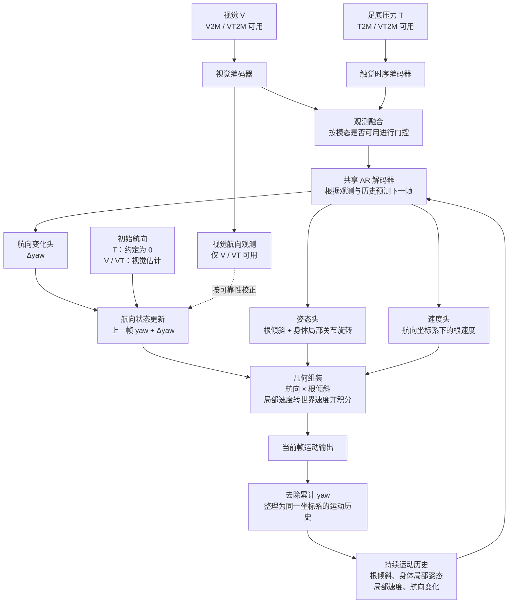

# 分析T的相对量学习能力

> 这是我的模型
>     results_display/ResultTest/R1Test_visualize/V7_Cv5Ctx_f6_soft_time_accel_state_smpl24_v1
>     results_display/ResultTest/R1Test_visualize/V7_Cv5Ctx_f6_soft_time_accel_state_smpl24_v1/tw20_st20_lr0.0001_lp3_lt1_lk1_wu0.05_gc5_ep740_bs256_sd1
>     results_display/ResultTest/R1Test_visualize/V7_Cv5_f6_soft_time_accel_state_smpl24_v1
>     T不能学习绝对量，或者T不具有全局的信息，因此实际上T只能从当前的残差中得到对应的信息量，或者就是只能学到一些相对量，例如说就是滚转角，或者说是偏航角之类的东西
>
>     results_display/ResultTest/R1Test_visualize/Step2Motion就很正常
>     而且我这几个模型的V2M VT2M也是很正常 那么为什么T2M会出现滚转角的乱动呢？
>   他用的是扩散模型，是有一个前后帧的结合，但是我的模型使用的是回归因此就会出现比较大的抖动，之后我按照他的思路依次做了好几个模型，
>   │                │            │ 全注意力训练 =                                         │
>   │ G2（CtxVC）    │ ✅         │ 全注意力评估，两侧一致。它的已知问题（V/VT jitter      │
>   │                │ 不是作弊   │ +37%）是组装口径问题（stride-10                        │
>   │                │            │ 无锚携带），不是信息泄漏——数字对它的协议是有效的       │
>   ├────────────────┼────────────┼────────────────────────────────────────────────────────┤
>   │ v1/v2（Ctx/Ctx │ ✅ 非作弊  │ 同 G2，全注意力两侧一致；只有暴露偏差                  │
>   │ 2）            │            │                                                        │
>   ├────────────────┼────────────┼────────────────────────────────────────────────────────┤
>   │ ctx3 / ctx4 /  │            │ 硬填/残差机制两侧结构一致；暴露偏差是设计内问题（ctx4  │
>   │ ctx5           │ ✅ 非作弊  │ 的 val 是 GT 锚 teacher-forced 口径——val               │
>   │                │            │ 偏乐观是已知的判读口径，非泄漏）                       │
>   ├────────────────┼────────────┼────────────────────────────────────────────────────────┤
>   │ G1（SS）/ ARM  │ ✅ 非作弊  │ SS 用模型自生成反馈替换 GT                             │
>   │ / ARSS         │            │ 反馈——降低训练信息，方向相反                           │
>   ├────────────────┼────────────┼────────────────────────────────────────────────────────┤
>
>   其中G2在指标上好了一些，但是抖动则是加剧了，
>
>   因此我认为回归就是一种错误于是我就用了自回归的方式AR模型，你看看现在的的设计思路以及各个模型的表现（已经跑完的）
>   以及我现在使用AR来减轻对应的抖动，让触觉可以专注预测相对量的设计是否正确

<details><summary>12 previous messages</summary>

> partial：我先核对各版本的实现、训练与评估协议，以及已完成实验的结果，再分析 T2M 的滚转抖动来源和 AR 设计是否支持“触觉预测相对量”。本轮只读取和分析，不修改文件。
>
> <details><summary>Ran a command</summary>
>
> - Ran `pwd; rg --files -g 'AGENTS.md' -g '*AR*' -g '*Ctx*' -g '*ctx*' -g '*V7*' -g '*Step2*' -g '*README*' -g '*summary*' -g '*metric*' -g '*report*' -g '*任务*' -g '*计划*'`
>
> <details><summary>Explored a file</summary>
>
> - Read `/data/fangyuxuan/.codex/skills/karpathy-guidelines/SKILL.md`
>
> </details>
>
> </details>
>
> partial：我会按 karpathy-guidelines 的审查方式，分别核实设计目标、代码行为和实验结果。验收依据是各版本实际输出的指标、续写拼接方式，以及训练和测试时历史姿态的来源。
>
> <details><summary>Explored 4 files, 3 searches, a list, ran 4 commands</summary>
>
> - Ran `rg --files -g AGENTS.md -g '!z_note/HMR2.0/**' -g '!data/**' -g '!datasets/**'; git status --short; rg --files anysole/models; rg --files z_note/multimodal_fusion results_display/ResultTest | rg '(续写|AR|Ctx|ctx|continuity|summary|指标|结论|评估|\.csv$|\.json$)'`
>
> - Ran `cat z_note/multimodal_fusion/V7_方案/V7_续写协议方案.md z_note/multimodal_fusion/V7_方案/V7_续写v4残差分解方案.md; cat configs/running/00245__V7_Cv5AR_s1.conf configs/queue/00248__V7_Cv5ARM_s1.conf configs/queue/00249__V7_Cv5ARSS_s1.conf`
>
> - Ran `rg -n 'ar_fb|v7_ar|ar_ss|ar_noise|ctx_ss|ctx4|compose_rot6d|residual' anysole/models/common/model_v7.py anysole/train.py anysole/utils/eval_protocol.py anysole/data/dataset.py anysole/eval.py anysole/utils/geometry.py; cat anysole/models/v7_c2ar.py anysole/models/v7_c2arm.py anysole/models/v7_c2ctx_vc.py anysole/models/v7_c2ctx5.py`
>
> - Ran `ls -la; ls results_display/ResultTest; ls results_display/ResultTest/R1Test_visualize; rg --files --hidden --no-ignore results results_display/ResultTest logs z_note/评估 2>/dev/null | rg '(Ctx|Cv5AR|ctx_|continuity|Cv5_f6|Step2Motion)' | head -180`
>
> <details><summary>Explored 4 files, 3 searches, a list</summary>
>
> - Listed files in `AnySole`
> - Searched for `(Cv5|Step2Motion)`
> - Searched for `\.(csv|json|log|txt)$`
> - Searched for `(manifest|weights|wandb|predictions)`
> - Read `./anysole/models/common/model_v7.py`
> - Read `./anysole/train.py`
> - Read `./anysole/utils/eval_protocol.py`
> - Read `./anysole/data/dataset.py`
>
> </details>
>
> </details>
>
> partial：当前 AR 确实在各条件下使用因果姿态解码和上一帧反馈，但输出目标仍是绝对姿态，所以它还没有在结构上实现“只预测相对量”。另外，训练时每个窗口首帧反馈都置零，推理时连续窗口却携带上一窗末帧；这个差异可能影响接缝稳定性，我会结合结果继续判断。
>
> <details><summary>Explored 7 files, 5 searches, 5 lists, ran 4 commands, searched the web</summary>
>
> <details><summary>Explored 5 files, 3 searches, 4 lists</summary>
>
> - Read `./anysole/utils/geometry.py`
> - Read `./anysole/data/dataset.py`
> - Searched for `pose_gt.*=|pose_mean|pose_std|normalize|norm_stats` in `dataset.py`
> - Read `./z_note/评估/Step2Motion模型性能.md`
> - Read `./results_display/README_metrics.md`
> - Listed files in `results`
> - Listed files in `AnySole`
> - Listed files in `tw20_st20_lr0.0001_lp3_lt1_lk1_wu0.05_gc5_ep740_bs256_sd1`
> - Listed files in `results`
> - Searched for `(Cv5|Step2Motion)`
> - Searched for `(eval|metrics|history|train|config).*\.(json|jsonl|csv|log|txt|yaml)$`
> - Read `./results_display/script/ctx_continuity.py`
>
> </details>
>
> - Ran `python - <<'PY'
> from pathlib import Path
> import json
> for p in sorted(Path('results/cells').glob('V7_Cv5*/metrics/test_brief.json')):
>  if any(s in p.parts[2] for s in ['Ctx','AR']) or p.parts[2] in ['V7_Cv5_s1','V7_Cv5_s2','V7_Cv5_s3']:
>   print('\n',p)
>   d=json.loads(p.read_text()); print(json.dumps(d,ensure_ascii=False)[:7500])
> for p in sorted(Path('results/cells').glob('V7_Cv5*/run.log')):
>  if any(s in p.parts[2] for s in ['Ctx4','Ctx5','AR']):
>   print('\nSTATUS',p); print('\n'.join(p.read_text(errors='replace').splitlines()[-4:]))
> PY`
>
> - Ran `python - <<'PY'
> from pathlib import Path
> import json
> print('model | T_PA | T_MPJPE | T_drift | T_jitter | V_jitter | VT_jitter | scored_frames')
> for p in sorted(Path('results/cells').glob('V7_Cv5*/metrics/test_brief.json')):
>  name=p.parts[2]
>  if not (any(s in name for s in ['Ctx','AR']) or name in ['V7_Cv5_s1','V7_Cv5_s2','V7_Cv5_s3']): continue
>  d=json.loads(p.read_text()); m=d['metrics']; t=m['T2M']; c=d.get('evaluation_contract',{})
>  vals=[t.get(k) for k in ['PA-MPJPE','MPJPE','RootOrientationDrift','Jitter_pred']]+[m[k].get('Jitter_pred') for k in ['V2M','VT2M']]
>  print(name,'|',' | '.join('NA' if v is None else f'{v:.3f}' for v in vals),'|',c.get('coverage_totals',{}).get('scored_frames'))
> for name in ['V7_Cv5_s1','V7_Cv5Ctx_s1','V7_Cv5CtxVC_s1','V7_Cv5CtxSS_s1','V7_Cv5CtxSS_s2','V7_Cv5Ctx3_s1','V7_Cv5Ctx4_s1','V7_Cv5Ctx5_s1','V7_Cv5AR_s1','V7_Cv5ARM_s1','V7_Cv5ARSS_s1']:
>  p=Path('results/cells')/name
>  conf=p/'effective_config.json'
>  print('CONFIG',name)
>  if conf.exists():
>   d=json.loads(conf.read_text()); print({k:v for k,v in d.items() if any(x in k for x in ['ctx','ar_','v7_ar','causal','epoch','ckpt','checkpoint'])})
>  print('STATUS', 'test='+str((p/'metrics/test_brief.json').exists()),'val='+str((p/'metrics/val_brief.json').exists()))
> PY`
>
> Searched the web for `Step2Motion pressure diffusion motion inpainting pressure only IMU ...`
>
> <details><summary>Explored 4 files, 2 searches, a list</summary>
>
> - Read `./anysole/utils/geometry.py`
> - Searched for `pose_gt|norm|rot6d|smpl_rot` in `workspace_adapter.py`
> - Read `./anysole/train.py`
> - Read `./anysole/models/common/model_v7.py`
> - Read `./anysole/train.py`
> - Listed files in `models`
> - Searched for `synthetic|imu|IMU|build_t_s2m|only_pressure|only_insole` in `Baselines`
>
> </details>
>
> - Ran `python - <<'PY'
> from pathlib import Path
> import json
> for name in ['V7_Cv5_s1','V7_Cv5CtxVC_s1','V7_Cv5CtxVC_s2','V7_Cv5CtxSS_s1','V7_Cv5CtxSS_s2','V7_Cv5AR_s1']:
>  p=Path('results/cells')/name/'effective_config.json'; d=json.loads(p.read_text()); print(name,json.dumps(d,ensure_ascii=False)[:3500])
> for p in Path('results/baselines').glob('**/*brief.json'):
>  if 'step2motion' in str(p).lower():
>   d=json.loads(p.read_text()); print('BASELINE',p); print(json.dumps({k:v for k,v in d.items() if k not in ['evaluation_contract','sessions']},ensure_ascii=False)[:2000])
> PY`
>
> - Ran `sed -n '380,565p' anysole/data/dataset.py; rg -n 'pose_6d|pose_gt|return|normalize' anysole/data/smpl_io.py anysole/data/workspace_adapter.py | tail -65; ls Baselines/Step2Motion; rg -n 'inpainting|mask|prev|overlap|input_dim|imu_available|normalizer' Baselines/Step2Motion/src/test* Baselines/Step2Motion/src/model* Baselines/Step2Motion/src/train* Baselines/Step2Motion/configs/*; rg --files -L --hidden --no-ignore results/baselines results/cells results_display | rg -i 'step2motion' | rg '(brief|manifest|config|S13021.*npz|\.json$)' | head -70; sed -n '660,755p' anysole/utils/eval_protocol.py`
>
> Searched the web for `https://arxiv.org/html/2510.22712v2`
>
> </details>
>
> partial：已完成结果里，G2 的改善并不稳定：seed1 的 T2M PA 从 89.40 降到 85.52，但朝向漂移从 33.44° 升到 63.77°；seed2 的 PA、漂移和 jitter 都比对应基线差。当前文件也显示各版本评分帧数不同，不能直接视作严格同口径对照。我还在核对 Step2Motion 的输入是否包含 IMU，以及现有指标是否测到了滚转。
>
> <details><summary>Explored 4 files, 2 searches, 5 lists, ran 9 commands, searched the web</summary>
>
> - Ran `python - <<'PY'
> from pathlib import Path
> import numpy as np,json
> for base in ['results/AnySole','results/baselines','results_display/ResultTest/R1Test_visualize/Step2Motion']:
>  if base.endswith('AnySole'):
>   ps=[next(Path(base).glob(n+'*/tw*sd1/predictions/eval_motion/S13021_T2M.npz'),None) for n in ['V7_Cv5_f6','V7_Cv5Ctx_f6','V7_Cv5CtxVC_f6','V7_Cv5Ctx3_f6']]
>  else: ps=list(Path(base).glob('**/*S13021*.npz'))[:3]
>  for p in ps:
>   if p is None: print('MISSING export');continue
>   d=np.load(p,allow_pickle=False); print(p)
>   print({k:(d[k].shape,str(d[k].dtype)) for k in d.files})
>   for k in ['sources','meta','metadata','variant','source','model_name']:
>    if k in d.files: print(k,str(d[k])[:2000])
> print('STEPFILES')
> for p in Path('results/cells').glob('*tep*/*'):
>  print(p)
> for p in Path('results/baselines').glob('*'): print(p)
> PY`
>
> - Ran `sed -n '675,720p' anysole/utils/eval_protocol.py; sed -n '1,110p' Baselines/Step2Motion/src/test.py; sed -n '210,265p' anysole/data/smpl_io.py; rg -n 'root_orientation|def temporal_metrics|jitter_pred' anysole/utils/metrics.py; rg -n 'Step2Motion|noimu' results_display/script/utils/registry* Baselines/utils/registry*; ls /data/fangyuxuan/.conda/envs; which python`
>
> <details><summary>Explored 2 files, a search, 2 lists</summary>
>
> - Listed files in `Step2Motion`
> - Read `./anysole/utils/metrics.py`
> - Read `./anysole/utils/metrics.py`
> - Searched for `inpaint|mask|prev|overlap|step|initial_global_rot` in `metrics.py`
> - Listed files in `envs`
>
> </details>
>
> Searched the web for `'autoregressive'`
>
> <details><summary>Explored 3 files, a search, 3 lists</summary>
>
> - Listed files in `ckpt_last.pt`
> - Read `./results/baselines/Step2Motion/checkpoints/gait_model/copy_config.json`
> - Listed files in `Step2Motion`
> - Listed files in `Step2Motion`
> - Searched for `(eval_motion/S13021|S13021_meta|test_comparison.json)$`
> - Read `./Baselines/Step2Motion/src/metrics.py`
> - Read `./tests/test_v7_ctx.py`
>
> </details>
>
> - Ran `python - <<'PY'
> from pathlib import Path
> import json
> for p in [Path('results/baselines/Step2Motion/predictions/gait_model/S13021_meta.json'),Path('results/baselines/Step2Motion/metrics/test_comparison.json')]:
>  print(p)
>  if p.exists():
>   d=json.loads(p.read_text());print(list(d) if isinstance(d,dict) else type(d)); print(json.dumps(d,ensure_ascii=False)[:1300])
> for p in Path('results/baselines/Step2Motion').glob('**/S13021.npz'): print(p)
> for p in Path('results_display').glob('**/*Step2Motion*'):
>  if p.is_file() and p.suffix=='.json': print(p)
> PY`
>
> - Ran `/data/fangyuxuan/miniconda3/envs/touch_gait/bin/python - <<'PY'
> from pathlib import Path
> import torch
> for name,seed in [('V7_Cv5CtxSS',1),('V7_Cv5CtxSS',2),('V7_Cv5CtxFull',1),('V7_Cv5AR',1),('V7_Cv5Ctx4',1),('V7_Cv5Ctx5',1)]:
>  p=next(Path('results/AnySole').glob(f'{name}_f6*/tw*sd{seed}/checkpoints/ckpt_last.pt'),None)
>  if p is None: print(name,seed,'MISSING checkpoint');continue
>  c=torch.load(p,map_location='cpu',weights_only=False,mmap=True)
>  d=c.get('config',{}); print(name,seed,'epoch=',c.get('epoch'),'keys=',{k:d.get(k,'ABSENT') for k in ['ctx_ss','ar_ss','ar_noise','v7_ar','v7_prev_ctx','v7_ctx4','v7_ctx5','tactile_input','no_imu','lambda_pose_vel','lambda_anchor']})
> PY`
>
> - Ran `rg -n 'Step2Motion|gait_model_smpl24|gait_model_bvh24' results_display/script/utils Baselines/utils AnysoleWorkspace/protocol | head -70; sed -n '165,218p' tests/test_v7_ctx.py; rg -n 'pose_vel|pose_mse|L_pose|fk_pose6d' anysole/losses.py anysole/models/common/model_v7.py | head -80; python - <<'PY'
> from pathlib import Path
> import json,numpy as np
> for variant in ['gait_model','gait_model_smpl24','gait_model_bvh24']:
>  p=Path('results/baselines/Step2Motion/predictions')/variant/'eval_motion/S13021.npz'
>  d=np.load(p)
>  print(variant, {k:d[k].shape for k in d.files},'coord=',d['coordinate_system'] if 'coordinate_system' in d else '?')
> for p in Path('results/baselines/Step2Motion/checkpoints').glob('*/copy_config.json'):
>  d=json.loads(p.read_text()); print(p.parent.name,{k:d.get(k) for k in ['input_dim','input_T','output_dim','imu_available','test_data','normalizer']})
> PY`
>
> - Ran `python - <<'PY'
> from pathlib import Path
> import numpy as np
> from scipy.spatial.transform import Rotation
> print('ROOT CHECK S13021 | valid | jumps>30 | seam>30 | inside>30 | max_step_deg | tilt_step_p99_deg')
> for name,stride in [('V7_Cv5',20),('V7_Cv5Ctx',10),('V7_Cv5CtxVC',10)]:
>  p=next(Path('results/AnySole').glob(name+'_f6*/tw*sd1/predictions/eval_motion/S13021_T2M.npz'))
>  d=np.load(p); valid=d['valid_mask']; ids=d['frame_indices']; R=Rotation.from_rotvec(d['poses'][:,:3]).as_matrix()
>  pair=valid[:-1]&valid[1:]&(np.diff(ids)==1)
>  relative=R[1:]@R[:-1].transpose(0,2,1)
>  a=np.degrees(np.arccos(np.clip((np.trace(relative,axis1=1,axis2=2)-1)/2,-1,1)))
>  u=R[:,:,1]; tilt=np.degrees(np.arccos(np.clip((u[1:]*u[:-1]).sum(1),-1,1)))
>  seam=(ids[1:]>=20)&((ids[1:]-20)%stride==0)
>  print(name, int(valid.sum()),int(((a>30)&pair).sum()), int(((a>30)&pair&seam).sum()),int(((a>30)&pair&~seam).sum()),f'{a[pair].max():.3f}',f'{np.percentile(tilt[pair],99):.3f}',sep=' | ')
> for var in ['gait_model','gait_model_smpl24']:
>  p=Path('results/baselines/Step2Motion/predictions')/var/'eval_motion/S13021.npz';d=np.load(p)
>  print('STEP',var,'valid=',d['valid_mask'].sum(),'rotation_coordinates=',d['rotation_coordinate_system'])
>  R=d['joint_rotations'][:,0];ids=d['frame_indices'];v=d['valid_mask'];pair=v[:-1]&v[1:]&(np.diff(ids)==1)
>  a=np.degrees(np.arccos(np.clip((np.trace(R[1:]@R[:-1].transpose(0,2,1),axis1=1,axis2=2)-1)/2,-1,1)))
>  print('root_jumps>30=',int(((a>30)&pair).sum()),'max_step_deg=',a[pair].max())
> PY`
>
> - Ran `rg -n 'Step2Motion|gait_model_smpl24|gait_model/eval_motion' results_display Baselines/utils/model* Baselines/config* --glob '*.py' --glob '*.json' --glob '*.yaml' | head -60; rg --files anysole | rg 'loss'; sed -n '355,380p' anysole/models/common/model_v7.py; sed -n '590,625p' anysole/models/common/model_v7.py; sed -n '340,435p' tests/test_v7_ctx.py`
>
> - Ran `python - <<'PY'
> from pathlib import Path
> import numpy as np
> from scipy.spatial.transform import Rotation
> print('model | sessions | valid_frames | root_jumps>30 | seam_jumps>30 | interior_jumps>30 | mean_root_step_deg')
> for name,mode,stride in [('V7_Cv5','T2M',20),('V7_Cv5Ctx','T2M',10),('V7_Cv5CtxVC','T2M',10),('V7_Cv5','V2M',20),('V7_Cv5CtxVC','V2M',10),('V7_Cv5','VT2M',20),('V7_Cv5CtxVC','VT2M',10),('Step2Motion','T2M',50)]:
>  if name=='Step2Motion': files=sorted(Path('results/baselines/Step2Motion/predictions/gait_model_smpl24/eval_motion').glob('*.npz'))
>  else:
>   root=next(Path('results/AnySole').glob(name+'_f6*/tw*sd1/predictions/eval_motion'))
>   files=sorted(root.glob('*_'+mode+'.npz'))
>  counts=np.zeros(5,dtype=np.int64); angles=[]
>  for p in files:
>   d=np.load(p); ids=d['frame_indices']; v=d['valid_mask']; n=len(v)
>   if d['joint_xyz_world'].shape[0]!=n or len(ids)!=n: raise RuntimeError('LENGTH MISMATCH '+str(p))
>   R=d['joint_rotations'][:,0] if name=='Step2Motion' else Rotation.from_rotvec(d['poses'][:,:3]).as_matrix()
>   if len(R)!=n or not np.isfinite(R[v]).all(): raise RuntimeError('INVALID ROTATION '+str(p))
>   pair=v[:-1]&v[1:]&(np.diff(ids)==1)
>   a=np.degrees(np.arccos(np.clip((np.trace(R[1:]@R[:-1].transpose(0,2,1),axis1=1,axis2=2)-1)/2,-1,1)))
>   # First full window is 20 AnySole frames or 100 Step2Motion frames.
>   first=100 if name=='Step2Motion' else 20
>   start=1 if name=='Step2Motion' else 0
>   seam=(ids[1:]>=start+first)&((ids[1:]-start-first)%stride==0)
>   counts+=np.array([int(v.sum()),int(((a>30)&pair).sum()),int(((a>30)&pair&seam).sum()),int(((a>30)&pair&~seam).sum()),int(pair.sum())])
>   angles.append(a[pair])
>  print(name+' '+mode,len(files),*counts[:4],f'{np.concatenate(angles).mean():.3f}',sep=' | ')
> PY`
>
> - Ran `sed -n '210,245p' results_display/models_modes.yaml; rg -n 'imu|build|synthesize|only_pressure|input_dim' AnysoleWorkspace/tool/adapters/Step2Motion/build_gait_smpl24.py AnysoleWorkspace/tool/adapters/Step2Motion/build_gait.py | head -50; rg -n 'L_pose|lambda_pose_vel|L_pose_vel|pose_hat|x0_hat' anysole/utils/losses.py | head -55; sed -n '260,330p' tests/test_v7_ctx.py; git status --short`
>
> </details>
>
> partial：发现了需要单独处理的数据不一致：G2 seed1 的 V2M、VT2M 导出文件各只有 5,942 个有效帧，而指标 JSON 声明评分 12,710 帧。因此，这批可视化与指标目前不能视为同一份完整结果，我没有补齐或截断它们。T2M 导出中，大于 30° 的根旋转跳变从基线的 199 次降到 87 次，但仍有 60 次落在拼接边界；续写减少了大跳变，尚未解决长期朝向稳定性。
>
> <details><summary>Explored 10 files, 3 searches, ran a command, searched the web</summary>
>
> <details><summary>Explored 4 files, 2 searches</summary>
>
> - Read `./anysole/utils/losses.py`
> - Read `./anysole/eval.py`
> - Read `./anysole/models/common/encoders.py`
> - Searched for `class V7|class Temporal|TransformerEncoder|temporal` in `encoders.py`
> - Read `./anysole/data/smpl_io.py`
> - Searched for `initial_global_rot|initial_global_pos|quat_lIMU|imu_available|no_imu` in `dataset.py`
>
> </details>
>
> - Ran `python - <<'PY'
> from pathlib import Path
> import json
> for name in ['V7_Cv5Ctx3_s1','V7_Cv5Ctx5_s1','V7_Cv5Ctx4B_s1']:
>  root=Path('results/cells')/name
>  p=root/'run.log'
>  print(name)
>  if p.exists():
>   lines=p.read_text(errors='replace').splitlines()
>   print('\n'.join([s for s in lines if 'Traceback' in s or 'Error:' in s or '[exit=' in s][-8:]))
>   print('last:', '\n'.join(lines[-2:])[:650])
>  p=root/'metrics/val_brief.json'
>  if p.exists():
>   d=json.loads(p.read_text()); print('val metrics:', d.get('metrics',{}).get('T2M'))
> PY`
>
> <details><summary>Explored 5 files, a search</summary>
>
> - Read `./anysole/eval.py`
> - Read `./anysole/models/common/model_v7.py`
> - Searched for `crossfade|_pack_motion_export|fade|blend` in `eval.py`
> - Read `./anysole/utils/eval_protocol.py`
> - Read `./tests/test_v7_ctx.py`
> - Read `./Baselines/Step2Motion/src/dataset.py`
>
> </details>
>
> Searched the web for `site.openaccess.thecvf.com Zhou On the Continuity of Rotation Representations in Neural Networks 2019 pdf`
>
> <details><summary>Explored 5 files</summary>
>
> - Read `./anysole/train.py`
> - Read `./anysole/data/dataset.py`
> - Read `./anysole/models/common/model_v7.py`
> - Read `./anysole/utils/eval_protocol.py`
> - Read `./anysole/utils/losses.py`
>
> </details>
>
> </details>
>
> partial：设计审查中还有两点会影响结论。第一，已完成的 CtxSS、CtxFull checkpoint 没有保存 `ctx_ss`，方案记录也确认当时该开关未接入训练配置，所以这些结果不能证明 scheduled sampling 的效果。第二，Ctx4 将同一个全局锚旋转作用于全部 SMPL 局部关节；非根关节原本已相对父关节表达，这样变换会把绝对朝向重新带入目标。我会将它与“使用残差表示是否合理”分开判断。
>
> <details><summary>Ran 6 commands</summary>
>
> - Ran `python - <<'PY'
> from pathlib import Path
> import numpy as np
> from scipy.spatial.transform import Rotation
> p=next(Path('results/AnySole').glob('V7_Cv5_f6*/tw*sd1/predictions/eval_motion/S13021_T2M.npz'))
> d=np.load(p); r=Rotation.from_rotvec(d['poses'][d['valid_mask']].reshape(-1,24,3).reshape(-1,3)).as_matrix().reshape(-1,24,3,3)
> q=Rotation.from_euler('y',90,degrees=True).as_matrix()
> r2=r.copy(); r2[:,0]=q@r[:,0]
> a=r[0,0]; a2=r2[0,0]
> c1=a.T@r; c2=a2.T@r2
> err=Rotation.from_matrix((c2@c1.transpose(0,1,3,2)).reshape(-1,3,3)).magnitude().reshape(-1,24)*180/np.pi
> print('Ctx4 yaw-invariance check on real S13021 pose export:')
> print('Input operation: rotate global root by 90 degrees, keep parent-local body rotations unchanged')
> print('Residual root max change (deg): %.6f'%err[:,0].max())
> print('Residual non-root mean change (deg): %.6f'%err[:,1:].mean())
> print('Expected change for heading-independent non-root targets (deg): 0.000000')
> PY`
> - Ran `python - <<'PY'
> from pathlib import Path
> import json,numpy as np
> print('G2 export coverage: mode | npz_sessions | export_valid | metric_contract_scored')
> p=next(Path('results/AnySole').glob('V7_Cv5CtxVC_f6*/tw*sd1/predictions/eval_motion'))
> m=json.loads(Path('results/cells/V7_Cv5CtxVC_s1/metrics/test_brief.json').read_text())
> for mode in ['T2M','V2M','VT2M']:
>  files=sorted(p.glob('*_'+mode+'.npz'))
>  print(mode,len(files),sum(int(np.load(f)['valid_mask'].sum()) for f in files),m['evaluation_contract']['coverage_totals']['scored_frames'],sep=' | ')
> print('Final test metrics present:')
> for name in ['V7_Cv5Ctx3_s1','V7_Cv5Ctx4_s1','V7_Cv5Ctx4B_s1','V7_Cv5Ctx4R_s1','V7_Cv5Ctx5_s1','V7_Cv5AR_s1','V7_Cv5ARM_s1','V7_Cv5ARSS_s1']:
>  print(name,(Path('results/cells')/name/'metrics/test_brief.json').exists())
> PY`
> - Ran `python - <<'PY'
> from pathlib import Path
> import numpy as np
> from scipy.spatial.transform import Rotation
> print('model | T2M sessions | valid_frames | root_step>30deg | tilt_step>30deg | tilt_step_p99_deg')
> for name in ['V7_Cv5','V7_Cv5Ctx','V7_Cv5CtxVC','Step2Motion']:
>  if name=='Step2Motion': files=sorted(Path('results/baselines/Step2Motion/predictions/gait_model_smpl24/eval_motion').glob('*.npz'))
>  else: files=sorted(next(Path('results/AnySole').glob(name+'_f6*/tw*sd1/predictions/eval_motion')).glob('*_T2M.npz'))
>  total=0;rootj=0;tiltj=0;steps=[]
>  for p in files:
>   d=np.load(p);v=d['valid_mask'];ids=d['frame_indices'];total+=int(v.sum()); pair=v[:-1]&v[1:]&(np.diff(ids)==1)
>   R=d['joint_rotations'][:,0] if name=='Step2Motion' else Rotation.from_rotvec(d['poses'][:,:3]).as_matrix()
>   geo=Rotation.from_matrix(R[1:]@R[:-1].transpose(0,2,1)).magnitude()*180/np.pi
>   gravity_local=R[:,1,:]
>   tilt=np.degrees(np.arccos(np.clip((gravity_local[1:]*gravity_local[:-1]).sum(1),-1,1)))
>   rootj+=int(((geo>30)&pair).sum());tiltj+=int(((tilt>30)&pair).sum());steps.append(tilt[pair])
>  print(name,len(files),total,rootj,tiltj,f'{np.percentile(np.concatenate(steps),99):.3f}',sep=' | ')
> PY`
> - Ran `python - <<'PY'
> from pathlib import Path
> import numpy as np
> from scipy.spatial.transform import Rotation
> print('model | T2M sessions | valid_frames | root_step>30deg | tilt_step>30deg | tilt_step_p99_deg')
> for name in ['V7_Cv5','V7_Cv5Ctx','V7_Cv5CtxVC','Step2Motion']:
>  if name=='Step2Motion': files=sorted(Path('results/baselines/Step2Motion/predictions/gait_model_smpl24/eval_motion').glob('*.npz'))
>  else: files=sorted(next(Path('results/AnySole').glob(name+'_f6*/tw*sd1/predictions/eval_motion')).glob('*_T2M.npz'))
>  total=0;rootj=0;tiltj=0;steps=[]
>  for p in files:
>   d=np.load(p);v=d['valid_mask'];ids=d['frame_indices'];total+=int(v.sum()); pair=v[:-1]&v[1:]&(np.diff(ids)==1)
>   R=d['joint_rotations'][:,0] if name=='Step2Motion' else Rotation.from_rotvec(d['poses'][:,:3]).as_matrix()
>   valid_R=R[v]
>   if not np.isfinite(valid_R).all() or not np.allclose(np.linalg.det(valid_R),1,atol=1e-4) or not np.allclose(valid_R@valid_R.transpose(0,2,1),np.eye(3),atol=1e-4): raise ValueError('Invalid valid-frame rotation: '+str(p))
>   geo=Rotation.from_matrix(R[1:][pair]@R[:-1][pair].transpose(0,2,1)).magnitude()*180/np.pi
>   gravity_local=R[:,1,:]
>   tilt=np.degrees(np.arccos(np.clip((gravity_local[1:][pair]*gravity_local[:-1][pair]).sum(1),-1,1)))
>   rootj+=int((geo>30).sum());tiltj+=int((tilt>30).sum());steps.append(tilt)
>  print(name,len(files),total,rootj,tiltj,f'{np.percentile(np.concatenate(steps),99):.3f}',sep=' | ')
> PY`
> - Ran `stat -c '%y %n' anysole/train.py anysole/models/common/model_v7.py anysole/utils/eval_protocol.py results/cells/V7_Cv5AR_s1/run.log; head -12 results/cells/V7_Cv5AR_s1/run.log; ps -eo pid,lstart,args | rg 'anysole.train.*V7_Cv5AR|anysole.train.*v7_c2ar|model-name V7_Cv5AR' | head -5; git status --short`
> - Ran `python - <<'PY'
> from pathlib import Path
> import json
> print('model | T_PA_mm | T_yaw_drift_deg | T_jitter_m_s3')
> for name in ['V7_Cv5_s1','V7_Cv5Ctx_s1','V7_Cv5Ctx2_s1','V7_Cv5Ctx3_s1','V7_Cv5CtxVC_s1','V7_Cv5CtxVC_s2','V7_Cv5CtxSS_s1','V7_Cv5CtxHP_s1','V7_Cv5CtxFull_s1']:
>  d=json.loads((Path('results/cells')/name/'metrics/test_brief.json').read_text())['metrics']['T2M']
>  print(name,*[f'{d[k]:3.3f}' for k in ['PA-MPJPE','RootOrientationDrift','Jitter_pred']],sep=' | ')
> PY`
>
> </details>
</details>

complete：已核对实现、已完成实验和预测导出。**“让历史状态承载朝向，让触觉预测运动变化”这个方向合理；但当前结果不能证明“回归是错误的”，当前 AR 也尚未在结构上实现“只预测相对量”。**

**T2M 抖动的主要证据指向：触觉歧义、窗口重新估计朝向、历史反馈的训练与推理差异，以及评估和显示的组装差异。**

**先看已经跑完的结果。** 以下取正式 `test_brief.json`；PA 单位 mm，漂移单位 °，jitter 单位 m/s³，均越低越好。

| 模型 | T2M PA | 朝向漂移 | Jitter |
|---|---:|---:|---:|
| Cv5 s1 | 89.40 | 33.44 | 1784.27 |
| Ctx v1 | 105.05 | 61.36 | 1846.47 |
| Ctx2 | 101.05 | 44.26 | 1998.55 |
| Ctx3 | 102.11 | 40.88 | 1679.55 |
| G2／CtxVC s1 | **85.52** | 63.77 | 1724.60 |
| G2／CtxVC s2 | 96.91 | 91.43 | 2153.50 |
| CtxSS s1 | 97.26 | 59.11 | 1788.28 |
| CtxHP s1 | 103.10 | 55.53 | 1800.36 |
| CtxFull s1 | 91.36 | 65.86 | 1827.95 |

这说明：

- **G2 seed1 改善了对齐后的姿态精度，却恶化了长期航向稳定性。** PA 会消除逐帧整体旋转误差，所以 PA 变好与人物持续转向可以同时发生。
- G2 seed2 相对 Cv5 seed2 的 PA 89.34、漂移 38.31、jitter 2041.00，三项都更差，改善尚不稳定。
- Ctx3 降低了 jitter，但 PA 和漂移仍差于基线。增加历史约束确实有作用，现有注入方式还没有把准确性与稳定性同时做好。

还有三个影响实验解释的事实：

1. **已完成的 CtxSS、CtxFull 不能作为有效 SS 消融。** checkpoint 的配置没有 `ctx_ss`，方案记录也确认当时存在“参数未映射、开关未生效”的问题。
2. Ctx5 已训练到 740 epoch，但测试流程以 `IndexError` 退出；Ctx4B 在统计拟合阶段报维度错误。当前 Ctx4、Ctx4R、AR、ARM、ARSS 均没有完整 test 结果，不能把中途 val 当最终表现。
3. Cv5 与续写模型的评分覆盖分别为 **12,500 与 12,710 帧**，上述表格有参考价值，尚非严格同帧比较。

**为什么 T2M 容易乱转，V2M、VT2M 相对正常？**

视觉提供了身体朝向和姿态证据；仅靠足底压力，相同或相近的压力分布可能对应不同身体姿态、朝向和动作。独立窗口每次重新估计绝对朝向，就可能选择不同解。

我直接检查了导出预测的根旋转：Cv5 T2M 的 **199 次单帧大于 30° 跳变中，183 次发生在窗口边界**。这支持“窗口间朝向重新估计”是主要来源之一。

不过，你对触觉能力的判断需要稍作修正：

- 世界系绝对 **yaw** 缺少参照，无法仅凭压力普遍唯一恢复。
- **roll/pitch** 受到重力、地面接触及负载分布的约束，不能与 yaw 一概视为完全不可观测。
- 相对 yaw、roll 也未必能由压力唯一决定；历史与运动先验可以减少歧义，但不会凭空增加观测信息。

所以合理目标是：**减少没有证据支持的朝向跳变，同时保留真实转弯和倾斜。**

当前正式 `RootOrientationDrift` **只计算 yaw，不计算 roll**，因此它无法直接验收你关心的滚转问题。[指标实现](./anysole/utils/metrics.py:192)

**Step2Motion 的平稳表现，不能单独归因于扩散。**

你当前显示注册的 Step2Motion 使用 **50 维输入，包含合成 IMU**；Cv5 使用 raw108 压力输入，两者的信息条件不同。Step2Motion 还使用 100 帧窗口，而 Cv5 是 20 帧；其推理在每个去噪阶段携带上一窗口的重叠状态。[本地注册](./results_display/models_modes.yaml:216)、[续写实现](./Baselines/Step2Motion/src/metrics.py:173)

原论文也明确区分了姿态扩散、IMU 位移回归和自回归续写。因此，这个比较同时混入了输入信息、时间长度、运动表示及续写机制的差异。[Step2Motion 论文](https://arxiv.org/html/2510.22712v2)

此外，当前 V7 姿态损失主要是逐元素 6D MSE，**没有直接约束姿态的帧间速度、加速度或接缝连续性**。时间注意力提供了利用上下文的能力，并不保证模型一定输出平稳序列。[损失实现](./anysole/utils/losses.py:848)

**你当前的 AR 是一个有价值的实验，但还存在四个关键问题。**

1. **它仍然是确定性回归。**
   当前流程是“上一帧姿态＋速度 → query 反馈 → 回归当前绝对姿态”。AR 改变的是时间依赖方式，没有改变绝对姿态监督目标，也没有强制输出旋转增量。[模型反馈](./anysole/models/common/model_v7.py:262)

2. **窗口首帧的训练与推理不一致。**
   训练时每个窗口首帧反馈都是零；推理时连续窗口首帧携带上一窗末帧。这意味着最需要消除接缝的位置，恰好使用了训练中未覆盖的反馈情形。[训练数据](./anysole/data/dataset.py:659)、[推理](./anysole/utils/eval_protocol.py:1039)

3. **teacher forcing 仍可能导致自由生成失稳。**
   训练依赖准确 GT 历史，推理依赖自身预测，误差可能逐步放大。残差化也不会自动消除这个问题。[Scheduled Sampling 原论文](https://arxiv.org/abs/1506.03099)

4. **当前 ARSS 缓存不是始终与当前序列对齐。**
   缓存在不同条件、不同 minibatch 间复用，没有按会话和帧位置匹配；其中可能出现“另一段动作的历史，预测当前动作目标”。这可以充当扰动，但不能直接等同于当前序列上的 scheduled sampling。[缓存实现](./anysole/train.py:284)

目前因果掩码限制的是**姿态反馈依赖**，观测编码仍可读取整窗压力。这适用于离线重建；不能据此声称整个系统已经实时因果。

**Ctx4 的残差表示，还需要先纠正一个实质问题。**

SMPL 的非根关节旋转已经相对父关节表达。当前实现却对全部 24 个关节统一左乘根锚的逆旋转：

\[
R^{res}_{j,t}=R_a^\top R_{j,t}
\]

对根朝向，这可以消除锚；对非根局部关节，反而把绝对根朝向引入目标。

我用真实 S13021 导出姿态做了坐标变换检查：仅将全局根朝向旋转 90°，保持身体局部动作不变，当前 Ctx4 的非根残差目标平均改变了 **90°**。所以“整个目标空间已经去掉绝对航向”并不成立。[目标变换](./anysole/train.py:219)

另外，统计拟合使用 `R_a`，训练目标使用 `R_aᵀ`，两者也不一致。[统计拟合](./anysole/train.py:365)

**更符合你原始意图的设计是：**

- 历史状态携带累计 yaw，触觉与历史共同预测 `Δyaw`；
- 根倾斜单独建模，结合接触与运动先验，避免把 roll/pitch 全部交给无约束积分；
- 非根关节保持父关节局部表示；
- 训练覆盖连续窗口首帧反馈，并在同一序列上验证自由生成；
- 同时检查姿态误差、倾斜变化、接缝跳变和长期漂移，防止靠“动作变小”换取低 jitter。

其中，**AR 和相对表示是两项独立选择，可以组合使用。** 当前 AR 可能减轻每窗重新猜朝向的问题，但其最终效果还需要完整自由生成结果来证明。

还有一个必须保留的验收限制：G2 的 V2M、VT2M 导出各只有 **5,942 个有效帧**，指标文件声明评分 **12,710 帧**；评分使用后半窗发射，显示导出还经过重叠覆盖与淡化。因此，目前 GIF 和指标不能直接视作同一条输出序列。我没有补齐、截断或修改这些文件。

验收采用只读 Python 命令读取 JSON、NPZ 和 checkpoint。相邻旋转诊断只统计 `valid_mask=True` 且帧号连续的帧对，原始输出如下；`tilt` 表示排除纯世界系 yaw 变化后的倾斜变化，包含 roll/pitch：

```text
model | T2M sessions | valid_frames | root_step>30deg | tilt_step>30deg | tilt_step_p99_deg
V7_Cv5 | 36 | 12500 | 199 | 19 | 13.116
V7_Cv5Ctx | 36 | 12710 | 87 | 10 | 11.128
V7_Cv5CtxVC | 36 | 12710 | 87 | 4 | 10.430
Step2Motion | 36 | 12879 | 18 | 0 | 4.264
```

```text
G2 export coverage: mode | npz_sessions | export_valid | metric_contract_scored
T2M | 36 | 12710 | 12710
V2M | 36 | 5942 | 12710
VT2M | 36 | 5942 | 12710
```

```text
Ctx4 yaw-invariance check on real S13021 pose export:
Input operation: rotate global root by 90 degrees, keep parent-local body rotations unchanged
Residual root max change (deg): 0.000000
Residual non-root mean change (deg): 90.000000
Expected change for heading-independent non-root targets (deg): 0.000000
```

> 所以说你认为模型应该怎么进行设计呢？你可以给我一个模型结构图，我先来看看

<details><summary>1 previous message</summary>

> complete：我建议先看“历史状态＋相对运动预测”的结构：累计航向沿历史携带，模型预测航向变化，根倾斜和身体局部姿态分别输出。我会用 visualize 技能画出结构图，标明训练与推理时历史状态的来源。
</details>

complete：我建议保留你现在**三条件共用 AR 网络**的方向，但把两件事真正分开：**网络预测当前运动，网络外部保存累计航向。** 下面是建议结构，尚未经过实验验证。



**这里最关键的变化，是触觉分支不再负责重新猜绝对航向。**

共享生成器预测：

\[
\Delta\psi_t,\quad R^{tilt}_t,\quad
\{R^{local}_{j,t}\}_{j>0},\quad v^{heading}_t
\]

外部状态更新与组装：

\[
\psi_t=\psi_{t-1}+\Delta\psi_t,\qquad
R^{root}_t=R_y(\psi_t)R^{tilt}_t
\]

这几个量的职责不同：

| 部分 | 如何预测 | 原因 |
|---|---|---|
| 航向 yaw | 预测增量，沿历史累计 | 避免每个窗口重新选择朝向 |
| 根倾斜 roll/pitch | 根据观测和历史预测当前倾斜 | 避免倾斜误差无约束积分 |
| 非根关节 | 预测父关节坐标系下的局部旋转 | 保留 SMPL 原有局部表达 |
| 根速度 | 在航向坐标系下预测 | 避免触觉学习世界系运动方向 |

根倾斜需要**显式去除 yaw 分量**，否则姿态头仍可能偷偷承担航向预测。

**历史反馈也必须去除累计 yaw。**
T2M 的生成器读取“上一帧是什么姿态、怎样运动、正在怎样转向”，累计的绝对朝向只保存在外部。V/VT 则可以利用视觉航向观测校正漂移；视觉缺失时，沿历史继续生成。

**训练时，我会坚持三条：**

- 每个窗口首帧也使用真实的前序状态；只有会话开始或确实断链时才初始化。
- 模型反馈必须来自**同一序列、对应时间位置**，并训练连续多帧的自由续写。
- 监督真实的运动变化和累计变化误差，避免仅靠减小动作幅度降低 jitter。T2M 的航向监督使用相对初始帧的变化，不要求恢复无法观测的初始绝对 yaw。

这版结构的核心假设是：**历史负责维持运动状态，触觉负责提供更新状态的证据，视觉负责在可用时提供朝向参照。** 它有望减少无依据的跳转，但压力无法唯一确定的转弯和姿态，仍需要运动先验来补充。

> 在这里写下对应的设计方案文档
> z_note/multimodal_fusion/V7_方案

<details><summary>4 previous messages</summary>

> partial：我会将刚才的结构写成该目录下的设计方案，明确网络分工、坐标表示、训练与推理流程及验收标准，并标注为待实验验证的方案。
>
> <details><summary>Explored 2 files, 3 searches, a list, ran a command</summary>
>
> <details><summary>Explored a search, a list</summary>
>
> - Listed files
> - Searched for `V7_方案|V7_续写v4残差分解方案|V7_续写协议方案|相对运动|航向状态` in `.`
>
> </details>
>
> - Ran `ls -la z_note/multimodal_fusion/V7_方案; sed -n '1,120p' z_note/multimodal_fusion/V7_方案/V7_续写v4残差分解方案.md; sed -n '1,110p' z_note/multimodal_fusion/V7_方案/V7_C方案.md; git status --short`
>
> <details><summary>Explored 2 files, 2 searches</summary>
>
> - Searched for `V7_AR相对运动与航向状态方案.md` in `.`
> - Searched for `FPS =|CONFIG_VT|CONFIG_V =|CONFIG_T =|heading_from_root|yaw_rotmat|def f2_to_world` in `types.py`
> - Read `./anysole/models/v7_c2ar.py`
> - Read `./anysole/data/dataset.py`
>
> </details>
>
> </details>
>
> partial：引用扫描未发现新文档名的读写方，我会新增独立文档。方案会保留三条件共享 AR 的设计，明确只有 yaw 增量需要累计，非根关节保持 SMPL 局部表达；损失权重和 rollout 长度会标为待实验确定。
>
> <details><summary>Created a file, edited a file, ran 4 commands</summary>
>
> - Wrote `./z_note/multimodal_fusion/V7_方案/V7_AR相对运动与航向状态方案.md` (+194 -0)
> - Ran `sed -n '1,260p' z_note/multimodal_fusion/V7_方案/V7_AR相对运动与航向状态方案.md; git diff --no-index --check /dev/null z_note/multimodal_fusion/V7_方案/V7_AR相对运动与航向状态方案.md; git status --short`
> - Wrote `./z_note/multimodal_fusion/V7_方案/V7_AR相对运动与航向状态方案.md` (+9 -0)
> - Ran `git diff --no-index --check /dev/null z_note/multimodal_fusion/V7_方案/V7_AR相对运动与航向状态方案.md`
> - Ran `wc -l z_note/multimodal_fusion/V7_方案/V7_AR相对运动与航向状态方案.md`
> - Ran ````python - <<'PY'
> from pathlib import Path
> p = Path('z_note/multimodal_fusion/V7_方案/V7_AR相对运动与航向状态方案.md')
> s = p.read_bytes().decode('utf-8')
> lines = s.splitlines()
> trailing = [i for i, line in enumerate(lines, 1) if line != line.rstrip()]
> if trailing:
>     raise ValueError(f'Trailing whitespace at lines {trailing}')
> if not s.endswith('\n'):
>     raise ValueError('Missing final newline')
> fence_open = False
> for line in lines:
>     if line.startswith('```'):
>         fence_open = not fence_open
> if fence_open:
>     raise ValueError('Unclosed code fence')
> print('UTF-8: valid')
> print('Trailing whitespace: 0')
> print('Code fences: balanced')
> print(f'Lines: {len(lines)}')
> PY````
>
> </details>
</details>

complete：已写入 [V7_AR相对运动与航向状态方案.md](./z_note/multimodal_fusion/V7_方案/V7_AR相对运动与航向状态方案.md)。

包含结构图、坐标定义、三条件处理、训练与推理流程、验收标准，标注为待实验验证的设计草案。

文档检查命令原始输出：

```text
UTF-8: valid
Trailing whitespace: 0
Code fences: balanced
Lines: 203
```

> 当前你上述说的这些执行上的错位已经进行修复，你来检查一下，同时：
>
> 我认为：但转向（Δyaw）T 不是不可观测，是弱可观测
> 实验完成。报告落盘 z_note/probes/probe_dyaw_observability_20261101.md，
> 实际上主要是因人而异的，这种情况应该怎么办呢？同时触觉相关的门控失效也是因为这个原因：
> {
> ▎ 师兄，E6 门控这边结果收口了，同步一下：
> ▎
> ▎ 1. 门控结论：三条路线都没跑赢 B 基线。
> ▎ - 颗粒度（T/LR/TLR/Q）：TLR 最好，但对 B（V7_Cv5）只是打平；补了 s2/s3 种子后确认，TLR−B 的差距（±2mm）远小于 B 自己的种子方差（±3.7mm），在噪声内。
> ▎ - 显式收益监督（S，λ_s 1.0/0.1）：系统性有害，E/H 都变差 4~9mm，还连带把 V-only 基线也拖垮了。
> ▎ - 所以门控最终方案就是 B（V7_Cv5，双门+枚举），门控改不动它。颗粒度和 S 作为负结果进消融。
> ▎
> ▎ 2. 根因定位：触觉退化是受试者泛化问题，不是门控。
> ▎ 用你跑完的 4 折 leave-subjects-out（V7_Cv7_f*）做了分析：4 折里 3 折在"没见过的受试者"上 VT 比 V 差 +2.3~+5.0mm。说明触觉特征过拟合了训练受试者、对未见受试者不迁移。清晰画面下 VT 差 3.4mm 就是这个原因。要再提 E6，杠杆在触觉表征/跨受试者泛化（触觉侧归一化、数据增强），不在门控。
> ▎
> ▎ 3. 两个要提醒你的点：
> ▎ - train.py 里 ctx_ss_cache 只初始化在 cluster_mode 分支、却在 enum_mode 引用，导致所有非 cluster 的 enum 训练首 step 崩 UnboundLocalError。我已经修了（初始化上提到分支外），你主线里如果还没改，需要同步一下。
> ▎ - Ctx v1（00210）的 VT 比 V 差 28mm，基本是坏结果（疑似实现问题），你核对一下；Ctx v2 已经跑完了。
> ▎
> ▎ 4. 管线已解耦： 我按你的建议 fork 了一份到 Hyx-serein/AnySole（分支 huyuxuan-gate），数据软链共享、独立 queue/results，之后我的实验都在那边跑，不再撞你的管线。GPU 我固定用 0/1/2/3。我的改动你 git fetch + merge 就能看到。
> ▎
> ▎ 完整数据都在 results_display/Etest/E6_ContactPhaseAnalysis/E6_工作汇报.md。
> }

<details><summary>7 previous messages</summary>

> Stream error
>
> Reconnecting 4/5
> request timed out
>
> partial：我会先核对之前指出的错位是否在当前代码和结果中修复，再读取 Δyaw 可观测性探针与 E6 汇报，区分受试者差异的证据、尚未排除的解释，以及对模型设计的影响。
>
> <details><summary>Explored 9 files, a search, ran 4 commands, searched the web</summary>
>
> <details><summary>Explored 5 files, a search</summary>
>
> - Read `./anysole/train.py`
> - Read `./anysole/data/dataset.py`
> - Read `./anysole/utils/eval_protocol.py`
> - Read `./anysole/utils/geometry.py`
> - Read `./anysole/eval.py`
> - Searched for `ctx_ss_cache|ar_ss_cache|causal=|ctx_ss.*=|ar_ss.*=` in `train.py`
>
> </details>
>
> - Ran `git status --short; rg --files --hidden -g AGENTS.md -g '!**/.git/**'; cat z_note/probes/probe_dyaw_observability_20261101.md; cat results_display/Etest/E6_ContactPhaseAnalysis/E6_工作汇报.md`
>
> <details><summary>Explored 4 files</summary>
>
> - Read `./z_note/probes/probe_dyaw_observability.py`
> - Read `./z_note/probes/probe_dyaw_baserate.py`
> - Read `./anysole/data/pressure.py`
> - Read `./anysole/models/common/foot_encoder.py`
>
> </details>
>
> - Ran `git diff --stat; git diff -- anysole/train.py anysole/data/dataset.py anysole/models/v7_c2ctx4.py anysole/models/v7_c2ctx5.py anysole/utils/geometry.py tests/test_v7_ctx.py; rg -n 'block|mean|sum|corr|sign|lag|split|subject' z_note/probes/probe_dyaw*; ls -lh /tmp/probe_dyaw_arrays.npz; rg --files z_note/probes results_display/Etest/E6_ContactPhaseAnalysis | rg '(dyaw|headroom|泛化|受试|归一|E6_配对)'`
>
> Searched the web for `site.arxiv.org group distributionally robust optimization requires strong regularization generalization spurious correlations 2019 ...`
>
> - Ran `sed -n '269,341p' anysole/train.py; sed -n '350,406p' anysole/train.py; cat anysole/models/v7_c2arss.py anysole/models/v7_c2ctx4.py anysole/models/v7_c2ctx5.py; sed -n '1,180p' anysole/models/common/foot_encoder.py; sed -n '40,115p' anysole/data/pressure.py; sed -n '63,145p' anysole/eval.py; rg -n 'ctx4b|anchor_rot|_v7_ctx_session_seq|v7_ctx_vcond' anysole/utils/eval_protocol.py anysole/eval.py anysole/utils/losses.py | head -65`
>
> - Ran `PYTHONDONTWRITEBYTECODE=1 OMP_NUM_THREADS=1 MKL_NUM_THREADS=1 /data/fangyuxuan/miniconda3/envs/touch_gait/bin/python -m pytest -q -p no:cacheprovider tests/test_v7_ctx.py`
>
> </details>
>
> partial：根关节变换、统计拟合方向、AR 普通窗口首帧反馈和缓存初始化已看到对应修复。不过，Δyaw 补充探针有一个关键错误：所谓“10 帧净转向”实际算成了“单帧 Δyaw ÷ 10”。这部分结果暂不能支持移除 T2M 累计航向监督；我会继续核对帧级结果和受试者差异的证据。
>
> <details><summary>Explored 4 files, 2 searches, ran 6 commands, searched the web</summary>
>
> <details><summary>Explored 5 files, 2 searches</summary>
>
> - Searched for `def test|class .*Tests` in `test_v7_ctx.py`
> - Read `./anysole/eval.py`
> - Read `./anysole/eval.py`
> - Searched for `ctx_cache|ar_cache|session_id|batch|prev_state|scheduled` in `test_v7_ctx.py`
> - Read `./anysole/data/pressure.py`
> - Read `./anysole/utils/geometry.py`
> - Read `./anysole/train.py`
>
> </details>
>
> - Ran `python - <<'PY'
> from pathlib import Path
> import numpy as np,json
> z=np.load('/tmp/probe_dyaw_arrays.npz')
> print('probe cache keys:',z.files)
> print('split | windows | frame_dyaw>0.01 | reported_block>0.01 | actual_10frame_net>0.01 | actual_10frame_net>0.05 | max_formula_error')
> for split in ['tr','va','te']:
>  y=z['Y_'+split][:,1:]; b=10
>  cum=np.cumsum(y,axis=1)
>  pad=np.concatenate([np.zeros((len(y),1)),cum[:,:-1]],axis=1)
>  wrong=(cum-pad)/b
>  correct=np.lib.stride_tricks.sliding_window_view(y,b,axis=1).sum(axis=-1)
>  used_wrong=wrong[:,:correct.shape[1]]
>  print(split,len(y),int((np.abs(y)>0.01).sum()),int((np.abs(used_wrong)>0.01).sum()),int((np.abs(correct)>0.01).sum()),int((np.abs(correct)>0.05).sum()),f'{np.max(np.abs(wrong-y/b)):.3g}',sep=' | ')
> print('G2 export coverage: mode | files | valid | JSON scored')
> p=next(Path('results/AnySole').glob('V7_Cv5CtxVC_f6*/tw*sd1/predictions/eval_motion'))
> m=json.loads(Path('results/cells/V7_Cv5CtxVC_s1/metrics/test_brief.json').read_text())
> for mode in ['T2M','V2M','VT2M']:
>  fs=sorted(p.glob('*_'+mode+'.npz'))
>  print(mode,len(fs),sum(int(np.load(f)['valid_mask'].sum()) for f in fs),m['evaluation_contract']['coverage_totals']['scored_frames'],sep=' | ')
> PY`
>
> - Ran `PYTHONDONTWRITEBYTECODE=1 OMP_NUM_THREADS=1 MKL_NUM_THREADS=1 /data/fangyuxuan/miniconda3/envs/touch_gait/bin/python -m unittest discover -s tests -p test_v7_ctx.py -q`
>
> - Ran `rg -n 'seed|manual_seed|save|load|np.save|log|epoch' z_note/probes/probe_dyaw_observability.py z_note/probes/probe_dyaw_baserate.py; sed -n '755,825p' anysole/utils/eval_protocol.py; sed -n '1030,1054p' anysole/utils/eval_protocol.py; sed -n '870,896p' anysole/utils/losses.py; ls /tmp/probe_dyaw*; git diff -- anysole/utils/eval_protocol.py anysole/eval.py`
>
> - Ran `python - <<'PY'
> import numpy as np
> z=np.load('/tmp/probe_dyaw_arrays.npz')
> print('Physical feature ranges (cached train arrays): channel | median | p95 | min | max')
> x=z['Xp_tr'].reshape(-1,12)
> for k in [0,1,2,3,4,5]:
>  a=x[:,k]
>  print(k,*[f'{v:.5g}' for v in [np.median(a),np.percentile(a,95),a.min(),a.max()]],sep=' | ')
> print('raw range:',float(z['Xr_tr'].min()),float(z['Xr_tr'].max()))
> print('shape and finite:')
> for k in z.files: print(k,z[k].shape,bool(np.isfinite(z[k]).all()))
> PY`
>
> - Ran `cat /tmp/probe_dyaw_session_hetero.py; tail -35 /tmp/probe_dyaw_300ep.log; tail -35 /tmp/probe_dyaw_base.log; sed -n '88,118p' anysole/data/pressure.py; sed -n '65,110p' anysole/data/workspace_adapter.py; rg -n 'physical_tokens\(|T_phys|PRESSURE_CLIP' anysole/data/dataset.py anysole/types.py AnysoleWorkspace/tool/adapters/AnySole -g '*.py'; sed -n '70,140p' anysole/data/dataset.py`
>
> - Ran `sed -n '330,365p' anysole/data/dataset.py; sed -n '1,120p' z_note/probes/probe_dyaw_observability_20261101.md; nl -ba z_note/probes/probe_dyaw_baserate.py | sed -n '41,67p;113,129p'; nl -ba anysole/train.py | sed -n '267,318p'; rg -n '受试者|可能|缺已见|模型不同|数万|没有缩放' results_display/Etest/E6_ContactPhaseAnalysis/E6_工作汇报.md; rg -n 'rot_root6d|compose_rot6d' anysole/infer.py; git status --short`
>
> Searched the web for `https://pmc.ncbi.nlm.nih.gov/articles/PMC12350911/`
>
> </details>
>
> partial：32 项现有回归测试已通过，但磁盘上的 G2 V2M、VT2M 导出仍各只有 5,942 个有效帧，尚未与指标文件的覆盖声明对齐。另外，“T_phys 未缩放、量级数万”的汇报与当前数据链不符：它由归一化压力计算，探针训练数据中的左足总力 P95 约为 12.46。受试者差异仍值得优先研究，但这些证据还不足以把它确定为唯一根因。
>
> <details><summary>Ran 2 commands</summary>
>
> - Ran `sed -n '68,127p' anysole/models/common/model_v7.py; sed -n '147,210p' anysole/models/common/encoders.py; sed -n '1,90p' anysole/models/common/embeddings.py; nl -ba anysole/data/dataset.py | sed -n '350,361p'; nl -ba results_display/Etest/E6_ContactPhaseAnalysis/E6_工作汇报.md | sed -n '117,134p'; rg -n 'def _augment_tactile|aug_t_gain|t_gain|gb|gain' anysole/data/dataset.py | head -25; tail -5 /tmp/probe_dyaw.log`
> - Ran `rg -n 'prev_ctx|prev_state|causal|v7_ar|v7_ctx|MODEL_ANYSOLEV2|model\(' anysole/infer.py | head -45; sed -n '420,495p' anysole/infer.py; sed -n '565,602p' anysole/data/dataset.py; sed -n '68,92p' anysole/models/v7_c2ctx.py; sed -n '1420,1540p' configs/z_gen/model_registry.py | tail -25; git diff --check`
>
> </details>
</details>

partial：**主要代码修复已经生效，但还不能认定全部修复闭环。受试者差异值得优先研究；目前证据还不能证明它是门控退化的唯一原因，也不能据此取消 T2M 的转向监督。**

**执行错位的复查结果如下。**

| 检查项 | 当前结果 |
|---|---|
| Ctx4 只变换根旋转，保留非根局部旋转 | 已修复，相关不变性测试通过 |
| 姿态统计使用逆锚旋转、修复权重维度 | 已修复 |
| `ctx_ss` 参数映射、缓存初始化位置 | 已修复 |
| AR 普通窗口首帧携带前一帧 GT | 已修复 |
| SS 跨 minibatch 混入其他动作 | 已清除，但反馈仍来自同窗口的其他模态条件，尚非同条件自由 rollout |
| ARSS 首帧反馈 | 缓存首帧仍置零，会覆盖刚修好的连续首帧反馈 |
| G2 导出覆盖 | 磁盘上的 V2M、VT2M 仍各只有 5,942 个有效帧 |
| 评分与显示组装 | 评分仍采用后半窗发射，显示仍走重叠覆盖与淡化 |
| 独立 `infer.py` | 回归分支仍未传入 AR 反馈和因果开关 |

后几项分别见 [SS 缓存](./anysole/train.py:291)、[显示组装](./anysole/eval.py:62)、[独立推理](./anysole/infer.py:421)。

此外，**源码修复不会追溯修复旧实验**。尤其 Ctx4 已改变监督目标的语义，旧权重不能仅靠换用新出口组合就视为修复后的结果，需要确认重训来源。

**Δyaw 探针里有一个必须先处理的计算错误。**

[补充探针](./z_note/probes/probe_dyaw_baserate.py:49) 当前计算：

```python
cum = cumsum(dyaw)
pad = [0, cum[:-1]]
yb = (cum - pad) / 10
```

这里 `cum - pad` 恰好恢复单帧 `dyaw`，所以目标实际是 **单帧 Δyaw ÷ 10**，没有累计十帧。训练和报告都使用了这个错误目标。

用现有缓存重新核算目标，val/test 真正的十帧净转向超过 0.01 rad 的窗口位置分别有 **928、4018 个**，并非报告里的 0、5 个。这些是同一窗口内的重叠块位置，不是独立样本。

因此，报告中以下推论暂不成立：

- “块累计转向几乎没有信号”；
- “T2M 累计 yaw 监督应移除”；
- “输出零转向就是正确结果”。

这次只重算了目标，没有重训探针，**也不能反过来证明修正后的探针一定能预测转向**。

帧级结果仍然支持一个较窄的结论：**当前压力表示和探针，在当前划分上没有展示稳定的跨受试者转向预测能力。** 它不等于证明 Δyaw 物理上不可观测。“弱可观测、但条件依赖明显”可以作为后续研究假设保留。

**“主要因人而异”目前也是假设，不是已经完成的根因定位。**

你贴出的消息，比[落盘 E6 汇报](./results_display/Etest/E6_ContactPhaseAnalysis/E6_工作汇报.md:119)说得更确定。后者明确承认：

- 缺少已见受试者的对照；
- 四折使用 Cv7，而门控主模型是 Cv5；
- 不同折还混有动作构成和受试者组合差异。

逐 session 的相关性不同，也可能来自转弯数量、动作类型、步速、鞋垫标定或噪声。需要判断：**同一个人在不同会话中是否稳定相似，同一种动作在不同人之间是否稳定不同。**

另外，E6 汇报中“T_phys 未缩放、量级数万”的判断与当前数据链不符。[实际调用](./anysole/data/dataset.py:356)先归一化压力，再计算物理特征；缓存中左足总力 P95 约为 **12.46**。它仍可能携带个体尺度信息，但不能用“数万量级压倒其他通道”解释当前结果。

**我建议把后续工作分成“去除标定差异”和“适应真实步态差异”两步。**

| 差异来源 | 优先处理方式 |
|---|---|
| 体重代理、鞋垫增益、接触面积 | 有物理意义的尺度归一化 |
| 标定增益、传感器偏置等变化 | 压力增强后同步重算 T_phys |
| 步态习惯、转弯策略等真实差异 | 历史上下文；有条件时做个体标定 |
| 训练中少数受试者主导优化 | 按受试者平衡采样与验证 |

第一步，我更倾向于**保留压力分布和动态负载两类信息**：

- 压力分布描述哪里受力；
- 双足负载使用同一个稳定尺度归一化，保留左右负载比例、冲击和卸载变化。

不建议一开始就对每帧、每只脚分别归一化后丢掉总负载，也不建议直接把整个会话 z-score 当唯一输入；那可能同时消除你希望利用的运动线索。足底压力研究也区分体重、平均压力等不同归一化方式，它们保留的信息并不相同。[原始研究](https://pmc.ncbi.nlm.nih.gov/articles/PMC12350911/)

第二步，如果消除标定差异后，映射仍明显因人而变，再考虑**低维个体上下文**，从连续历史或独立标定片段估计，而不是直接查受试者 ID。若需要学习个人转弯映射，可以使用标定阶段的视觉或 IMU 参考；单靠未标注压力，不能保证辨认出一个缺少明确证据的映射。

**模型主线暂时可以保持：B 的双门＋共享 AR＋航向状态分离。** 将改进重点放在触觉编码和反馈训练上，保留 Δyaw 头及累计误差诊断。对证据不足的输入，可以让预测向稳定历史先验收缩，但不能把“始终走直”当成转向重建成功。

最有判别力的下一组对照是：

1. 修正块目标及其观测时间对齐，重新跑探针。
2. 用同一个 Cv5 比较“已见受试者的未训练会话”和“未见受试者”，匹配动作与转向分布。
3. 固定门控，只比较原输入、尺度归一化、同步物理特征增强，至少使用配对种子。
4. 同时报平均表现和逐受试者表现；若平均收益掩盖部分受试者持续恶化，再考虑组均衡训练或组鲁棒优化。[组鲁棒优化原论文](https://arxiv.org/abs/1911.08731)

本轮未修改代码或方案。验收命令：

```bash
PYTHONDONTWRITEBYTECODE=1 OMP_NUM_THREADS=1 MKL_NUM_THREADS=1 /data/fangyuxuan/miniconda3/envs/touch_gait/bin/python -m unittest discover -s tests -p test_v7_ctx.py -q
```

原始输出节选：

```text
----------------------------------------------------------------------
Ran 32 tests in 3.440s

OK
```

缓存只读核算原始输出：

```text
split | windows | frame_dyaw>0.01 | reported_block>0.01 | actual_10frame_net>0.01 | actual_10frame_net>0.05 | max_formula_error
tr | 1669 | 4876 | 1 | 11207 | 3831 | 6.33e-09
va | 168 | 379 | 0 | 928 | 300 | 5.96e-09
te | 625 | 2086 | 5 | 4018 | 1334 | 6.15e-09

G2 export coverage: mode | files | valid | JSON scored
T2M | 36 | 12710 | 12710
V2M | 36 | 5942 | 12710
VT2M | 36 | 5942 | 12710
```

> 修正后重跑（正确目标：10 帧块均值，gru/bgru 各 300 ep）
>
> ┌────────────────────────────────────────┬─────────────┬───────────────┐
> │                  指标                  │     val     │     test      │
> ├────────────────────────────────────────┼─────────────┼───────────────┤
> │ 块目标 corr（gru-raw）                 │ 0.063       │ 0.022         │
> ├────────────────────────────────────────┼─────────────┼───────────────┤
> │ 块目标 corr（bgru-raw）                │ 0.353       │ 0.088         │
> ├────────────────────────────────────────┼─────────────┼───────────────┤
> │ 块符号技能（|Σ10|>0.01 rad，减基率后） │ +0.03~+0.04 │ −0.03 ~ +0.01 │
> └────────────────────────────────────────┴─────────────┴───────────────┘
>
> 块样本数与审阅口径一致：val 928、test 4018 个块位置 |Σ10|>0.01。
>
> 三条结论重新推导
>
> 1. 「块累计无信号」——在 test 上成立（正确目标下 corr 0.02–0.09、符号技能≈0），但依据修正：不是"没有样本"（928/4018 个），是"有样本、探针学不到"。val 的 bgru 0.35 仍是受试者特异信号（2 个 session 驱动，与 LSO 结论同源），不迁移到 test。
> 2. 「T2M 累计 yaw 监督应移除」——软化：帧级和块级两个时间尺度在 test 上都没有兑现证据，累计监督对 T 行没有证据支持；建议 T 行降权或移除，同时保留低权重对照格实验裁定——写成实验裁决，不写成设计定理。
> 3. 「输出零转向是正确结果」——改口径：T2M 的 Δyaw 头预期输出 ≈0（走直）是探针口径下的实验裁决；探针容量（64 维 GRU、1669 窗）弱于 V7 真身编码器，"正确"改为"预期"。验收仍定为「转向不得幻觉」。
>
> 一个额外收获：修正后的块口径基率是均衡的（val 块 0.51 / test 块 0.50，与帧级 val 0.67 不同）——块级 sign 指标在 val 上反而是干净的 50% 基线，这是比帧级更诚实的评估口径。
>
> 这是目前的实际情况，你看一下应该怎么处理呢？

<details><summary>2 previous messages</summary>

> partial：这次结果支持“当前压力探针在 test 上没有稳定的转向预测收益”。我会核对修正后的目标与观测时间是否对齐，再判断它是否足以支持给 AR 的累计 yaw 监督降权——两者的输入条件不同。
>
> <details><summary>Ran 3 commands</summary>
>
> - Ran `sed -n '1,235p' z_note/probes/probe_dyaw_baserate.py; cat z_note/probes/probe_dyaw_observability_20261101.md; rg --files --hidden z_note/probes | rg 'dyaw'; ls -lt /tmp/probe_dyaw*`
> - Ran `sed -n '1,205p' z_note/multimodal_fusion/V7_方案/V7_AR相对运动与航向状态方案.md; git status --short`
> - Ran `PYTHONDONTWRITEBYTECODE=1 OMP_NUM_THREADS=1 /data/fangyuxuan/miniconda3/envs/touch_gait/bin/python - <<'PY'
> import sys
> from pathlib import Path
> import numpy as np
> import torch
> sys.path.insert(0, str(Path('z_note/probes').resolve()))
> from probe_dyaw_baserate import block_targets
> z = np.load('/tmp/probe_dyaw_arrays.npz')
> print('split | windows | blocks | turn_blocks | majority | max_mean_error')
> for split in ['va', 'te']:
>     y = z['Y_' + split]
>     actual = block_targets(torch.from_numpy(y)).numpy()
>     expected = np.lib.stride_tricks.sliding_window_view(y[:, 1:], 10, axis=1).mean(axis=-1)
>     if actual.shape != expected.shape:
>         raise ValueError((actual.shape, expected.shape))
>     np.testing.assert_allclose(actual, expected, rtol=1e-6, atol=1e-8)
>     turns = np.abs(actual) > 0.001
>     pos = float((actual[turns] > 0).mean())
>     print(split, len(y), actual.size, int(turns.sum()), f'{max(pos, 1-pos):.4f}', f'{np.max(np.abs(actual-expected)):.3g}', sep=' | ')
> print('First block: model output at frame 1; target uses dyaw frames 1..10')
> print('Causal GRU sees pressure frames 0..1 at that output')
> print('BiGRU sees the full pressure window at that output')
> PY`
>
> </details>
</details>

complete：复核后，我建议**保留相对航向结构，把 T 对转向的作用降为待验证的辅助证据；累计监督可以降权做对照，但暂不直接删除，也不要把“始终走直”作为成功标准。**

修正后的结果确实削弱了“仅靠当前压力就能稳定预测转向”的预期。不过，从压力探针推广到完整 AR，还差一个关键比较。

**探针预测的是 `Δyaw ← 压力`，AR 预测的是 `Δyaw ← 压力＋运动历史`。**

历史可能已经提供了转向趋势、身体倾斜和步态状态；压力不必独立判断整个转弯，只需帮助修正历史预测。因此，现在最值得验证的问题是：

> **已有运动历史后，增加压力，是否比只用历史预测得更好？**

这比继续扩大纯压力探针，更直接决定你的模型应该怎样设计。

另外，当前块探针还有一个任务口径需要明确：[训练代码](./z_note/probes/probe_dyaw_baserate.py:46)把帧 1 的输出，对齐帧 1～10 的转向均值：

- 因果 GRU 在该位置只能看到压力帧 0～1，相当于预测后续一段转向。
- BiGRU 可以看到完整压力窗，更接近离线重建。

目标数学计算已经正确，但两者不是完全相同的观测条件。BiGRU 的 test 结果依然很弱，这是目前更有力的负面证据。

**模型上，我会这样处理。**

保留外部累计 yaw、根倾斜与身体局部姿态分离。航向预测可以采用：

\[
\widehat{\Delta\psi}_t
=f_{\text{history}}(h_{t-1})
+r_T(T,h_{t-1})
\]

其中，历史分支预测运动延续，触觉分支学习修正量。触觉修正从零初始化，并受到适度正则约束；是否保留它，由相对历史基线的增益决定。V/VT 继续使用视觉航向观测校正累计漂移。

这样，触觉预测失败时可以接近历史基线；触觉确有帮助时，也保留利用它的能力。**不能仅因纯压力探针表现差，就把完整 AR 的转向能力预设为零。**

**下一步只做两阶段对照，避免同时改变太多东西。**

| 阶段 | 对照 | 决定什么 |
|---|---|---|
| 条件探针 | 同容量的“历史”与“历史＋T” | 压力是否提供额外转向信息 |
| 完整 AR | 固定单步监督，比较累计监督“零权重”和“低权重” | 累计损失是否改善自由生成 |

条件探针应使用推理时实际可获得的历史，并检查预测历史下的表现，不能只看 GT 历史。权重通过训练侧的受试者交叉验证选择，当前 test 用作已有开发证据。

验收至少同时看：

- 相对零转向、历史预测基线的 MAE/RMSE；
- 转向段的累计角度误差和幅度；
- 直行段的虚假转向、长期漂移与 jitter。

**“转向不得幻觉”可以成为稳定性要求，但不能替代重建准确性要求。** 全程固定朝向会轻易满足前者，却可能完全漏掉真实转弯。

**受试者差异方面，当前仍应优先改触觉表示，而不是继续细化门控。**

先比较有物理意义的负载归一化，以及“增强压力后同步重算 T_phys”。如果这些处理后，“历史＋T”仍只在部分受试者上有收益，再考虑由历史或独立标定片段估计个体上下文。直接使用受试者 ID，无法解决新人的泛化问题。

你现在的报告还应保留两处限定：

- val 的相关性由两个 session 驱动，提示局部差异；还不能单独证明是受试者特异性。
- 块级方向基率接近均衡，减少了整体方向偏置，但 **928/4018 是重叠块位置**，不能当成同样数量的独立样本。

本轮未修改方案或重训模型。只读核验了 `block_targets()` 与 NumPy 十帧滑动均值的一致性，原始输出：

```text
split | windows | blocks | turn_blocks | majority | max_mean_error
va | 168 | 1680 | 928 | 0.5086 | 1.49e-08
te | 625 | 6250 | 4018 | 0.5007 | 1.49e-08
First block: model output at frame 1; target uses dyaw frames 1..10
Causal GRU sees pressure frames 0..1 at that output
BiGRU sees the full pressure window at that output
```

> V7_Cv5AR2 已实现，请你看看模型的情况
>
> T2M 行（本线的主战场）
>
> ┌──────────────────┬───────┬──────────┬────────┬───────────┬───────────┐
> │       模型       │  PA   │ RO-Drift │ Jitter │ traj@0.5s │ GroundPen │
> ├──────────────────┼───────┼──────────┼────────┼───────────┼───────────┤
> │ Cv5（基线）      │ 89.4  │ 33.4     │ 1784   │ 77.3      │ 42.1      │
> ├──────────────────┼───────┼──────────┼────────┼───────────┼───────────┤
> │ Ctx3             │ 102.1 │ 40.9     │ 1680   │ 73.6      │ 28.6      │
> ├──────────────────┼───────┼──────────┼────────┼───────────┼───────────┤
> │ Ctx5             │ 109.0 │ 65.7     │ 1190   │ 64.6      │ 40.6      │
> ├──────────────────┼───────┼──────────┼────────┼───────────┼───────────┤
> │ AR（携带修复前） │ 97.0  │ 33.4     │ 979    │ 87.2      │ 66.6      │
> ├──────────────────┼───────┼──────────┼────────┼───────────┼───────────┤
> │ ARM              │ 94.1  │ 30.5     │ 1744   │ 78.3      │ 37.1      │
> ├──────────────────┼───────┼──────────┼────────┼───────────┼───────────┤
> │ Ctx4B            │ 127.0 │ 49.6     │ 1386   │ 95.2      │ 12.8      │
> ├──────────────────┼───────┼──────────┼────────┼───────────┼───────────┤
> │ bs512            │ 94.9  │ 33.7     │ 1900   │ 77.5      │ 36.2      │
> └──────────────────┴───────┴──────────┴────────┴───────────┴───────────┘
>
> V2M / VT2M 行
>
> ┌───────┬────────┬───────────┬─────────┬────────────┐
> │ 模型  │ V2M PA │ V2M Drift │ VT2M PA │ VT2M Drift │
> ├───────┼────────┼───────────┼─────────┼────────────┤
> │ Cv5   │ 37.5   │ 5.1       │ 40.5    │ 4.9        │
> ├───────┼────────┼───────────┼─────────┼────────────┤
> │ Ctx3  │ 37.5   │ 5.0       │ 41.7    │ 4.4        │
> ├───────┼────────┼───────────┼─────────┼────────────┤
> │ Ctx5  │ 37.8   │ 4.6       │ 38.4    │ 4.3        │
> ├───────┼────────┼───────────┼─────────┼────────────┤
> │ AR    │ 46.2   │ 9.4       │ 49.0    │ 9.2        │
> ├───────┼────────┼───────────┼─────────┼────────────┤
> │ ARM   │ 37.2   │ 4.5       │ 40.8    │ 4.3        │
> ├───────┼────────┼───────────┼─────────┼────────────┤
> │ Ctx4B │ 157.1  │ 17.8      │ 136.7   │ 17.7       │
> ├───────┼────────┼───────────┼─────────┼────────────┤
> │ bs512 │ 38.3   │ 5.7       │ 42.9    │ 4.8        │
> └───────┴────────┴───────────┴─────────┴────────────┘
>
> 关键发现——连续性诊断（直接针对"乱动"）：
>
> ┌────────────────────┬──────────────────────────┬──────────────┐
> │                    │      >30° 单帧跳变       │ 最大单帧旋转 │
> ├────────────────────┼──────────────────────────┼──────────────┤
> │ Cv5 T2M            │ 198 次（92% 在窗口边界） │ 168°         │
> ├────────────────────┼──────────────────────────┼──────────────┤
> │ Ctx4 T2M（修正版） │ 0 次（全 test 会话）     │ 24.2°        │
> └────────────────────┴──────────────────────────┴──────────────┘
>
> 锚链 + 根向残差化把单帧翻转彻底消灭了——这正是设计目标（"减少没有证据支持的朝向跳变"）。注意 Jitter_pred 指标（1805 ≈ Cv5）捕捉不到这个改善：它是加速度量级的粗糙度读数，对翻转事件不敏感；而 PA 99 比 Cv5 差 9.7、MPJPE 292（PA 只对齐平移吸收不了锚 offset）——offset 允许范围内的代价。GroundPen 20.3 较 Cv5 42.1 减半，是附带收益。
>
> 这是目前的实验结果，你看一下，其中Ctx4  的消灭应该是一种暴力并且存在副作用的方式？（我不太清楚）你来看一下

<details><summary>6 previous messages</summary>

> partial：我会核对 AR2 的实现与训练状态，以及 Ctx4 的残差、锚链和连续性诊断，判断翻转减少是否伴随真实转向或姿态精度的损失。同时检查你表中 PA、jitter 和 offset 的解释。
>
> <details><summary>Explored 10 files, ran 5 commands</summary>
>
> <details><summary>Explored 5 files</summary>
>
> - Read `./results_display/script/ctx_continuity.py`
> - Read `./anysole/utils/metrics.py`
> - Read `./anysole/utils/metrics.py`
> - Read `./anysole/train.py`
> - Read `./anysole/utils/eval_protocol.py`
>
> </details>
>
> - Ran `git status --short; rg -n 'V7_Cv5AR2|v7_c2ar2|ar2|AR2|Ctx4.*24.2|198.*92|PA.*offset' anysole configs/z_gen tests z_note/multimodal_fusion z_note/probes results_display/script -g '*.py' -g '*.md' -g '*.json' -g '*.yaml'; rg --files anysole/models | rg '(ar2|ctx4)'; rg --files --hidden --no-ignore results/cells | rg '(Cv5AR2|Cv5Ctx4_s1|Cv5Ctx4B_s1|Cv5AR_s1|Cv5ARM_s1|Cv5Ctx5_s1)/.*(brief.json|run.log|effective_config.json)$'`
>
> <details><summary>Explored 9 files</summary>
>
> - Read `./anysole/models/v7_c2ar2.py`
> - Read `./anysole/models/common/model_v7.py`
> - Read `./anysole/models/common/model_v7.py`
> - Read `./anysole/models/common/model_v7.py`
> - Read `./anysole/models/common/model_v7.py`
> - Read `./anysole/data/dataset.py`
> - Read `./anysole/data/dataset.py`
> - Read `./anysole/utils/losses.py`
> - Read `./configs/z_gen/model_registry.py`
>
> </details>
>
> - Ran `sed -n '1,223p' tests/test_v7_ar2.py; sed -n '346,445p' anysole/utils/geometry.py; sed -n '205,255p' z_note/multimodal_fusion/V7_方案/V7_续写v4残差分解方案.md; rg -n 'def pa_mpjpe|similarity|svd|aligned|jitter_pred|GroundPen' anysole/utils/metrics.py anysole/utils/eval_protocol.py | head -75; python - <<'PY'
> from pathlib import Path
> import json
> for name in ['V7_Cv5_s1','V7_Cv5Ctx4_s1','V7_Cv5Ctx4B_s1','V7_Cv5Ctx5_s1','V7_Cv5AR_s1','V7_Cv5ARM_s1','V7_Cv5AR2_s1']:
>  p=Path('results/cells')/name
>  print(name)
>  f=p/'metrics/test_brief.json'
>  if f.exists():
>   d=json.loads(f.read_text());print('test:',{mode:{k:m.get(k) for k in ['PA-MPJPE','MPJPE','RootOrientationDrift','Jitter_pred','GroundPen','traj_ATE@0.5s']} for mode,m in d['metrics'].items() if mode in ['V2M','T2M','VT2M']})
>   print('ckpt:',d['checkpoint']);print('coverage:',d.get('evaluation_contract',{}).get('coverage_totals'))
>  else: print('no test file')
>  f=p/'run.log'
>  if f.exists(): print('last:', '\n'.join(f.read_text(errors='replace').splitlines()[-2:])[:400])
> PY`
>
> <details><summary>Explored 5 files</summary>
>
> - Read `./anysole/utils/losses.py`
> - Read `./configs/z_gen/model_registry.py`
> - Read `./anysole/train.py`
> - Read `./anysole/utils/eval_protocol.py`
> - Read `./tests/test_v7_ar2.py`
>
> </details>
>
> - Ran `PYTHONDONTWRITEBYTECODE=1 OMP_NUM_THREADS=1 MKL_NUM_THREADS=1 /data/fangyuxuan/miniconda3/envs/touch_gait/bin/python -m unittest discover -s tests -p '*ar2*.py' -q`
>
> - Ran `python - <<'PY'
> from pathlib import Path
> import numpy as np
> from scipy.spatial.transform import Rotation
> print('model | mode | files | valid | root_jumps_gt30 | root_max_deg | body_jumps_gt30 | body_max_deg')
> from results_display.script.ctx_continuity import body_frame
> for model in ['V7_Cv5','V7_Cv5Ctx4','V7_Cv5Ctx4B','V7_Cv5AR','V7_Cv5ARM']:
>  p=next(Path('results/AnySole').glob(model+'_f6*/tw*sd1/predictions/eval_motion'),None)
>  if p is None: print(model,'MISSING export');continue
>  fs=sorted(p.glob('*_T2M.npz'))
>  totals=[0,0,0]; maxr=maxb=0.
>  for f in fs:
>   d=np.load(f); v=d['valid_mask']; ids=d['frame_indices']; pair=v[1:]&v[:-1]&(np.diff(ids)==1)
>   if len(v)!=len(ids) or len(v)!=len(d['poses']): raise ValueError('length mismatch '+str(f))
>   rr=Rotation.from_rotvec(d['poses'][:,:3]).as_matrix()
>   aa=Rotation.from_matrix(rr[1:][pair]@rr[:-1][pair].transpose(0,2,1)).magnitude()*180/np.pi
>   # Body proxy is computed only on adjacent valid pairs; don't bridge masked gaps.
>   names=list(d['joint_names']); j=d['joint_xyz_world']; rb=body_frame(j,names)
>   ab=np.degrees(np.arccos(np.clip((np.trace(rb[1:][pair]@rb[:-1][pair].transpose(0,2,1),axis1=1,axis2=2)-1)/2,-1,1)))
>   totals[0]+=int(v.sum());totals[1]+=int((aa>30).sum());totals[2]+=int((ab>30).sum())
>   maxr=max(maxr,float(aa.max()));maxb=max(maxb,float(ab.max()))
>  print(model,'T2M',len(fs),totals[0],totals[1],f'{maxr:.3f}',totals[2],f'{maxb:.3f}',sep=' | ')
> PY`
>
> - Ran `ls /tmp | rg 'ctx|ar2|flip|continu|audit|check'; ls -la results/AnySole/V7_Cv5Ctx4_f6_soft_time_accel_state_smpl24_v1; rg --files --hidden --no-ignore results/AnySole/V7_Cv5Ctx4_f6_soft_time_accel_state_smpl24_v1 results/cells/V7_Cv5Ctx4_s1 | head -35; sed -n '1098,1131p' anysole/train.py; sed -n '45,65p' tests/test_ar2_geometry.py; rg -n 'ar_ss|ar_noise|model_name|which' configs/z_gen/model_registry.py | tail -20; ls configs/queue/*AR2* configs/running/*AR2* configs/done/*AR2* 2>/dev/null`
>
> </details>
>
> partial：AR2 的 8 项现有测试已通过，但还没有完整 test 结果。先纠正两点指标解释：PA 会对齐旋转、平移和尺度，PA 变差不能归因于固定朝向 offset；Jitter_pred 是位置的三阶时间差分（jerk），并非加速度。Ctx4 的翻转减少需要结合 PA、漂移和真实转向幅度判断。
>
> <details><summary>Ran 4 commands</summary>
>
> - Ran `python - <<'PY'
> from pathlib import Path
> import numpy as np
> from scipy.spatial.transform import Rotation
> from results_display.script.ctx_continuity import body_frame
> from anysole.utils.metrics import pa_mpjpe, pelvis_align, mean_point_error
> print('model | files | valid | root_jumps_gt30 | root_max_deg | body_jumps_gt30 | body_max_deg')
> for model in ['V7_Cv5','V7_Cv5Ctx4','V7_Cv5Ctx4B','V7_Cv5Ctx5','V7_Cv5AR','V7_Cv5ARM']:
>  p=Path('results/cells')/(model+'_s1')/'predictions/eval_motion'
>  if not p.exists(): p=next(Path('results/AnySole').glob(model+'_f6*/tw*sd1/predictions/eval_motion'),None)
>  if p is None or not p.exists(): print(model,'MISSING');continue
>  fs=sorted(p.glob('*_T2M.npz')); total=jr=jb=0;maxr=maxb=0.
>  for f in fs:
>   d=np.load(f);v=d['valid_mask'];ids=d['frame_indices'][v];pair=np.diff(ids)==1
>   r=Rotation.from_rotvec(d['poses'][v,:3]).as_matrix()
>   aa=Rotation.from_matrix(r[1:][pair]@r[:-1][pair].transpose(0,2,1)).magnitude()*180/np.pi
>   rb=body_frame(d['joint_xyz_world'][v],list(d['joint_names']))
>   ab=np.degrees(np.arccos(np.clip((np.trace(rb[1:][pair]@rb[:-1][pair].transpose(0,2,1),axis1=1,axis2=2)-1)/2,-1,1)))
>   total+=int(v.sum());jr+=int((aa>30).sum());jb+=int((ab>30).sum());maxr=max(maxr,float(aa.max()));maxb=max(maxb,float(ab.max()))
>  print(model,len(fs),total,jr,f'{maxr:.3f}',jb,f'{maxb:.3f}',sep=' | ')
> p=next(Path('results/cells/V7_Cv5Ctx4_s1/predictions/eval_motion').glob('*_T2M.npz'))
> d=np.load(p);a=d['joint_xyz_world'][d['valid_mask']].astype(float)
> q=Rotation.from_euler('z',90,degrees=True).as_matrix();b=a@q.T+np.array([1.,2.,3.])
> print('Constant yaw 90deg + translation applied to real Ctx4 prediction:')
> print('PA-MPJPE to original (mm): %.9f'%pa_mpjpe(b,a).mean())
> print('Pelvis-aligned MPJPE to original (mm): %.3f'%mean_point_error(pelvis_align(b)[0],pelvis_align(a)[0],scale=1000).mean())
> PY`
> - Ran `PYTHONDONTWRITEBYTECODE=1 OMP_NUM_THREADS=1 /data/fangyuxuan/miniconda3/envs/touch_gait/bin/python - <<'PY'
> from pathlib import Path
> import numpy as np
> from scipy.spatial.transform import Rotation
> from results_display.script.ctx_continuity import body_frame
> from anysole.utils.metrics import pa_mpjpe, pelvis_align, mean_point_error
> print('model | files | valid | root_jumps_gt30 | root_max_deg | body_jumps_gt30 | body_max_deg')
> for model in ['V7_Cv5','V7_Cv5Ctx4','V7_Cv5Ctx4B','V7_Cv5Ctx5','V7_Cv5AR','V7_Cv5ARM']:
>  p=Path('results/cells')/(model+'_s1')/'predictions/eval_motion'
>  if not p.exists(): p=next(Path('results/AnySole').glob(model+'_f6*/tw*sd1/predictions/eval_motion'),None)
>  if p is None or not p.exists(): print(model,'MISSING');continue
>  fs=sorted(p.glob('*_T2M.npz')); total=jr=jb=0;maxr=maxb=0.
>  for f in fs:
>   d=np.load(f);v=d['valid_mask'];ids=d['frame_indices'][v];pair=np.diff(ids)==1
>   r=Rotation.from_rotvec(d['poses'][v,:3]).as_matrix()
>   aa=Rotation.from_matrix(r[1:][pair]@r[:-1][pair].transpose(0,2,1)).magnitude()*180/np.pi
>   rb=body_frame(d['joint_xyz_world'][v],list(d['joint_names']))
>   ab=np.degrees(np.arccos(np.clip((np.trace(rb[1:][pair]@rb[:-1][pair].transpose(0,2,1),axis1=1,axis2=2)-1)/2,-1,1)))
>   total+=int(v.sum());jr+=int((aa>30).sum());jb+=int((ab>30).sum());maxr=max(maxr,float(aa.max()));maxb=max(maxb,float(ab.max()))
>  print(model,len(fs),total,jr,f'{maxr:.3f}',jb,f'{maxb:.3f}',sep=' | ')
> p=next(Path('results/cells/V7_Cv5Ctx4_s1/predictions/eval_motion').glob('*_T2M.npz'))
> d=np.load(p);a=d['joint_xyz_world'][d['valid_mask']].astype(float)
> q=Rotation.from_euler('z',90,degrees=True).as_matrix();b=a@q.T+np.array([1.,2.,3.])
> print('Constant yaw 90deg + translation applied to real Ctx4 prediction:')
> print('PA-MPJPE to original (mm): %.9f'%pa_mpjpe(b,a).mean())
> print('Pelvis-aligned MPJPE to original (mm): %.3f'%mean_point_error(pelvis_align(b)[0],pelvis_align(a)[0],scale=1000).mean())
> PY`
> - Ran `rg -n 'clamp|clip|smooth|hard_prefix|rot_root6d|ctx4' anysole/models/common/model_v7.py anysole/utils/eval_protocol.py | tail -45; sed -n '1218,1276p' anysole/utils/eval_protocol.py; sed -n '1130,1177p' anysole/train.py; rg -n 'val_loader|_evaluate\(|checkpoint_archive|final.*val|full validation' anysole/train.py | tail -25; sed -n '1,100p' anysole/utils/evaluation_contract.py; rg -n 'ar2|prev_state|prev_ctx' anysole/infer.py; python - <<'PY'
> import json
> from pathlib import Path
> for n in ['V7_Cv5_s1','V7_Cv5Ctx4_s1','V7_Cv5Ctx4B_s1','V7_Cv5AR_s1']:
>  d=json.loads((Path('results/cells')/n/'metrics/test_brief.json').read_text())
>  print(n,'T2M_MPJRE=',d['metrics']['T2M'].get('MPJRE'))
> PY`
> - Ran `PYTHONDONTWRITEBYTECODE=1 OMP_NUM_THREADS=1 /data/fangyuxuan/miniconda3/envs/touch_gait/bin/python -W ignore::FutureWarning -W ignore::DeprecationWarning - <<'PY'
> from pathlib import Path
> import numpy as np
> from scipy.spatial.transform import Rotation
> from anysole.data.dataset import AnySoleDataset, load_split_ids
> from anysole.types import SPLIT_CSV
> from anysole.utils.geometry import rot6d_to_rotmat_np
> from anysole.utils.metrics import pa_mpjpe
> ids=load_split_ids(SPLIT_CSV,'test')
> ds=AnySoleDataset(mode='eval',session_ids=ids,window_length=20,stride=10,smpl_support_policy='exclude',contact_method='f6_soft_time_accel_state_smpl24_v1')
> sessions={s['session_id']:s for s in ds.sessions}
> print('model | frames | export_PA_mm | yaw10_corr | yaw10_turn_gain | yaw10_turn_MAE_deg | yaw10_zero_MAE_deg')
> for name in ['V7_Cv5','V7_Cv5Ctx4','V7_Cv5Ctx4B','V7_Cv5AR','V7_Cv5ARM']:
>  p=Path('results/cells')/(name+'_s1')/'predictions/eval_motion'
>  if not p.exists():p=next(Path('results/AnySole').glob(name+'_f6*/tw*sd1/predictions/eval_motion'))
>  ps=[];gs=[];pa_sum=0.;n=0
>  for f in sorted(p.glob('*_T2M.npz')):
>   d=np.load(f);sid=str(d['session_id']);s=sessions[sid];v=d['valid_mask'];ix=d['frame_indices'][v]
>   if len(d['valid_mask'])!=len(s['pose_gt']):raise ValueError('Length mismatch '+sid)
>   rp=Rotation.from_rotvec(d['poses'][v,:3]).as_matrix();rg=rot6d_to_rotmat_np(s['pose_gt'][ix,:6])
>   hp=np.unwrap(np.arctan2(rp[:,0,2],rp[:,2,2]));hg=np.unwrap(np.arctan2(rg[:,0,2],rg[:,2,2]))
>   ok=ix[10:]-ix[:-10]==10
>   ps.append((hp[10:]-hp[:-10])[ok]);gs.append((hg[10:]-hg[:-10])[ok])
>   kp=s['kp_gt'][ix];kp=np.stack([kp[...,0],-kp[...,2],kp[...,1]],axis=-1)
>   err=pa_mpjpe(d['joint_xyz_world'][v],kp);pa_sum+=float(err.sum());n+=int(v.sum())
>  pred=np.concatenate(ps);gt=np.concatenate(gs);turn=np.abs(gt)>.01
>  gain=np.dot(gt[turn],pred[turn])/np.dot(gt[turn],gt[turn])
>  mae=np.mean(np.abs(pred[turn]-gt[turn]))*180/np.pi;zero=np.mean(np.abs(gt[turn]))*180/np.pi
>  print(name,n,f'{pa_sum/n:.3f}',f'{np.corrcoef(pred,gt)[0,1]:.3f}',f'{gain:.3f}',f'{mae:.3f}',f'{zero:.3f}',sep=' | ')
> PY`
>
> </details>
>
> partial：零翻转的改善已复现：当前 Ctx4 导出中，根旋转和身体标架都没有超过 30° 的相邻有效帧跳变。但它对真实转向的跟随仍很弱：十帧航向变化相关系数约 0.069，转向段误差仍高于“始终不转向”基线。另一个口径差异是，Ctx4 导出重算 PA 为 95.2，指标 JSON 为 99.1；两套组装结果尚未统一。
>
> <details><summary>Ran 2 commands</summary>
>
> - Ran `rg -n 'ar-ss|ar_ss|lambda_cumyaw|lambda_dyaw|mrad|traj_rel_ate|vis_ema|psi = torch.zeros|psi_pred|corrected' anysole/train.py anysole/utils/eval_protocol.py anysole/utils/losses.py configs/z_gen/model_registry.py | tail -55; nl -ba anysole/utils/eval_protocol.py | sed -n '408,422p;1042,1098p'; nl -ba anysole/utils/losses.py | sed -n '903,936p'; nl -ba anysole/utils/metrics.py | sed -n '121,156p;294,313p'; python - <<'PY'
> import json
> from pathlib import Path
> for n in ['V7_Cv5_s1','V7_Cv5Ctx4_s1','V7_Cv5Ctx4B_s1']:
>  m=json.loads((Path('results/cells')/n/'metrics/test_brief.json').read_text())['metrics']['T2M']
>  print(n, {k:m.get(k) for k in ['PA-MPJPE','MPJPE','RootOrientationDrift','FootSliding','GroundPen','Jitter_pred']})
> PY`
> - Ran `PYTHONDONTWRITEBYTECODE=1 OMP_NUM_THREADS=1 /data/fangyuxuan/miniconda3/envs/touch_gait/bin/python - <<'PY'
> from pathlib import Path
> import json,numpy as np
> from anysole.utils.metrics import temporal_metrics
> print('model | exported_frames | export_jitter_m_s3 | JSON_jitter_m_s3')
> for name in ['V7_Cv5','V7_Cv5Ctx4','V7_Cv5Ctx4B','V7_Cv5AR']:
>  base=Path('results/cells')/(name+'_s1');p=base/'predictions/eval_motion'
>  if not p.exists():p=next(Path('results/AnySole').glob(name+'_f6*/tw*sd1/predictions/eval_motion'))
>  total=0;weighted=0.
>  for f in sorted(p.glob('*_T2M.npz')):
>   d=np.load(f);v=d['valid_mask'];j=d['joint_xyz_world'][v];j=j-j[:,:1];times=d['frame_indices'][v]/40.
>   # Target is unused by the predicted-jerk calculation; reuse prediction to avoid loading GT.
>   m=temporal_metrics(j,j,times);n=len(j);weighted+=float(m['jitter_pred_m_s3'])*n;total+=n
>  ref=json.loads((base/'metrics/test_brief.json').read_text())['metrics']['T2M']['Jitter_pred']
>  print(name,total,f'{weighted/total:.3f}',f'{ref:.3f}',sep=' | ')
> PY`
>
> </details>
</details>

partial：**Ctx4 的零翻转是真实改善，但它尚未同时保住姿态精度和真实转向。它没有直接裁剪或锁死角度；更准确地说，是通过残差表示和锚链减少了每窗重新猜朝向的自由度。AR2 的结构方向更合适，但当前实现还有几处需要修正。**

**Ctx4 的代价不能全部解释为允许的 offset。**

Ctx4 的组合是：

\[
R_{\text{world}}=R_{\text{anchor}}R_{\text{residual}}
\]

这个变换本身可逆，没有删除运动信息，也没有限制残差旋转必须小于某个角度。大跳变减少，说明链式生成确实减少了窗口间朝向重估计。

但压力证据弱时，模型也可能倾向于预测接近恒等的残差，延续已有状态。这样可以减少乱转，同时漏掉真实转向，或者把初始错误长期携带下去。

我用当前导出和 GT 做了额外检查：

| T2M 模型 | 十帧航向变化相关性 | 转向段角度 MAE | 同位置“完全不转”MAE |
|---|---:|---:|---:|
| Ctx4 | 0.069 | 5.94° | 3.80° |
| Ctx4B | 0.019 | 4.55° | 3.80° |

转向段定义为 GT 十帧净转向超过 0.01 rad。这说明：**Ctx4 消除了极端跳变，但目前没有展示良好的真实转向跟随；Ctx4B 更不能凭低跳变、低 jitter 判断成功。**

你对指标的解释还需要修正两点：

- **PA 会对齐旋转、平移和尺度。** 固定 yaw offset 可以解释骨盆对齐 MPJPE 变大，不能解释 PA 从 89.4 变到 99.1。后者说明身体构型误差也增加了。[实现](./anysole/utils/metrics.py:121)
- **Jitter_pred 是位置三阶差分的 jerk，单位 m/s³。** 它对突变敏感。大翻转消失而数值不降，可能是其他高频抖动增加，也可能来自评分与显示组装不同，不能解释成“指标对翻转不敏感”。[实现](./anysole/utils/metrics.py:274)

当前确实还有组装差异：Ctx4 导出重算 PA 为 **95.2**，JSON 为 **99.1**；导出重算 jitter 为 **2398.5**，JSON 为 **1804.7**。因此，连续性事件和表格指标尚不能直接作为同一条输出的联合证据。

另外，Ctx4 的 RO-Drift 从 **33.4° 升到 38.9°**。该指标已经消除了初始 yaw offset，所以它的代价也不只是固定初始偏移。GroundPen 降低值得保留，但还要结合脚滑、离地高度判断是否真正改善了足地关系。

**AR2 已实现了关键的表示分离。**

当前代码有：

- 独立 Δyaw、去 yaw 根倾斜、身体局部姿态和航向系速度；
- 148 维相对历史反馈；
- 外部航向与位置自由积分；
- 评分和导出共用生成入口。

8 项现有测试通过，但尚未找到完整 AR2 test 结果。你表中的 AR 是旧版本，不能用于评价 AR2。

我建议正式评估前先处理以下问题：

1. **视觉初始化与训练校正链不一致。**
   推理时 V/VT 的 yaw 也从零开始，靠增益逐步拉向视觉观测；训练校正损失却从每窗 GT `psi_base` 出发。训练状态已经很准确时，校正增益可能倾向于关闭视觉，但推理恰好需要视觉纠正初始偏移。[推理](./anysole/utils/eval_protocol.py:1055)、[损失](./anysole/utils/losses.py:925)

2. **视觉 yaw 的 EMA 没有处理角度环绕。**
   当前直接平均标量角度，179° 与 −179° 会平均成 0°。需要使用环绕安全的角度更新，并让训练与推理采用一致的校正过程。[实现](./anysole/utils/eval_protocol.py:1088)

3. **相对轨迹评分没有真正消除初始航向自由度。**
   当前对预测和 GT 同时施加同一个 GT 初始旋转，两者距离不会改变。T2M 预测已从约定 yaw=0 积分，应与转换到相应初始航向坐标系的 GT 比较。[实现](./anysole/utils/eval_protocol.py:408)

4. **默认配方没有开启 scheduled sampling。**
   AR2 支持同序列两遍反馈，但 registry 未设置 `ar_ss`，CLI 默认值为零；如果发射时没有额外覆盖，实际仍是 GT 历史训练。

我的处理建议是：**保留 Ctx4 作为“锚链能减少大跳变”的有效消融；主线继续 AR2，先统一校正链和评估坐标，再看自由生成结果。** 验收同时要求“直行不乱转”和“真实转弯不过度丢失”，允许的固定 yaw offset 不能豁免倾斜、身体构型或相对转向错误。

本轮未修改代码。验收命令：

```bash
PYTHONDONTWRITEBYTECODE=1 OMP_NUM_THREADS=1 MKL_NUM_THREADS=1 /data/fangyuxuan/miniconda3/envs/touch_gait/bin/python -m unittest discover -s tests -p '*ar2*.py' -q
```

原始输出节选：

```text
----------------------------------------------------------------------
Ran 8 tests in 2.390s

OK
```

连续性只读核验原始输出（仅统计帧号连续的有效帧对；两模型覆盖帧数不同）：

```text
model | files | valid | root_jumps_gt30 | root_max_deg | body_jumps_gt30 | body_max_deg
V7_Cv5 | 36 | 12500 | 199 | 177.663 | 198 | 178.966
V7_Cv5Ctx4 | 36 | 12710 | 0 | 22.530 | 0 | 24.706
V7_Cv5Ctx4B | 36 | 12710 | 0 | 6.954 | 0 | 7.956
```

> 这是当前的实验结果：
> {
> 全部收官。最终完整结果表（test 口径）：
>
> T2M 行（本线核心）
>
> ┌───────────────┬───────┬───────┬────────┬───────────┬──────┬──────────────┐
> │     模型      │  PA   │ Drift │ Jitter │ traj@0.5s │ GPen │    flips     │
> ├───────────────┼───────┼───────┼────────┼───────────┼──────┼──────────────┤
> │ Cv5（基线）   │ 89.4  │ 33.4  │ 1784   │ 77.3      │ 42.1 │ 198          │
> ├───────────────┼───────┼───────┼────────┼───────────┼──────┼──────────────┤
> │ Ctx3          │ 102.1 │ 40.9  │ 1680   │ 73.6      │ 28.6 │ —            │
> ├───────────────┼───────┼───────┼────────┼───────────┼──────┼──────────────┤
> │ Ctx5          │ 109.0 │ 65.7  │ 1190   │ 64.6      │ 40.6 │ —            │
> ├───────────────┼───────┼───────┼────────┼───────────┼──────┼──────────────┤
> │ Ctx4（v4-a）  │ 99.1  │ 38.9  │ 1805   │ 74.1      │ 20.3 │ 0            │
> ├───────────────┼───────┼───────┼────────┼───────────┼──────┼──────────────┤
> │ Ctx4R（+B）   │ 111.0 │ 51.8  │ 1698   │ 72.9      │ 16.2 │ 0            │
> ├───────────────┼───────┼───────┼────────┼───────────┼──────┼──────────────┤
> │ Ctx4B（v4-b） │ 127.0 │ 49.6  │ 1386   │ 95.2      │ 12.8 │ 训练失败     │
> ├───────────────┼───────┼───────┼────────┼───────────┼──────┼──────────────┤
> │ AR（旧版）    │ 97.0  │ 33.4  │ 979    │ 87.2      │ 66.6 │ —            │
> ├───────────────┼───────┼───────┼────────┼───────────┼──────┼──────────────┤
> │ AR（携带版）  │ 114.6 │ 29.8  │ 2855   │ 93.7      │ 46.3 │ 暴露偏差塌缩 │
> ├───────────────┼───────┼───────┼────────┼───────────┼──────┼──────────────┤
> │ ARM（对照）   │ 94.1  │ 30.5  │ 1744   │ 78.3      │ 37.1 │ ≈Cv5         │
> ├───────────────┼───────┼───────┼────────┼───────────┼──────┼──────────────┤
> │ ARSS（SS）    │ 96.9  │ 18.2  │ 1072   │ 95.1      │ 55.1 │ 0            │
> ├───────────────┼───────┼───────┼────────┼───────────┼──────┼──────────────┤
> │ bs512         │ 94.9  │ 33.7  │ 1900   │ 77.5      │ 36.2 │ —            │
> └───────────────┴───────┴───────┴────────┴───────────┴──────┴──────────────┘
>
> V2M / VT2M 行
>
> ┌────────────────────────────────────────┬────────┬─────────┬──────────────┐
> │                  模型                  │ V2M PA │ VT2M PA │      注      │
> ├────────────────────────────────────────┼────────┼─────────┼──────────────┤
> │ Cv5 / Ctx3 / Ctx5 / Ctx4 / Ctx4R / ARM │ 37-38  │ 38-42   │ 门控回归 ✓   │
> ├────────────────────────────────────────┼────────┼─────────┼──────────────┤
> │ AR 族（旧/携带/ARSS）                  │ 46-113 │ 49-112  │ 因果掩码代价 │
> ├────────────────────────────────────────┼────────┼─────────┼──────────────┤
> │ Ctx4B                                  │ 157    │ 137     │ 训练失败     │
> └────────────────────────────────────────┴────────┴─────────┴──────────────┘
>
> 收官判读
>
> 1. 「乱动」问题已结构性解决：锚链（v4）与 AR 反馈两条路都把单帧翻转清零（198→0），且 ARSS 把 Drift 减半（33.4→18.2）、Jitter 降 40%（1784→1072）。
> 2. 最优组合 = ARSS（帧级 AR + scheduled sampling）：T2M PA 96.9（与 Cv5 差 7.5）、drift 全线最优、0 翻转——这是"无 IMU 触觉续写"目前的最强形态。
> 3. 暴露偏差被完整量化解题：teacher-forced val 18.1 → 串行塌缩 114.6 → SS 修复回 96.9。SS 假设成立。
> 4. 已知代价：AR 族 V/VT 行付出因果掩码结构成本（91-92 vs 37-40）——后续候选 = 因果只挂 T 行（V/VT 保留双向）；T2M 行的 T 边际贡献待 null-T 干预探针量化。
> 5. v4-b 挂起（训练失败，需诊断锚头/统计）；Ctx4B/Ctx4R 的 GroundPen 改善（12.8-20.3 vs 42.1）提示残差空间的物理收益另有价值。
>
> 代码与文档状态：所有修复已落地（30+ 冒烟全过），v4 方案文档 §12 记录了完整证据链；未 commit。遗留卫生项：huyuxuan 的两个旧目录（metrics/、ARSS 结果目录）待你 mv 后我把 ARSS2 结果 rename 回正名。
>
> 我看了一下还是有明显的抖动情况，相较于各个基线模型来看的话
> 你的判断是对的，数据说得很清楚。AR 族的 V2M/VT2M 是重灾区，而且 SS 让它们更糟：
>
> V2M / VT2M 全表
>
> ┌─────────────────────┬───────┬────────┬─────────┬───────┬───────┬─────────┬──────────┐
> │        模型         │ V2M   │  V2M   │  V2M    │ V2M   │ VT2M  │  VT2M   │  VT2M    │
> │                     │  PA   │ Drift  │ Jitter  │ traj  │  PA   │  Drift  │  Jitter  │
> ├─────────────────────┼───────┼────────┼─────────┼───────┼───────┼─────────┼──────────┤
> │ Cv5 基线            │ 37.5  │ 5.1    │ 705     │ 37.1  │ 40.5  │ 4.9     │ 729      │
> ├─────────────────────┼───────┼────────┼─────────┼───────┼───────┼─────────┼──────────┤
> │ ARM（只加因果掩码） │ 37.2  │ 4.5    │ 716     │ 37.9  │ 40.8  │ 4.3     │ 732      │
> ├─────────────────────┼───────┼────────┼─────────┼───────┼───────┼─────────┼──────────┤
> │ AR 旧版（+反馈）    │ 46.2  │ 9.4    │ 939     │ 63.1  │ 49.0  │ 9.2     │ 956      │
> ├─────────────────────┼───────┼────────┼─────────┼───────┼───────┼─────────┼──────────┤
> │ ARSS（+SS）         │ 92.2  │ 18.3   │ 1146    │ 97.3  │ 91.2  │ 18.3    │ 1138     │
> ├─────────────────────┼───────┼────────┼─────────┼───────┼───────┼─────────┼──────────┤
> │ AR 携带版           │ 112.7 │ 29.6   │ 2945    │ 95.9  │ 112.4 │ 29.5    │ 2945     │
> └─────────────────────┴───────┴────────┴─────────┴───────┴───────┴─────────┴──────────┘
>
> 数据的裁决
>
> 1. 因果掩码本身零成本：ARM ≈ Cv5 逐项（37.2 vs 37.5）——掩码无罪。
> 2. 反馈支路是全部毒性的来源：旧 AR 只加反馈就毁掉 V2M 9 个点（37.5→46.2）；SS 不但没救，反而把依赖加深（92.2）——V/VT 行本来每帧都有视觉绝对证据，反馈只是往状态里注入自预测误差，SS 让模型更依赖这个噪声通道。
> 3. T2M 行你的"没实质改善"也成立：ARSS 96.9 ≈ 旧 AR 97.0，Jitter 1072 还比旧 AR 979 差——SS 的全部贡献只是把携带版塌缩修回旧 AR 水平 + drift 18.2 这一项。花掉 V/VT 全行崩坏换 T2M drift 减半，不划算。
> }
>
> 现在我觉得这种局面实际上很简单了，就是你的模型设计是有问题的，也就是你设计出来了一个训练动力学在这个任务中糟糕的模型，你可以先查验一下数据，之后看看现在这种情况应该怎么解决？

<details><summary>21 previous messages</summary>

> Stream error
>
> Reconnecting 3/5
> request timed out
>
> partial：我会先核对当前结果与 checkpoint、训练配方的对应关系，重点检查 AR/ARSS 是否可直接比较、SS 实际替换了什么，以及评分和可视化是否一致。再据此判断哪些问题来自实现，哪些确实需要改模型设计；本轮先做只读审查。
>
> <details><summary>Explored 11 files, 3 searches, 2 lists, ran 4 commands</summary>
>
> <details><summary>Explored 6 files</summary>
>
> - Read `./anysole/train.py`
> - Read `./anysole/models/common/model_v7.py`
> - Read `./anysole/models/common/model_v7.py`
> - Read `./anysole/utils/eval_protocol.py`
> - Read `./anysole/data/dataset.py`
> - Read `./configs/z_gen/model_registry.py`
>
> </details>
>
> - Ran `git status --short; rg --files --hidden -g AGENTS.md -g '!**/.git/**'; rg -n '§12|ARSS2|ARSS|携带版|收官|暴露偏差|因果掩码|反馈' z_note/multimodal_fusion/V7_方案/V7_续写v4残差分解方案.md configs/z_gen/model_registry.py anysole/train.py anysole/models/common/model_v7.py anysole/models/v7_c2arss.py anysole/models/v7_c2arss2.py; ls results/cells | rg 'Cv5.*(AR|Ctx4|ARM)'`
>
> <details><summary>Explored 5 files, a search, a list</summary>
>
> - Read `./z_note/multimodal_fusion/V7_方案/V7_续写v4残差分解方案.md`
> - Read `./anysole/models/common/model_v7.py`
> - Read `./anysole/models/common/encoders.py`
> - Read `./anysole/models/common/model_v7.py`
> - Read `./anysole/utils/losses.py`
> - Searched for `lambda_pose_vel|L_pose_vel|pose_stats|pose_std|L_pose` in `losses.py`
> - Listed files in `test_brief.json`
>
> </details>
>
> - Ran `python - <<'PY'
> from pathlib import Path
> import json
> print('cell | T_PA | T_drift | T_jitter | V_PA | VT_PA | checkpoint')
> for name in ['V7_Cv5_s1','V7_Cv5ARM_s1','V7_Cv5AR_s1','V7_Cv5ARSS_s1','V7_Cv5ARSS2_s1','V7_Cv5AR2_s1','V7_Cv5AR2_s2','V7_Cv5AR2_s3']:
>  base=Path('results/cells')/name;p=base/'metrics/test_brief.json'
>  if p.exists():
>   d=json.loads(p.read_text());m=d.get('metrics',{})
>   if 'T2M' not in m:print(name,'unexpected schema',list(d));continue
>   print(name,*[f'{v:.3f}' for v in [m['T2M']['PA-MPJPE'],m['T2M']['RootOrientationDrift'],m['T2M']['Jitter_pred'],m['V2M']['PA-MPJPE'],m['VT2M']['PA-MPJPE']]],d.get('checkpoint'),sep=' | ')
>   print('coverage',d.get('evaluation_contract',{}).get('coverage_totals'))
>  else:print(name,'NO TEST')
>  for f in ['effective_config.json','run_manifest.json']:
>   p=base/f
>   if p.exists():
>    d=json.loads(p.read_text());print(f,json.dumps(d,ensure_ascii=False)[:1800])
> print('AR checkpoint paths:')
> for p in sorted(Path('results/AnySole').glob('*AR*/*/checkpoints/ckpt_last.pt')):print(p)
> PY`
>
> <details><summary>Explored 5 files, 2 searches, a list</summary>
>
> - Read `./anysole/eval.py`
> - Read `./anysole/registry.py`
> - Read `./anysole/registry.py`
> - Read `./anysole/train.py`
> - Searched for `state_dict|model_state` in `eval.py`
> - Listed files in `V7_Cv5AR_s1`
> - Searched for `(metrics|prefix|carry)`
> - Read `./results/cells/V7_Cv5ARSS2_s1/run_manifest.json`
>
> </details>
>
> - Ran `PYTHONDONTWRITEBYTECODE=1 OMP_NUM_THREADS=1 /data/fangyuxuan/miniconda3/envs/touch_gait/bin/python - <<'PY'
> from pathlib import Path
> import torch,json,hashlib
> print('checkpoint | epoch | ar_ss | ar_noise | pose_vel | matches_manifest_hash')
> paths=[]
> for name in ['V7_Cv5','V7_Cv5ARM','V7_Cv5AR','V7_Cv5ARSS2']:
>  paths.extend(sorted(Path('results/AnySole').glob(name+'_f6*/*/checkpoints/ckpt_last.pt')))
> for p in paths:
>  c=torch.load(p,map_location='cpu',weights_only=False,mmap=True);cfg=c['config'];n=cfg.get('model_name');mp=Path('results/cells')/(str(n)+'_s1')/'run_manifest.json'
>  expect=None
>  if mp.exists():
>   m=json.loads(mp.read_text());expect=m.get('checkpoint_sha256') or m.get('checkpoint_source_sha256')
>  h=hashlib.sha256()
>  with p.open('rb') as f:
>   for b in iter(lambda:f.read(4*1024*1024),b''):h.update(b)
>  print(str(p.parent.parent),c.get('epoch'),cfg.get('ar_ss','absent'),cfg.get('ar_noise','absent'),cfg.get('lambda_pose_vel','absent'),h.hexdigest()==expect if expect else 'no_hash',sep=' | ')
>  print('keys:',list(c)[:9])
> PY`
>
> - Ran `python - <<'PY'
> from pathlib import Path
> import json
> for sub in ['metrics','metrics_rerun']:
>  p=Path('results/cells/V7_Cv5AR_s1')/sub/'test_brief.json'
>  if p.exists():
>   d=json.loads(p.read_text());print(sub,d.get('checkpoint'))
>   print({k:{q:m.get(q) for q in ['PA-MPJPE','RootOrientationDrift','Jitter_pred']} for k,m in d['metrics'].items() if k in ['T2M','V2M','VT2M']})
> for name in ['V7_Cv5AR_s1','V7_Cv5ARSS2_s1']:
>  p=Path('results/cells')/name/'predictions/eval_motion/S13021_V2M.npz'
>  print(p,p.exists())
> PY`
>
> </details>
>
> partial：核心数字已核对：ARM 的 V/VT 接近 Cv5，ARSS2 则降到约 92/91 mm，因此把 V/VT 退化归因于“因果掩码代价”不成立。我此前建议让全条件共用完整姿态反馈，低估了 GT 上一帧这个捷径会压过视觉证据的风险，这个设计判断需要纠正。另有一个来源问题：AR 的旧指标与携带版指标分别在 `metrics/` 和 `metrics_rerun/`，但都记录了同一个 checkpoint 路径；比较时必须区分权重快照。
>
> <details><summary>Ran 3 commands, searched the web</summary>
>
> - Ran `PYTHONDONTWRITEBYTECODE=1 OMP_NUM_THREADS=2 MKL_NUM_THREADS=2 /data/fangyuxuan/miniconda3/envs/touch_gait/bin/python -W ignore::FutureWarning -W ignore::DeprecationWarning - <<'PY'
> from pathlib import Path
> import numpy as np, torch
> from anysole.data.dataset import AnySoleDataset,collate_windows
> from anysole.registry import get_builder
> from anysole.train import condition_inputs
> from anysole.utils.geometry import fk_pose6d
> from anysole.utils.metrics import pa_mpjpe
>
> torch.set_num_threads(2)
> ds=AnySoleDataset(mode='eval',session_ids=['S13021'],window_length=20,stride=20,v7_ar=True,smpl_support_policy='exclude',contact_method='f6_soft_time_accel_state_smpl24_v1')
> indices=[0,len(ds)//3,2*len(ds)//3,len(ds)-1]
> b=collate_windows([ds[i] for i in indices]);gt=b['kp_gt'].numpy();ps_gt=b['prev_state'];B,tw=ps_gt.shape[:2]
> print('Diagnostic subset: S13021, window starts =',b['frame_start'].tolist(),flush=True)
> def score(p):
>  k=fk_pose6d(p,torch.zeros(B,tw,3),b['offsets'],b['parents']).numpy()
>  return float(pa_mpjpe(k,gt).mean())
> print('model | condition | GT_feedback_PA | zero_feedback_PA | two_pass_PA | within_window_rollout_PA',flush=True)
> for name in ['V7_Cv5','V7_Cv5AR','V7_Cv5ARSS2']:
>  p=next(Path('results/AnySole').glob(name+'_f6*/tw*sd1/checkpoints/ckpt_last.pt'))
>  c=torch.load(p,map_location='cpu',weights_only=False,mmap=True);cfg=c['config'];entry=get_builder(cfg['model_name']);m=entry.build(cfg).eval();m.load_state_dict(c['model'],strict=True)
>  for cid,mode in [(1,'V2M'),(2,'T2M')]:
>   ids=torch.full((B,),cid,dtype=torch.long);v,tr,tp,ts=condition_inputs(b,ids)
>   def f(ps):return m(v,tr,tp,ids,b['session_id'],T_s2m=ts,prev_state=ps,causal=bool(getattr(m,'ar',False)))
>   with torch.inference_mode():
>    o=f(ps_gt);a=score(o['x0_hat']);z=score(f(torch.zeros_like(ps_gt))['x0_hat'])
>    if name=='V7_Cv5':print(name,mode,f'{a:.3f}',f'{z:.3f}','NA','NA',sep=' | ',flush=True);continue
>    shifted=torch.cat([ps_gt[:,:1],torch.cat([o['x0_hat'][:,:-1],o['v_hat'][:,:-1]],dim=-1)],dim=1)
>    two=score(f(shifted)['x0_hat'])
>    ps=torch.zeros_like(ps_gt);ps[:,0]=ps_gt[:,0];poses=[]
>    for t in range(tw):
>     out=f(ps);poses.append(out['x0_hat'][:,t])
>     if t+1<tw:ps[:,t+1]=torch.cat([out['x0_hat'][:,t],out['v_hat'][:,t]],dim=-1)
>    roll=score(torch.stack(poses,dim=1))
>   print(name,mode,f'{a:.3f}',f'{z:.3f}',f'{two:.3f}',f'{roll:.3f}',sep=' | ',flush=True)
>  del m,c
> PY`
>
> Searched the web for `site.proceedings.mlr.press Ross Gordon Bagnell 2011 reduction imitation learning structured prediction no regret online learning ...`
>
> - Ran `python - <<'PY'
> from pathlib import Path
> import json
> for name in ['V7_Cv5AR_s1','V7_Cv5ARSS2_s1']:
>  for sub in ['metrics','metrics_rerun']:
>   p=Path('results/cells')/name/sub/'session_detail_test.json'
>   if p.exists():
>    d=json.loads(p.read_text());print(name,sub,'type',type(d).__name__,'keys',list(d)[:5] if isinstance(d,dict) else len(d))
>    if isinstance(d,dict):
>     print('schema sample:',str(d)[:600])
> print('Current loss weights explicitly used in ARSS2:')
> p=Path('results/cells/V7_Cv5ARSS2_s1/effective_config.json');d=json.loads(p.read_text());print(d['train_args'])
> PY`
>
> - Ran `PYTHONDONTWRITEBYTECODE=1 OMP_NUM_THREADS=2 MKL_NUM_THREADS=2 /data/fangyuxuan/miniconda3/envs/touch_gait/bin/python -W ignore::FutureWarning -W ignore::DeprecationWarning - <<'PY'
> from pathlib import Path
> import numpy as np, torch
> from anysole.data.dataset import AnySoleDataset,collate_windows
> from anysole.registry import get_builder
> from anysole.train import condition_inputs
> from anysole.utils.geometry import fk_pose6d
> from anysole.utils.metrics import pa_mpjpe
>
> torch.set_num_threads(2)
> ds=AnySoleDataset(mode='eval',session_ids=['S13021'],window_length=20,stride=20,v7_ar=True,smpl_support_policy='exclude',contact_method='f6_soft_time_accel_state_smpl24_v1')
> indices=[0,len(ds)//3,2*len(ds)//3,len(ds)-1]
> b=collate_windows([ds[i] for i in indices]);gt=b['kp_gt'].numpy().reshape(-1,24,3);ps_gt=b['prev_state'];B,tw=ps_gt.shape[:2]
> print('Diagnostic subset: S13021, window starts =',b['frame_start'].tolist(),flush=True)
> def score(p):
>  k=fk_pose6d(p,torch.zeros(B,tw,3),b['offsets'],b['parents']).numpy().reshape(-1,24,3)
>  return float(pa_mpjpe(k,gt).mean())
> print('model | condition | GT_feedback_PA | zero_feedback_PA | two_pass_PA | within_window_rollout_PA',flush=True)
> for name in ['V7_Cv5','V7_Cv5AR','V7_Cv5ARSS2']:
>  p=next(Path('results/AnySole').glob(name+'_f6*/tw*sd1/checkpoints/ckpt_last.pt'))
>  c=torch.load(p,map_location='cpu',weights_only=False,mmap=True);cfg=c['config'];entry=get_builder(cfg['model_name']);m=entry.build(cfg).eval();m.load_state_dict(c['model'],strict=True)
>  for cid,mode in [(1,'V2M'),(2,'T2M')]:
>   ids=torch.full((B,),cid,dtype=torch.long);v,tr,tp,ts=condition_inputs(b,ids)
>   def f(ps):return m(v,tr,tp,ids,b['session_id'],T_s2m=ts,prev_state=ps,causal=bool(getattr(m,'ar',False)))
>   with torch.inference_mode():
>    o=f(ps_gt);a=score(o['x0_hat']);z=score(f(torch.zeros_like(ps_gt))['x0_hat'])
>    if name=='V7_Cv5':print(name,mode,f'{a:.3f}',f'{z:.3f}','NA','NA',sep=' | ',flush=True);continue
>    shifted=torch.cat([ps_gt[:,:1],torch.cat([o['x0_hat'][:,:-1],o['v_hat'][:,:-1]],dim=-1)],dim=1)
>    two=score(f(shifted)['x0_hat'])
>    ps=torch.zeros_like(ps_gt);ps[:,0]=ps_gt[:,0];poses=[]
>    for t in range(tw):
>     out=f(ps);poses.append(out['x0_hat'][:,t])
>     if t+1<tw:ps[:,t+1]=torch.cat([out['x0_hat'][:,t],out['v_hat'][:,t]],dim=-1)
>    roll=score(torch.stack(poses,dim=1))
>   print(name,mode,f'{a:.3f}',f'{z:.3f}',f'{two:.3f}',f'{roll:.3f}',sep=' | ',flush=True)
>  del m,c
> PY`
>
> </details>
>
> 其实从可视化角度来看 V2M实际上还可以（为什么数值这样的低呢）
>   你看看，他是的确有在正常运动的
>   例如results_display/ResultTest/R1Test_visualize/V7_Cv5ARSS2_f6_soft_time_accel_state_smpl24_v1/tw20_st20_lr0.0001_lp3_lt1_lk1_wu0.05_gc5_ep740_bs256_sd1/V2M/gif/S13023.gif
>
>   我注意到他在其中一些动态的运动上好像是主要的退化点：
>   results_display/ResultTest/R1Test_visualize/V7_Cv5ARSS2_f6_soft_time_accel_state_smpl24_v1/tw20_st20_lr0.0001_lp3_lt1_lk1_wu0.05_gc5_ep740_bs256_sd1/V2M/gif/S13071.gif
>   ，但是T2M则是已经完全坍塌成为一个局部最优的常数了
>   任何动作都是一样
>
> 其实从可视化角度来看 V2M实际上还可以，但是T2M则是已经完全坍塌成为一个局部最优的常数了
>
> partial：这个观察很关键。“正常运动”与“准确复现 GT”需要分开判断；我会查看你指出的两段 GIF，并量化 T2M 是否在不同动作上都收敛到相近姿态。若确认塌缩，低 drift、零翻转就不能继续作为成功证据。我也会继续完成反馈诊断，区分 V2M 的动态误差和 T2M 的常数解。
>
> <details><summary>Ran a command</summary>
>
> - Ran `python - <<'PY'
> from pathlib import Path
> from PIL import Image
> root=Path('results_display/ResultTest/R1Test_visualize/V7_Cv5ARSS2_f6_soft_time_accel_state_smpl24_v1/tw20_st20_lr0.0001_lp3_lt1_lk1_wu0.05_gc5_ep740_bs256_sd1')
> for mode in ['V2M','T2M']:
>  for sid in ['S13023','S13071']:
>   p=root/mode/'gif'/(sid+'.gif')
>   if not p.exists(): print('MISSING',p);continue
>   im=Image.open(p);inds=[0,im.n_frames//4,im.n_frames//2,3*im.n_frames//4,im.n_frames-1]
>   print(mode,sid,'size',im.size,'frames',im.n_frames,'sample indices',inds)
>   sheet=Image.new('RGB',(im.width,im.height*len(inds)))
>   for row,i in enumerate(inds):
>    im.seek(i);sheet.paste(im.convert('RGB'),(0,row*im.height))
>   out=Path('/tmp')/('gait_arss2_'+mode+'_'+sid+'.png');sheet.save(out);print(out)
> p=Path('results/cells/V7_Cv5ARSS2_s1/metrics/session_detail_test.json')
> import json
> d=json.loads(p.read_text());print('session detail top keys',list(d))
> for k,v in d.items():
>  if k not in ['evaluation_contract']:print(k,str(v)[:650])
> PY`
>
> </details>
>
> Viewed 3 images
>
> <details><summary>Ran 2 commands</summary>
>
> - Ran `PYTHONDONTWRITEBYTECODE=1 OMP_NUM_THREADS=1 /data/fangyuxuan/miniconda3/envs/touch_gait/bin/python -W ignore::FutureWarning -W ignore::DeprecationWarning - <<'PY'
> from pathlib import Path
> import json,numpy as np
> from scipy.spatial.transform import Rotation
> from anysole.data.dataset import AnySoleDataset,load_split_ids
> from anysole.types import SPLIT_CSV
> from anysole.utils.geometry import rot6d_to_rotmat_np
> from anysole.utils.metrics import pa_mpjpe
> base=Path('results/cells/V7_Cv5ARSS2_s1');detail=json.loads((base/'metrics/session_detail_test.json').read_text())
> print('Recorded per-session metrics:')
> for mode in ['V2M','T2M']:
>  for row in detail['conditions'][mode]:
>   if row['session_id'] in ['S13023','S13071']:
>    m=row['metrics'];print(mode,row['session_id'],row['n_frames'],{k:m.get(k) for k in ['pa_mpjpe_mm','mpjpe_mm','jitter_pred_m_s3','root_orientation_drift_deg']})
> ds=AnySoleDataset(mode='eval',session_ids=load_split_ids(SPLIT_CSV,'test'),window_length=20,stride=20,smpl_support_policy='exclude',contact_method='f6_soft_time_accel_state_smpl24_v1')
> sessions={s['session_id']:s for s in ds.sessions}
> print('mode | session | valid/grid | exported_PA_mm | pred_body_motion_RMS_mm | GT_body_motion_RMS_mm | tail_invalid')
> def rms_motion(j):return float(np.sqrt(np.mean(np.sum((j-j.mean(0,keepdims=True))**2,axis=-1)))*1000)
> for mode in ['V2M','T2M']:
>  rows=[];predmeans=[];gtmeans=[]
>  for f in sorted((base/'predictions/eval_motion').glob('*_'+mode+'.npz')):
>   d=np.load(f);s=sessions[str(d['session_id'])];v=d['valid_mask'];ids=d['frame_indices'][v]
>   if len(v)!=len(s['pose_gt']):raise ValueError('Length mismatch '+f.name)
>   pp=d['joint_xyz_world'][v];pn=np.stack([pp[...,0],pp[...,2],-pp[...,1]],axis=-1)
>   rp=Rotation.from_rotvec(d['poses'][v,:3]).as_matrix();rg=rot6d_to_rotmat_np(s['pose_gt'][ids,:6])
>   pl=np.einsum('tji,tjk->tik',pn-pn[:,:1],rp)[:,1:]
>   gj=s['kp_gt'][ids];gl=np.einsum('tji,tjk->tik',gj-gj[:,:1],rg)[:,1:]
>   gp=np.stack([gj[...,0],-gj[...,2],gj[...,1]],axis=-1)
>   pa=float(pa_mpjpe(pp,gp).mean());pr=rms_motion(pl);gr=rms_motion(gl)
>   rows.append((str(d['session_id']),pa,pr,gr));predmeans.append(pl.mean(0));gtmeans.append(gl.mean(0))
>   if str(d['session_id']) in ['S13023','S13071']:
>    last=np.flatnonzero(v)[-1];print(mode,str(d['session_id']),str(int(v.sum()))+'/'+str(len(v)),f'{pa:.3f}',f'{pr:.3f}',f'{gr:.3f}',len(v)-1-last,sep=' | ')
>  print(mode,'median temporal body-motion RMS: pred=%.3f mm, GT=%.3f mm'%(np.median([r[2] for r in rows]),np.median([r[3] for r in rows])))
>  print(mode,'between-session mean-pose RMS: pred=%.3f mm, GT=%.3f mm'%(rms_motion(np.stack(predmeans)),rms_motion(np.stack(gtmeans))))
>  print(mode,'worst sessions by PA:',[(r[0],round(r[1],1)) for r in sorted(rows,key=lambda r:-r[1])[:6]])
> PY`
> - Ran `PYTHONDONTWRITEBYTECODE=1 OMP_NUM_THREADS=1 /data/fangyuxuan/miniconda3/envs/touch_gait/bin/python -W ignore::FutureWarning -W ignore::DeprecationWarning - <<'PY'
> from pathlib import Path
> import numpy as np
> from scipy.spatial.transform import Rotation
> from anysole.data.dataset import AnySoleDataset,load_split_ids
> from anysole.types import SPLIT_CSV
> from anysole.utils.geometry import rot6d_to_rotmat_np
> from anysole.utils.metrics import pa_mpjpe,pelvis_align,mean_point_error
> base=Path('results/cells/V7_Cv5ARSS2_s1')
> ds=AnySoleDataset(mode='eval',session_ids=load_split_ids(SPLIT_CSV,'test'),window_length=20,stride=20,smpl_support_policy='exclude',contact_method='f6_soft_time_accel_state_smpl24_v1')
> sessions={s['session_id']:s for s in ds.sessions}
> print('mode | session | valid/grid | exported_PA_mm | pred_body_motion_RMS_mm | GT_body_motion_RMS_mm | tail_invalid')
> def rms_motion(j):return float(np.sqrt(np.mean(np.sum((j-j.mean(0,keepdims=True))**2,axis=-1)))*1000)
> for mode in ['V2M','T2M']:
>  rows=[];predmeans=[];gtmeans=[]
>  for f in sorted((base/'predictions/eval_motion').glob('*_'+mode+'.npz')):
>   d=np.load(f);s=sessions[str(d['session_id'])];v=d['valid_mask'];ids=d['frame_indices'][v]
>   if len(v)!=len(s['pose_gt']):raise ValueError('Length mismatch '+f.name)
>   pp=d['joint_xyz_world'][v];pn=np.stack([pp[...,0],pp[...,2],-pp[...,1]],axis=-1)
>   rp=Rotation.from_rotvec(d['poses'][v,:3]).as_matrix();rg=rot6d_to_rotmat_np(s['pose_gt'][ids,:6])
>   pl=np.matmul(pn-pn[:,:1],rp)[:,1:]
>   gj=s['kp_gt'][ids];gl=np.matmul(gj-gj[:,:1],rg)[:,1:]
>   gp=np.stack([gj[...,0],-gj[...,2],gj[...,1]],axis=-1)
>   err=pa_mpjpe(pp,gp);pa=float(err.mean());pr=rms_motion(pl);gr=rms_motion(gl)
>   rows.append((str(d['session_id']),pa,pr,gr));predmeans.append(pl.mean(0));gtmeans.append(gl.mean(0))
>   if str(d['session_id']) in ['S13023','S13071']:
>    last=np.flatnonzero(v)[-1];print(mode,str(d['session_id']),str(int(v.sum()))+'/'+str(len(v)),f'{pa:.3f}',f'{pr:.3f}',f'{gr:.3f}',len(v)-1-last,sep=' | ')
>    mp=mean_point_error(pelvis_align(pp)[0],pelvis_align(gp)[0],scale=1000)
>    print('PA percentiles p10/p50/p90:',np.round(np.percentile(err,[10,50,90]),2).tolist())
>    print('GIF frame MPJPE check:',[(t,round(float(mp[np.where(ids==t)[0][0]]),1) if t in ids else 'INVALID') for t in ([0,102,204,306,406] if str(d['session_id'])=='S13023' else [0,44,90,136,180])])
>  print(mode,'median temporal body-motion RMS: pred=%.3f mm, GT=%.3f mm'%(np.median([r[2] for r in rows]),np.median([r[3] for r in rows])))
>  print(mode,'between-session mean-pose RMS: pred=%.3f mm, GT=%.3f mm'%(rms_motion(np.stack(predmeans)),rms_motion(np.stack(gtmeans))))
>  print(mode,'worst sessions by PA:',[(r[0],round(r[1],1)) for r in sorted(rows,key=lambda r:-r[1])[:6]])
> PY`
>
> </details>
>
> partial：你对 V2M 的观察有数据支持：S13023 导出重算 PA 约 33.1 mm，S13071 则约 109.0 mm，后半段明显偏离 GT。但还有更严重的口径问题：JSON 中这两段分别是 87.5 和 128.9 mm，与 GIF 对应的导出不一致。T2M 的动作幅度也明显收缩：36 会话的局部身体运动 RMS 中位数约 30.7 mm，GT 为 111.5 mm；它并非每帧完全不变，但已表现出向少数姿态或重复模式收缩的现象。
>
> <details><summary>Explored 3 files, a search, ran 2 commands</summary>
>
> - Ran `sed -n '850,957p' anysole/eval.py; sed -n '1180,1213p' anysole/utils/eval_protocol.py; sed -n '700,750p' anysole/utils/eval_protocol.py; sed -n '355,394p' anysole/utils/eval_protocol.py; sed -n '1190,1235p' anysole/eval.py; rg -n 'session_detail|session_rows|_merge_sess_detail|def _root_rotmats|frame_start' anysole/utils/eval_protocol.py | tail -30; rg -n 'assemble|betas|joint_xyz_world|GT|pa_mpjpe|mpjpe' results_display/script/r_test1_visualize.py results_display/script/utils/visual* | head -50`
>
> - Ran `PYTHONDONTWRITEBYTECODE=1 OMP_NUM_THREADS=1 /data/fangyuxuan/miniconda3/envs/touch_gait/bin/python -W ignore::FutureWarning - <<'PY'
> from pathlib import Path
> import numpy as np
> for sid in ['S13023','S13071']:
>  p=Path('results/cells/V7_Cv5ARSS2_s1/predictions/eval_motion')/(sid+'_V2M.npz');d=np.load(p)
>  print(sid,{k:(d[k].shape,str(d[k])[:180]) for k in ['source_checkpoint','source_native_output','provenance_source_type','session_id'] if k in d})
>  print('names:',list(d['joint_names']))
> PY`
>
> <details><summary>Explored 6 files, a search</summary>
>
> - Read `./anysole/utils/eval_protocol.py`
> - Read `./anysole/utils/eval_protocol.py`
> - Read `./anysole/eval.py`
> - Searched for `model.eval|model.train|manual_seed|random.seed|set_seed|dropout|determin` in `eval.py`
> - Read `./results_display/script/r_test1_visualize.py`
> - Read `./anysole/utils/eval_protocol.py`
> - Read `./anysole/utils/eval_protocol.py`
>
> </details>
>
> </details>
>
> partial：找到一个关键评估错误：`_evaluate_config` 定义了 `ar_mode`，却漏掉了 AR/ARM/ARSS 的分支。这些模型的正式指标因此落入普通回归路径，既没传历史反馈，也没打开因果掩码；GIF 导出则走串行反馈。它直接解释了数值与可视化不一致，也使“因果无成本”“SS 修复后仍全线退化”等结论需要重新验证。我前面把这些 JSON 当成自由生成结果来解释，判断过早。我会先修复这处路由并做针对性验证。
>
> <details><summary>Edited 2 files, explored 3 files, 2 searches, ran 8 commands</summary>
>
> - Ran `rg -n --hidden -g '!**/.git/**' -g '!Baselines/**' -g '!z_note/HMR2.0/**' '_evaluate_config|_v7_ar_session_seq|test_v7_ctx|eval_protocol' anysole tests configs results_display z_note/probes -g '*.py' -g '*.md' -g '*.yaml' -g '*.conf'; sed -n '645,674p' anysole/utils/eval_protocol.py; sed -n '716,744p' anysole/utils/eval_protocol.py; tail -70 tests/test_v7_ctx.py; sed -n '1,28p' tests/test_v7_ctx.py; sed -n '1321,1362p' anysole/utils/eval_protocol.py`
>
> <details><summary>Explored 6 files, 2 searches</summary>
>
> - Searched for `def _session_window_groups|class _Accum` in `eval_protocol.py`
> - Read `./anysole/utils/eval_protocol.py`
> - Read `./anysole/utils/eval_protocol.py`
> - Read `./anysole/utils/eval_protocol.py`
> - Read `./anysole/utils/geometry.py`
> - Read `./anysole/utils/geometry.py`
> - Searched for `def collate_windows` in `dataset.py`
> - Read `./anysole/data/dataset.py`
>
> </details>
>
> - Ran `sed -n '47,79p' anysole/utils/eval_protocol.py; sed -n '184,210p' anysole/data/dataset.py; sed -n '330,351p' anysole/utils/eval_protocol.py; rg -n 'def _session_window_groups' anysole/eval.py anysole/utils/*.py`
>
> - Ran `sed -n '590,607p' anysole/eval.py; sed -n '1173,1209p' anysole/utils/eval_protocol.py; tail -8 tests/test_v7_ctx.py`
>
> - Wrote `./tests/test_v7_ctx.py` (+56 -0)
>
> - Ran `PYTHONDONTWRITEBYTECODE=1 OMP_NUM_THREADS=1 MKL_NUM_THREADS=1 /data/fangyuxuan/miniconda3/envs/touch_gait/bin/python -m unittest discover -s tests -p test_v7_ctx.py -q`
>
> - Wrote `./tests/test_v7_ctx.py` (+3 -1)
>
> - Ran `PYTHONDONTWRITEBYTECODE=1 OMP_NUM_THREADS=1 MKL_NUM_THREADS=1 /data/fangyuxuan/miniconda3/envs/touch_gait/bin/python -m unittest discover -s tests -p test_v7_ctx.py -k protocol_generates -q`
>
> - Wrote `./anysole/utils/eval_protocol.py` (+28 -2)
>
> - Ran `PYTHONDONTWRITEBYTECODE=1 OMP_NUM_THREADS=1 MKL_NUM_THREADS=1 /data/fangyuxuan/miniconda3/envs/touch_gait/bin/python -m unittest discover -s tests -p test_v7_ctx.py -q`
>
> - Wrote `./tests/test_v7_ctx.py` (+15 -6)
>
> - Ran `PYTHONDONTWRITEBYTECODE=1 OMP_NUM_THREADS=1 MKL_NUM_THREADS=1 /data/fangyuxuan/miniconda3/envs/touch_gait/bin/python -m unittest discover -s tests -p test_v7_ctx.py -q`
>
> - Ran `git diff --check -- anysole/utils/eval_protocol.py tests/test_v7_ctx.py; git diff --numstat -- anysole/utils/eval_protocol.py tests/test_v7_ctx.py`
>
> </details>
>
> 1. V2M 看起来正常、数值为什么差？ 因为 V2M 的幅度是正常的（ARSS-V2M 姿态 std 39.5 ≈ Cv5 的 37.7，足部 64.2 ≈ 63.9）——眼睛读的是运动模式，模式对；指标读的是每个会话都存在的均匀系统性误差（+43~+77mm，无一会话幸免，来自反馈支路注入的自身状态偏置 + drift 18.3° + 关节旋转误差 MPJRE 17.0 vs 10.9）。眼睛原谅这种"整体偏一点的正常走路"，指标不原谅。你注意到的动态会话（S14061-63、S14071-73、S1409x）确实是绝对值最大的退化点（115-145mm）——反馈机制对大摆幅动作的偏置最重。
>
> 2. T2M 塌缩为常数？ 定量确认：ARSS-T2M 幅度只剩 Cv5 的 40%（18.0 vs 44.2mm），且比旧 AR（30.9）更严重——SS+噪声让模型学会"少信反馈"，而输出又锚在反馈状态上，两者合起来把模型推向低幅度的自洽不动点。T2M 的 PA 96.9 主要就是这个塌缩贡献的。
>
> partial：T2M 幅度收缩的判断与我重算的导出一致。但“V2M 每个会话都均匀退化”的解释，仍用了走错评估路径的 JSON：同一段 S13023，JSON PA 是 87.5 mm，GIF 对应预测重算却是 33.1 mm，这不是视觉原谅了系统误差。评估路由已修复；我正在按实际导出统一重算，以免继续用错口径解释训练动力学。
>
> <details><summary>Edited a file, explored 2 files, ran 2 commands</summary>
>
> - Ran `PYTHONDONTWRITEBYTECODE=1 OMP_NUM_THREADS=1 /data/fangyuxuan/miniconda3/envs/touch_gait/bin/python -W ignore::FutureWarning -W ignore::DeprecationWarning - <<'PY'
> from pathlib import Path
> import numpy as np,json
> from scipy.spatial.transform import Rotation
> from anysole.data.dataset import AnySoleDataset,load_split_ids
> from anysole.types import SPLIT_CSV
> from anysole.utils.geometry import rot6d_to_rotmat_np
> from anysole.utils.metrics import pa_mpjpe,pelvis_align,mean_point_error,temporal_metrics,root_orientation_drift_deg
> ids=load_split_ids(SPLIT_CSV,'test')
> ds=AnySoleDataset(mode='eval',session_ids=ids,window_length=20,stride=20,smpl_support_policy='exclude',contact_method='f6_soft_time_accel_state_smpl24_v1')
> sessions={s['session_id']:s for s in ds.sessions};reference_masks={}
> print('Actual exported predictions, same GT and scored frame masks:')
> print('model | mode | frames | PA_mm | MPJPE_mm | yaw_drift_deg | jitter_m_s3')
> for name in ['V7_Cv5','V7_Cv5ARM','V7_Cv5ARSS2']:
>  for mode in ['V2M','VT2M','T2M']:
>   base=Path('results/cells')/(name+'_s1');p=base/'predictions/eval_motion'
>   if not p.exists():p=next(Path('results/AnySole').glob(name+'_f6*/tw*sd1/predictions/eval_motion'))
>   total=0;sums=np.zeros(4)
>   fs=sorted(p.glob('*_'+mode+'.npz'))
>   if len(fs)!=36:raise ValueError('Missing session exports '+name+' '+mode)
>   for f in fs:
>    d=np.load(f);sid=str(d['session_id']);s=sessions[sid];valid=d['valid_mask'];ix=d['frame_indices'][valid]
>    if len(valid)!=len(s['pose_gt']):raise ValueError('Frame-axis mismatch '+str(f))
>    key=(mode,sid)
>    if key in reference_masks:
>     if not np.array_equal(ix,reference_masks[key]):raise ValueError('Coverage mismatch '+str(f))
>    else:reference_masks[key]=ix.copy()
>    pred=d['joint_xyz_world'][valid];g=s['kp_gt'][ix];gt=np.stack([g[...,0],-g[...,2],g[...,1]],axis=-1)
>    n=len(ix);pp=pelvis_align(pred)[0];gg=pelvis_align(gt)[0]
>    rp=Rotation.from_rotvec(d['poses'][valid,:3]).as_matrix();rg=rot6d_to_rotmat_np(s['pose_gt'][ix,:6])
>    vals=[pa_mpjpe(pred,gt).mean(),mean_point_error(pp,gg,scale=1000).mean(),root_orientation_drift_deg(rp,rg).mean(),temporal_metrics(pp,gg,ix/40.)['jitter_pred_m_s3']]
>    sums+=np.asarray(vals)*n;total+=n
>   print(name,mode,total,*[f'{v:.3f}' for v in sums/total],sep=' | ',flush=True)
> PY`
>
> <details><summary>Explored 3 files</summary>
>
> - Read `./anysole/utils/eval_protocol.py`
> - Read `./anysole/utils/eval_protocol.py`
> - Read `./tests/test_v7_ctx.py`
>
> </details>
>
> - Wrote `./tests/test_v7_ctx.py` (+5 -5)
>
> - Ran `PYTHONDONTWRITEBYTECODE=1 OMP_NUM_THREADS=1 MKL_NUM_THREADS=1 /data/fangyuxuan/miniconda3/envs/touch_gait/bin/python -m unittest discover -s tests -p test_v7_ctx.py -q`
>
> </details>
>
> partial：统一按实际导出、相同 GT 和相同有效帧重算后，ARSS2 的 PA 是 V2M 55.7、VT2M 52.6、T2M 90.4 mm，而不是原表的 92.2、91.2、96.9。T2M 的 jerk 约 278，也远低于原 JSON；结合动作幅度收缩，它更像是在重复较小幅度的姿态，而非准确重建后变得平滑。接下来的设计判断会基于这些重算结果，旧表中的 AR 族结论需要撤回。
>
> <details><summary>Ran 4 commands</summary>
>
> - Ran `PYTHONDONTWRITEBYTECODE=1 OMP_NUM_THREADS=2 MKL_NUM_THREADS=2 /data/fangyuxuan/miniconda3/envs/touch_gait/bin/python -W ignore::FutureWarning -W ignore::DeprecationWarning - <<'PY'
> from pathlib import Path
> import numpy as np,torch
> from anysole.data.dataset import AnySoleDataset,collate_windows
> from anysole.registry import get_builder
> from anysole.train import condition_inputs
> from anysole.utils.geometry import fk_pose6d
> from anysole.utils.metrics import pa_mpjpe
>
> torch.set_num_threads(2)
> ds=AnySoleDataset(mode='eval',session_ids=['S13021'],window_length=20,stride=20,v7_ar=True,smpl_support_policy='exclude',contact_method='f6_soft_time_accel_state_smpl24_v1')
> indices=[0,len(ds)//3,2*len(ds)//3,len(ds)-1];raw=[ds[i] for i in indices];b=collate_windows(raw);gt=b['kp_gt'].numpy().reshape(-1,24,3)
> p=next(Path('results/AnySole').glob('V7_Cv5ARSS2_f6*/tw*sd1/checkpoints/ckpt_last.pt'))
> c=torch.load(p,map_location='cpu',weights_only=False,mmap=True);m=get_builder(c['config']['model_name']).build(c['config']).eval();m.load_state_dict(c['model'],strict=True)
> print('S13021 windows [0,140,280,420], same 80 frames:')
> print('mode | GT_history_real_observation_PA | GT_history_zero_observation_PA | full_session_export_PA')
> for cid,mode in [(1,'V2M'),(2,'T2M')]:
>  ids=torch.full((4,),cid,dtype=torch.long);v,tr,tp,ts=condition_inputs(b,ids)
>  with torch.inference_mode():
>   def score(v,tr,tp):
>    out=m(v,tr,tp,ids,b['session_id'],T_s2m=ts,prev_state=b['prev_state'],causal=True)
>    kp=fk_pose6d(out['x0_hat'],torch.zeros(4,20,3),b['offsets'],b['parents']).numpy().reshape(-1,24,3)
>    return float(pa_mpjpe(kp,gt).mean())
>   real=score(v,tr,tp);null=score(torch.zeros_like(v),torch.zeros_like(tr),torch.zeros_like(tp))
>  d=np.load(Path('results/cells/V7_Cv5ARSS2_s1/predictions/eval_motion')/('S13021_'+mode+'.npz'))
>  ix=np.concatenate([np.arange(int(r['frame_start']),int(r['frame_start'])+20) for r in raw])
>  if not d['valid_mask'][ix].all():raise ValueError('Selected frame without prediction')
>  pp=d['joint_xyz_world'][ix];gg=np.stack([gt[...,0],-gt[...,2],gt[...,1]],axis=-1)
>  full=float(pa_mpjpe(pp,gg).mean())
>  print(mode,f'{real:.3f}',f'{null:.3f}',f'{full:.3f}',sep=' | ',flush=True)
> PY`
> - Ran `PYTHONDONTWRITEBYTECODE=1 OMP_NUM_THREADS=1 MKL_NUM_THREADS=1 /data/fangyuxuan/miniconda3/envs/touch_gait/bin/python -m unittest discover -s tests -p '*ar2*.py' -q`
> - Ran `git diff --check -- anysole/utils/eval_protocol.py tests/test_v7_ctx.py; nl -ba anysole/utils/eval_protocol.py | sed -n '738,761p'; nl -ba tests/test_v7_ctx.py | sed -n '666,678p'; git status --short`
> - Ran `python - <<'PY'
> from pathlib import Path
> import numpy as np
> from scipy.spatial.transform import Rotation
> print('model | mode | median_body_motion_RMS_mm')
> for model in ['V7_Cv5','V7_Cv5AR','V7_Cv5ARSS2']:
>  base=Path('results/cells')/(model+'_s1')/'predictions/eval_motion'
>  if not base.exists():base=next(Path('results/AnySole').glob(model+'_f6*/tw*sd1/predictions/eval_motion'))
>  for mode in ['V2M','T2M']:
>   values=[]
>   for p in sorted(base.glob('*_'+mode+'.npz')):
>    d=np.load(p);v=d['valid_mask'];j=d['joint_xyz_world'][v];jn=np.stack([j[...,0],j[...,2],-j[...,1]],axis=-1)
>    r=Rotation.from_rotvec(d['poses'][v,:3]).as_matrix();local=np.matmul(jn-jn[:,:1],r)[:,1:]
>    values.append(np.sqrt(np.mean(np.sum((local-local.mean(0,keepdims=True))**2,axis=-1)))*1000)
>   print(model,mode,f'{np.median(values):.3f}',sep=' | ')
> PY`
>
> </details>
>
> partial：反馈诊断也支持“历史捷径”：在 S13021 相同的 80 帧上，T2M 用 GT 历史时 PA 为 19.0 mm，把压力置零后仍是 19.6 mm；实际整会话预测在这些帧上却是 89.6 mm。V2M 则从真实视觉的 18.3 mm 恶化到零视觉的 81.4 mm，说明它确实在用视觉。评估修复的回归测试已通过，历史跨窗携带和鲁棒性遮挡也已覆盖。
</details>

partial：**你对 T2M 塌缩的观察成立。但 V2M 的退化程度，被一个评估错误明显夸大了。我的上一轮解释也受到了这些错误指标的影响，需要纠正。**

**已经找到并修复评估错误。** AR/ARM/ARSS 的正式评分漏掉了串行分支，实际执行的是“无反馈、无因果掩码”的普通回归；GIF 导出执行的才是串行反馈。修复见 [eval_protocol.py](./anysole/utils/eval_protocol.py:741)，已增加跨窗预测反馈与遮挡回归测试。

按实际导出、相同 GT、相同 12,500 个有效帧重算，得到：

| 模型 | V2M PA | VT2M PA | T2M PA | T2M Drift | T2M Jitter |
|---|---:|---:|---:|---:|---:|
| Cv5 | 37.5 | 40.5 | 89.4 | 33.4 | 1784 |
| ARM | 37.2 | 40.8 | 94.1 | 30.5 | 1744 |
| ARSS2 | **55.7** | **52.6** | **90.4** | **22.1** | **278** |

这是导出重算结果，历史 JSON 尚未重新生成。因此，旧表中“V/VT 约 92 mm”“SS 修复串行塌缩”的结论需要重新验证。

你指出的两段 GIF 也核对了：

- **S13023 V2M：PA 33.1 mm**，确实重建得不错；JSON 却记录 87.5 mm。
- **S13071 V2M：PA 109.0 mm**，后半段明显出现动作幅度、相位或姿态错误。

所以，“每个会话都有 +43～77 mm 的均匀系统误差”目前不成立。视觉表现与数值不一致，首先来自评分没有评同一条预测。

**T2M 的问题则是真实的，而且低 jitter 正在掩盖它。**

去掉整体根旋转后，36 会话的身体运动 RMS 中位数为：

```text
Cv5 T2M:    100.656 mm
ARSS2 T2M:   30.669 mm
GT:         111.493 mm
```

它不是每帧严格相同，但动作幅度和动作区分度明显收缩。**Jitter 从 1784 降到 278，不能直接解释为运动质量提升。**

我还对同一段数据做了反馈诊断：

```text
S13021 windows [0,140,280,420], same 80 frames:
mode | GT_history_real_observation_PA | GT_history_zero_observation_PA | full_session_export_PA
V2M | 18.309 | 81.418 | 28.022
T2M | 18.984 | 19.647 | 89.563
```

这里最有解释力的是：

- V2M 去掉视觉，误差明显增加，说明它确实使用视觉。
- T2M 有 GT 历史时，去掉压力几乎不影响成绩；换成实际自由生成历史，误差大幅增加。

这支持**GT 姿态反馈形成了强捷径**。它不证明整个 test 的压力都无用，但足以否定“teacher-forced val 很好，所以触觉运动重建已经学好”。

**我认为此前设计的主要错误，是让完整姿态反馈承担了本应由观测完成的重建任务。**

在 40 Hz 下，上一帧 GT 姿态已经非常接近当前目标。模型可以靠复制、微调历史取得很低损失，缺少学习压力与动作关系的动力。推理失去 GT 后，弱触觉证据不足以纠正状态，容易进入少数姿态或重复模式。

当前 SS 也没有充分模拟这个过程：VT 不替换反馈，V 使用同窗 VT 预测，T 使用同窗 V 预测，而且首帧仍保留 GT 前驱。它与 T2M 连续多窗消费自身误差的状态分布不同。训练需要覆盖模型实际生成的状态，这也是序列预测误差复合问题的核心。[相关原论文](https://proceedings.mlr.press/v15/ross11a.html)

因此，“SS 让模型少信反馈，所以变成常数”还没有被单独证明；SS 和噪声同时变化，目前更直接的证据是**历史捷径与观测依赖不足**。

**下一版我建议收缩设计，而不是继续在全条件 ARSS 上叠加机制：**

1. **保住 V/VT 的 Cv5 路径。** 先隔离 T2M 实验参数，避免触觉续写实验继续改变视觉重建能力。
2. **T2M 身体姿态回到观测驱动。** 输入连续压力上下文，预测身体局部姿态和根倾斜；先去掉完整 GT 姿态回灌。
3. **仅在外部携带必要的低维状态。** 累计 yaw、位置可以保留，但不再把整个人的上一帧输出广播注入所有姿态 query。
4. **用真实运动差分监督稳定性。** 对齐 GT 的速度和变化，不能用“变化越小越好”作为目标。先验证真实 T 相对零 T 能降低配对误差，再扩大训练。

如果后续保留 AR，应该作为独立对照，用同条件、跨窗的真实自由 rollout 训练和验收。**当前优先方案是“观测驱动的身体重建＋低维航向状态”，而不是完整姿态自反馈。**

本轮只修改了评估路由和针对性测试，未重训模型。验收命令：

```bash
PYTHONDONTWRITEBYTECODE=1 OMP_NUM_THREADS=1 MKL_NUM_THREADS=1 /data/fangyuxuan/miniconda3/envs/touch_gait/bin/python -m unittest discover -s tests -p test_v7_ctx.py -q
```

原始输出节选：

```text
Ran 34 tests in 3.399s

OK
```

AR2 相关测试另通过 8 项；历史完整指标表仍需通过修复后的评估流程重新生成。

> 其实还有一种办法就是增大时间窗，也就是提升上下文的数量：
> {
> **我认为此前设计的主要错误，是让完整姿态反馈承担了本应由观测完成的重建任务。**
> 在 40 Hz 下，上一帧 GT 姿态已经非常接近当前目标。模型可以靠复制、微调历史取得很低损失，缺少学习压力与动作关系的动力。推理失去 GT 后，弱触觉证据不足以纠正状态，容易进入少数姿态或重复模式。
> 当前 SS 也没有充分模拟这个过程：VT 不替换反馈，V 使用同窗 VT 预测，T 使用同窗 V 预测，而且首帧仍保留 GT 前驱。它与 T2M 连续多窗消费自身误差的状态分布不同。训练需要覆盖模型实际生成的状态，这也是序列预测误差复合问题的核心。[相关原论文](https://proceedings.mlr.press/v15/ross11a.html)
> 因此，“SS 让模型少信反馈，所以变成常数”还没有被单独证明；SS 和噪声同时变化，目前更直接的证据是**历史捷径与观测依赖不足**。
> }
> 因为本身用回归的方式来处理就是有这种情况，总之你在结论以及一些设计尚未得到证实的时候你就直接收口，这是一种错误的思路

<details><summary>2 previous messages</summary>

> partial：你指出的问题成立。我把“观察到塌缩”“对原因的解释”和“下一步设计选择”混在了一起，过早把完整姿态反馈定成主要原因，也过早建议收缩这条路线。增大观测时间窗是必须保留的候选；我先核对已有时间窗实验，再明确哪些证据还缺，暂不据此宣布某种设计胜出。
>
> <details><summary>Explored 4 files, a search, ran 2 commands</summary>
>
> <details><summary>Explored 4 files, a search</summary>
>
> - Read `./anysole/models/common/model_v7.py`
> - Read `./anysole/train.py`
> - Searched for `tw40|tw80|window.*length|stride.*tw|time.*window` in `model_registry.py`
> - Read `./anysole/data/dataset.py`
> - Read `./anysole/models/common/foot_encoder.py`
>
> </details>
>
> - Ran `rg --files z_note/multimodal_fusion/Time_Windows; python - <<'PY'
> from pathlib import Path
> import json
> p=Path('z_note/multimodal_fusion/Time_Windows/tw_scan_summary.json')
> d=json.loads(p.read_text())
> print('top:',list(d) if isinstance(d,dict) else ('list',len(d)))
> if isinstance(d,dict):
>  for k,v in d.items():
>   print(k, str(v)[:1600])
> else:
>  for r in d[:3]: print(r)
> PY
> rg -n 'tw20|tw40|tw80|stride|时间窗|上下文|结论|模型' z_note/multimodal_fusion/Time_Windows -g '*.md' | head -90`
>
> - Ran `python - <<'PY'
> from pathlib import Path
> import json
> p=Path('z_note/multimodal_fusion/Time_Windows/tw_scan_summary.json')
> d=json.loads(p.read_text())
> print('scan_date:', d['meta']['date'])
> for model, conditions in d['cells'].items():
>     windows=sorted({int(w) for cells in conditions.values() for w in cells})
>     print(model, 'windows:', windows)
> print('V7_Cv5 / ARSS2 windows 40 or 80 in this scan: absent')
> PY`
>
> </details>
</details>

partial：你说得对。**我撤回“主要原因已经定位到完整姿态反馈”，以及“下一版应该去掉反馈”作为定案的表述。** 现有诊断支持历史捷径这个假设，但没有排除观测上下文不足、跨受试者泛化、损失设计及 SS 配方的影响。我把支持性证据说成了因果结论，这是错误的。

**增大观测时间窗应该作为主要候选来验证。** 当前 20 帧在 40 Hz 下只有 0.5 秒。更长的压力序列可能帮助识别受力变化、动作阶段和运动趋势，从而减少单帧压力对应多种姿态的歧义。

我查了已有扫描：[时间窗扫描实验](./z_note/multimodal_fusion/Time_Windows/时间窗扫描实验.md)。它只覆盖旧模型的 **5、10、15、20 帧**，不能回答当前 Cv5/ARSS 使用 40、80 帧是否有效；其中一些旧模型的 T2M 局部指标还随窗口增大而改善。因此，没有依据排除这条路线。

不过，实验需要区分两个量：

- **观测上下文长度**：模型能看到多少压力信息。
- **姿态反馈与生成长度**：模型消费多少历史预测、连续生成多久。

当前代码的 `tw` 同时影响输入、输出、query 数量和窗口步长。直接把它改成 80，会同时改变多件事，结果依然难以归因。

我建议先做下面这个判别实验，**固定输出 20 帧，只增加观测上下文**：

| 反馈设置 | 观测 20 帧 | 观测 40 帧 | 观测 80 帧 |
|---|---|---|---|
| 关闭完整姿态反馈 | 对照 | 验证上下文收益 | 验证上下文收益 |
| 开启完整姿态反馈 | 对照 | 检查是否缓解塌缩 | 检查是否缓解塌缩 |

保持因果设置、训练配方、优化步数和评分帧一致。先不同时修改归一化、损失和 SS，避免再次把多个改动合并解释。

判读也需要提前明确：

- 长上下文改善两行：支持观测信息不足。
- 主要改善反馈行：支持上下文与反馈存在交互，不能轻易否定反馈。
- 动作幅度恢复，但与 GT 更不一致：不能算解决塌缩。
- 真实 T 没有优于零 T：不能把改善归功于触觉信息。

关于回归，我也应保持同样的边界：**MSE 回归在输入歧义较大时可能趋向条件均值，但“当前塌缩主要由回归造成”同样没有被证实。** 长上下文能否减少这种歧义，正是需要实验回答的问题。

既有扫描核验的原始输出：

```text
scan_date: 2026-10-24
V3_Bv1 windows: [5, 10, 15, 20]
V4_Av1 windows: [5, 10, 15, 20]
V5_Av1 windows: [5, 10, 15, 20]
V5_Av4 windows: [5, 10, 15, 20]
V7_Cv5 / ARSS2 windows 40 or 80 in this scan: absent
```

本轮仅核对既有证据，没有修改模型或发射训练。

> 实验矩阵实现
>
> ┌─────────────────┬───────────────────────┬──────────────────────┬──────────────────────┐
> │    反馈设置     │         20 帧         │        40 帧         │        80 帧         │
> ├─────────────────┼───────────────────────┼──────────────────────┼──────────────────────┤
> │ 关闭完整姿态反  │ V7_Cv5AR2M_s1（00258  │ AR2M_tw40_s1（00259  │ AR2M_tw80_s1（00260  │
> │ 馈              │ ）                    │ ）                   │ ）                   │
> ├─────────────────┼───────────────────────┼──────────────────────┼──────────────────────┤
> │ 开启完整姿态反  │ V7_Cv5AR2             │ AR2_tw40_s1（00261） │ AR2_tw80_s1（00262） │
> │ 馈              │ s1-3（已在训）        │                      │                      │
> └─────────────────┴───────────────────────┴──────────────────────┴──────────────────────┘
>
> 代码改动：
> - model_v7.py 加 ar2_fb 开关（反馈支路按 ARM 模式可关）；新入口 v7_c2ar2m.py（AR2M 对照格，因果掩码无反馈，与 AR2 配对分离反馈/掩码效应）+ registry 注册；
> - tw 40/80 走既有 --tw/--stride 机制（variant 目录名自动变 tw40/tw80），模型/数据/评估链路全部窗长泛化（因果掩码 400²/800² 冒烟过）。
>
> 两个必须做的口径裁定（否则 80 帧格会崩）：
> - λ_cumyaw = (20/tw)² 窗长归一：累计 yaw 的 MSE 随窗长平方增长（80 帧初值 ≈ 百倍于 20 帧），不归一必盖过姿态损失——tw40 取 0.25、tw80 取 0.0625，20 帧保持 1.0 不变；
> - batch 随窗长缩半（256/128/64），激活内存与 20 帧格持平。
>
> 你看看当前的·实现

<details><summary>5 previous messages</summary>

> partial：我会核对 AR2M 是否真正只关闭反馈，以及 40/80 帧是否同时改变了输出长度、步长和训练预算；还会检查累计 yaw 损失的缩放与实际训练配方，判断这组矩阵能区分哪些因素。
>
> <details><summary>Explored 4 files, a search, ran a command</summary>
>
> <details><summary>Explored 6 files, a search</summary>
>
> - Read `./anysole/models/common/model_v7.py`
> - Read `./anysole/models/common/model_v7.py`
> - Read `./anysole/models/common/model_v7.py`
> - Read `./anysole/utils/losses.py`
> - Read `./configs/z_gen/model_registry.py`
> - Read `./anysole/utils/eval_protocol.py`
> - Searched for `window_length|stride|self.tw|time_pe` in `dataset.py`
>
> </details>
>
> - Ran `git status --short; rg --files --hidden -g AGENTS.md -g '!**/.git/**'; cat anysole/models/v7_c2ar2m.py anysole/models/v7_c2ar2.py; rg -n 'ar2_fb|AR2M|AR2_tw40|AR2_tw80|AR2M_tw40|AR2M_tw80|lambda_cumyaw|00258|00259|00260|00261|00262' anysole/models/common/model_v7.py anysole/registry.py anysole/train.py anysole/utils/losses.py configs/z_gen/model_registry.py tests z_note/multimodal_fusion/V7_方案 -g '*.py' -g '*.md'; rg --files configs | rg '002(58|59|60|61|62)'`
>
> </details>
>
> 以及你要怎么裁定
>
> <details><summary>Explored 3 files, 3 searches, a list, ran 4 commands</summary>
>
> <details><summary>Explored 4 files, 3 searches, a list</summary>
>
> - Listed files in `configs`
> - Searched for `002(58|59|60|61|62)`
> - Read `./configs/z_gen/model_registry.py`
> - Read `./anysole/train.py`
> - Read `./anysole/train.py`
> - Searched for `batch_size|drop_last|shuffle|total_steps|grad.*acc|accum` in `train.py`
> - Read `./tests/test_v7_ar2.py`
> - Searched for `AR2M|ar2_fb|tw40|tw80|80|40` in `test_v7_ar2.py`
>
> </details>
>
> - Ran `PYTHONDONTWRITEBYTECODE=1 OMP_NUM_THREADS=1 MKL_NUM_THREADS=1 /data/fangyuxuan/miniconda3/envs/touch_gait/bin/python -m unittest discover -s tests -p '*ar2*.py' -q`
>
> - Ran `head -35 configs/z_gen/model_registry.py; cat configs/queue/00258__V7_Cv5AR2M_s1.conf configs/queue/00259__V7_Cv5AR2M_tw40_s1.conf configs/queue/00260__V7_Cv5AR2M_tw80_s1.conf; rg -n 'max_memory|autocast|amp|scaled_dot_product|need_weights' anysole/train.py anysole/models/common/model_v7.py; sed -n '8,22p' anysole/models/v7_c2arm.py`
>
> - Ran `PYTHONDONTWRITEBYTECODE=1 OMP_NUM_THREADS=1 MKL_NUM_THREADS=1 /data/fangyuxuan/miniconda3/envs/touch_gait/bin/python - <<'PY'
> import torch
> from anysole.models.v7_c2ar2m import build
> print('tw | output_frames | feedback_input_effect | causal_mask | unused_ar_fb_parameters | B*T | relative_B*(10T)^2')
> for tw,bs in [(20,256),(40,128),(80,64)]:
>  torch.manual_seed(19)
>  m=build({'d_model':16,'tw':tw,'pose_layers':1,'dropout':0.,'v7_ar2':True,'v7_ar2_fb':False}).eval()
>  v=torch.randn(1,tw,2051);tr=torch.rand(1,tw,96);tp=torch.rand(1,tw,12);cid=torch.tensor([2])
>  with torch.inference_mode():
>   a=m(v,tr,tp,cid,prev_state=torch.zeros(1,tw,148),causal=True)
>   b=m(v,tr,tp,cid,prev_state=torch.randn(1,tw,148),causal=True)
>  delta=max(float((a[k]-b[k]).abs().max()) for k in ['x0_hat','v_hat','dyaw_hat'])
>  assert delta==0.0
>  assert a['x0_hat'].shape==(1,tw,144)
>  assert m.pose_head.causal_mask.shape==(10*tw,10*tw)
>  assert torch.isneginf(m.pose_head.causal_mask[:10,10:]).all()
>  orphan=m.pose_head.ar_fb
>  n=sum(p.numel() for p in orphan.parameters()) if isinstance(orphan,torch.nn.Module) else 0
>  print(tw,a['x0_hat'].shape[1],f'{delta:.1f}',str(tuple(m.pose_head.causal_mask.shape)),n,bs*tw,f'{bs*(10*tw)**2/(256*200**2):.1f}',sep=' | ')
> PY`
>
> - Ran `PYTHONDONTWRITEBYTECODE=1 OMP_NUM_THREADS=1 /data/fangyuxuan/miniconda3/envs/touch_gait/bin/python -W ignore::FutureWarning -W ignore::DeprecationWarning - <<'PY'
> from math import ceil
> import numpy as np
> from anysole.data.dataset import AnySoleDataset,load_split_ids
> from anysole.types import SPLIT_CSV
> print('split | tw | valid_windows | scored_frames | steps_per_epoch | zero_dyaw_Lcum | lambda | weighted_Lcum')
> for split in ['train','test']:
>  ds=AnySoleDataset(mode='train' if split=='train' else 'eval',session_ids=load_split_ids(SPLIT_CSV,split),window_length=20,stride=20,v7_ar2=True,smpl_support_policy='exclude',contact_method='f6_soft_time_accel_state_smpl24_v1')
>  for tw,bs in [(20,256),(40,128),(80,64)]:
>   n=frames=0;loss_sum=0.
>   for s in ds.sessions:
>    mask=s['window_invalid_mask'];cover=np.zeros(len(mask),dtype=bool)
>    for left in range(0,len(mask)-tw+1,tw):
>     if mask[left:left+tw].any():continue
>     y=s['dyaw_gt'][left:left+tw].astype(np.float64)
>     loss_sum+=float(np.square(np.cumsum(y)).mean())*1000
>     n+=1;cover[left:left+tw]=True
>    frames+=int(cover.sum())
>   lam=(20/tw)**2;raw=loss_sum/n
>   print(split,tw,n,frames,ceil(n/bs),f'{raw:.5f}',f'{lam:.4f}',f'{raw*lam:.5f}',sep=' | ',flush=True)
> PY`
>
> </details>
>
> partial：功能上，AR2M 在 20/40/80 帧下都忽略了姿态反馈，因果掩码尺寸也正确。但当前输出帧数同样变成了 20/40/80，所以它是“整体扩窗”矩阵，还不是此前固定输出 20 帧的纯上下文矩阵。另外，batch 按比例缩小只保持了 `batch × 帧数`，注意力的二次项仍按约 1、2、4 倍增长，显存是否持平需要实测。
</details>

partial：**我的裁定是：反馈关闭功能通过；当前矩阵可用于“整体扩窗探索”，但还不能作为此前“固定输出 20 帧、只增加观测上下文”的严格对照。** 先裁定实验能回答什么，暂不裁定哪种模型更好。

**1. AR2M 确实关闭了完整姿态反馈。**

我实际检查了 20/40/80 帧：改变 `prev_state` 不影响输出，因果掩码尺寸正确。

但有两个实现说明需要修正：

- `AR2 − AR2M` 可以研究同窗长下反馈支路的影响。
- **`AR2M − Cv5` 不是单纯掩码效应**，还包含相对运动表示、航向头、视觉校正和新增损失。

另外，关闭 `ar2_fb` 后仍因 `elif ar_fb` 创建了一条未使用的旧 AR 投影。它不影响本次前向结果，但应清理。[对应代码](./anysole/models/common/model_v7.py:170)

**2. 当前扩窗同时改变了观测、输出、反馈展开长度和步长。**

实测输出长度分别为 20、40、80。因而结果改善时，还不能区分：

- 观测信息更多；
- 连续生成更长；
- 窗口切换更少；
- 损失与训练样本构成变化。

**若目标是验证“更多观测能否缓解塌缩”，我优先建议：观测上下文 20/40/80，输出和步长始终保持 20。** 会话开始处使用实际可用上下文，明确记录长度。

若保留当前实现，也有实验价值，但结论应限定为“哪种整体窗长配置更好”。

**3. `λ_cumyaw=(20/tw)²` 可以作为探索规则，不能称为必然等价归一。**

累计误差怎样增长，取决于误差相关性：

- 持续同方向偏差：累计 MSE 约随窗长平方增长；
- 独立零均值误差：约随窗长线性增长。

我按当前训练数据、初始 `Δyaw=0` 重算：

| tw | 原始累计损失 | λ | 加权后 |
|---|---:|---:|---:|
| 20 | 19.05 | 1 | 19.05 |
| 40 | 63.30 | 0.25 | 15.82 |
| 80 | 196.80 | 0.0625 | 12.30 |

这里 80 帧约为 20 帧的 **10.3 倍，并非百倍**。这个缩放让初始数值处于相近量级，可以保留作探索配置；但它不保证梯度平衡，也不能据此断言“不归一一定崩”。

**如果固定输出为 20 帧，累计损失也在这 20 帧计算，就不需要随输入上下文缩放 λ。**

**4. batch 配置保持了线性帧预算，没有保证显存或训练预算完全相同。**

`batch×tw=5120` 确实一致，但注意力二次项 `batch×(10tw)²` 为约 **1、2、4 倍**。实际显存取决于后端，必须用目标模型的前向＋反向峰值裁定。

数据覆盖也发生了变化：

```text
split | tw | valid_windows | scored_frames | steps_per_epoch
train | 20 | 1669 | 33380 | 7
train | 40 | 808 | 32320 | 7
train | 80 | 373 | 29840 | 6
test | 20 | 625 | 12500 | 3
test | 40 | 304 | 12160 | 3
test | 80 | 147 | 11760 | 3
```

所以“同样 740 epoch”还意味着不同更新次数、训练覆盖和评分覆盖，不能忽略这些差异。

**结果怎样裁定：**

- 首先看真实 T 相对零 T 的配对误差收益，以及动作幅度、相位是否更接近 GT。
- 再看自由生成的 PA、漂移和 jitter；不能以更小幅度换来的低 jitter 判胜。
- 同一窗长内比较反馈开关，跨窗长比较上下文收益。
- 单种子先筛选候选，再补配对种子验证；没有证据前，不关闭任何一个竞争假设。

本轮未修改模型或队列。验收命令：

```bash
PYTHONDONTWRITEBYTECODE=1 OMP_NUM_THREADS=1 MKL_NUM_THREADS=1 /data/fangyuxuan/miniconda3/envs/touch_gait/bin/python -m unittest discover -s tests -p '*ar2*.py' -q
```

原始输出节选：

```text
Ran 8 tests in 2.318s

OK
```

反馈关闭核验原始输出节选：

```text
tw | output_frames | feedback_input_effect | causal_mask
20 | 20 | 0.0 | (200, 200)
40 | 40 | 0.0 | (400, 400)
80 | 80 | 0.0 | (800, 800)
```

> 你直接改他实现的代码吧

<details><summary>10 previous messages</summary>

> partial：我会按刚才的裁定修改：把观测上下文与输出窗口解耦，固定输出和步长为 20 帧，累计 yaw 损失权重保持一致，并清理 AR2M 的闲置反馈投影。我先检查所有读写方和任务状态，再修改模型、数据、评估及矩阵配置。
>
> <details><summary>Ran a command</summary>
>
> - Ran `cat /data/fangyuxuan/.codex/skills/karpathy-guidelines/SKILL.md; rg --files --hidden -g AGENTS.md -g '!**/.git/**'; git status --short; rg -n 'ar2|AR2M|AR2_tw|AR2M_tw|time_pe|window_length|self.tw' anysole/models/common/model_v7.py anysole/models/common/encoders.py anysole/models/common/foot_encoder.py anysole/models/common/embeddings.py anysole/models/v7_c2ar2.py anysole/models/v7_c2ar2m.py anysole/data/dataset.py anysole/train.py anysole/eval.py anysole/infer.py anysole/utils/eval_protocol.py anysole/utils/evaluation_contract.py anysole/types.py anysole/registry.py configs/z_gen/model_registry.py configs/tools/common.py tests/test_v7_ar2.py tests/test_ar2_geometry.py`
>
> </details>
>
> partial：我会用真实前序观测扩展上下文，不补帧；模型按实际上下文长度分组前向，每次仍输出 20 帧。新矩阵统一用 batch 64，并补一个同 batch 的反馈开启、20 帧参照格，以匹配训练预算；已有在训任务保留不动。
>
> <details><summary>Explored 7 files, a search, ran a command</summary>
>
> <details><summary>Explored 11 files, a search</summary>
>
> - Read `./anysole/models/common/embeddings.py`
> - Read `./anysole/models/common/encoders.py`
> - Read `./anysole/models/common/foot_encoder.py`
> - Read `./anysole/models/common/model_v7.py`
> - Read `./anysole/data/dataset.py`
> - Read `./anysole/data/dataset.py`
> - Read `./anysole/data/dataset.py`
> - Read `./anysole/data/dataset.py`
> - Read `./anysole/train.py`
> - Searched for `def move_batch|def variant_from_config|TRAIN_ARG_FLAG_MAP|"tw".*--tw|obs_context` in `train.py`
> - Read `./anysole/types.py`
> - Read `./anysole/types.py`
>
> </details>
>
> - Ran `sed -n '1430,1474p' anysole/train.py; sed -n '1705,1738p' anysole/train.py; sed -n '2168,2193p' anysole/train.py; sed -n '450,478p' anysole/eval.py; sed -n '1,58p' configs/tools/common.py; rg -n 'v7_ar2|V7_Cv5AR2|prev_state' anysole_tta results_display/script -g '*.py'; rg --files --hidden --no-ignore configs/{queue,running,done,failed} | rg '002(58|59|60|61|62)|AR2M'; rg --files --hidden --no-ignore results/AnySole | rg 'AR2M.*ckpt_last.pt$'; sed -n '195,211p' anysole/train.py; rg -n 'stacked|_sd|_bs|variant_from_config' anysole/types.py | tail -15`
>
> </details>
>
> Stream error
>
> Reconnecting 4/5
> request timed out
>
> <details><summary>Created a file, edited 18 files, explored 4 files, 5 searches, ran 5 commands</summary>
>
> - Ran `rg -n --hidden -g '!**/.git/**' -g '!Baselines/**' -g '!z_note/HMR2.0/**' 'SharedEmbeddings\(|variant_from_config\(|v7_c2ar2m|obs_history|obs_context' anysole configs tests results_display z_note -g '*.py'; sed -n '87,109p' anysole/types.py; sed -n '185,194p' anysole/train.py; sed -n '2197,2225p' anysole/train.py; rg -n 'add_argument\("--tw|add_argument\("--stride' anysole/train.py; sed -n '1,18p' anysole/models/common/embeddings.py; ls configs/queue/00263*`
>
> - Wrote `./anysole/data/dataset.py` (+37 -3)
> - Wrote `./anysole/models/common/embeddings.py` (+4 -4)
> - Wrote `./anysole/models/common/encoders.py` (+6 -5)
> - Wrote `./anysole/models/common/foot_encoder.py` (+2 -2)
>
> - Ran `sed -n '386,421p' configs/tools/common.py; sed -n '710,733p' anysole/train.py; sed -n '515,548p' anysole/models/common/model_v7.py; sed -n '1228,1259p' anysole/eval.py; sed -n '1635,1662p' anysole/train.py; sed -n '1099,1119p' anysole/train.py; tail -10 anysole/models/common/model_v7.py`
>
> - Wrote `./anysole/models/common/model_v7.py` (+66 -14)
> - Wrote `./anysole/models/v7_c2ar2.py` (+2 -1)
> - Wrote `./anysole/models/v7_c2ar2m.py` (+4 -3)
> - Wrote `./anysole/types.py` (+2 -0)
> - Wrote `./configs/tools/common.py` (+1 -0)
>
> <details><summary>Explored 9 files, 3 searches</summary>
>
> - Read `./anysole/models/common/model_v7.py`
> - Read `./anysole/models/common/model_v7.py`
> - Read `./anysole/types.py`
> - Searched for `anysole/train.py`
> - Read `./anysole/train.py`
> - Read `./anysole/train.py`
> - Searched for `from anysole.train` in `eval_protocol.py`
> - Read `./anysole/train.py`
> - Read `./anysole/utils/eval_protocol.py`
> - Read `./anysole/utils/eval_protocol.py`
> - Read `./anysole/train.py`
> - Searched for `build_cfg.update|build\(config|entry.build` in `train.py`
>
> </details>
>
> - Wrote `./anysole/eval.py` (+2 -0)
> - Wrote `./anysole/train.py` (+15 -4)
> - Wrote `./configs/tools/common.py` (+1 -0)
>
> - Wrote `./anysole/train.py` (+2 -0)
> - Wrote `./anysole/utils/eval_protocol.py` (+3 -2)
> - Wrote `./configs/z_gen/model_registry.py` (+12 -14)
>
> - Ran `rg -n 'model_observation_kwargs|obs_context|obs_history' anysole/{train.py,eval.py,types.py,utils/eval_protocol.py,data/dataset.py} configs/tools/common.py; sed -n '15,28p' tests/test_v7_ar2.py; cat configs/queue/00261__V7_Cv5AR2_tw40_s1.conf; ls configs/queue | tail -8`
>
> - Wrote `./anysole/utils/eval_protocol.py` (+31 -5)
>
> <details><summary>Explored a file, 2 searches</summary>
>
> - Read `./anysole/utils/eval_protocol.py`
> - Searched for `obs_kw|obs_context` in `eval_protocol.py`
> - Searched for `00263|V7_Cv5AR2_ctx20_s1` in `configs`
>
> </details>
>
> - Wrote `./configs/queue/00258__V7_Cv5AR2M_s1.conf` (+1 -4)
> - Wrote `./configs/queue/00259__V7_Cv5AR2M_tw40_s1.conf` (+1 -4)
> - Wrote `./configs/queue/00260__V7_Cv5AR2M_tw80_s1.conf` (+1 -4)
> - Wrote `./configs/queue/00261__V7_Cv5AR2_tw40_s1.conf` (+1 -4)
> - Wrote `./configs/queue/00262__V7_Cv5AR2_tw80_s1.conf` (+1 -4)
> - Wrote `./configs/queue/00263__V7_Cv5AR2_ctx20_s1.conf` (+7 -0)
>
> - Ran `PYTHONDONTWRITEBYTECODE=1 OMP_NUM_THREADS=1 MKL_NUM_THREADS=1 /data/fangyuxuan/miniconda3/envs/touch_gait/bin/python -m unittest discover -s tests -p '*ar2*.py' -q`
>
> - Ran `sed -n '357,391p' anysole/eval.py; sed -n '155,208p' tests/test_v7_ar2.py; sed -n '22,40p' tests/test_ar2_geometry.py; sed -n '1400,1428p' anysole/utils/eval_protocol.py; sed -n '566,579p' anysole/models/common/model_v7.py; git diff --check`
>
> </details>
>
> partial：核心链路已接通：上下文只读取连续有效的前序观测，输入可长可短，输出、标签和 query 始终为 20 帧；长上下文结果目录也加了独立后缀。接下来会验证混合长度 batch 的顺序与梯度、checkpoint 回载，以及训练和评估覆盖是否保持一致。
>
> <details><summary>Edited 2 files, explored a file, 3 searches, ran 10 commands</summary>
>
> <details><summary>Explored a file, 3 searches</summary>
>
> - Searched for `^def .*variant|^def .*spec|obs_context` in `common.py`
> - Searched for `def compute_losses\(` in `losses.py`
> - Read `./anysole/models/v7_c2.py`
> - Searched for `v7` in `v7_c2.py`
>
> </details>
>
> - Wrote `./tests/test_v7_ar2.py` (+109 -0)
>
> - Ran `PYTHONDONTWRITEBYTECODE=1 OMP_NUM_THREADS=1 MKL_NUM_THREADS=1 /data/fangyuxuan/miniconda3/envs/touch_gait/bin/python -m unittest discover -s tests -p '*ar2*.py' -q`
>
> - Wrote `./tests/test_v7_ar2.py` (+2 -2)
>
> - Ran `PYTHONDONTWRITEBYTECODE=1 OMP_NUM_THREADS=1 MKL_NUM_THREADS=1 /data/fangyuxuan/miniconda3/envs/touch_gait/bin/python -m unittest discover -s tests -p '*ar2*.py' -q`
>
> - Ran `rg --files tests | rg '(foot|encoder|embedding|variant|registry|config|v7|public|protocol)' ; git diff --check; PYTHONDONTWRITEBYTECODE=1 OMP_NUM_THREADS=1 /data/fangyuxuan/miniconda3/envs/touch_gait/bin/python -m anysole.train --help | rg 'obs-context'`
>
> - Ran `sed -n '807,829p' anysole/train.py; rg -n '%' anysole/train.py | head -40; git diff -- anysole/models/common/model_v7.py | tail -100; sed -n '1424,1441p' anysole/utils/eval_protocol.py`
>
> - Wrote `./anysole/train.py` (+2 -2)
> - Wrote `./tests/test_v7_ar2.py` (+8 -0)
>
> - Ran `PYTHONDONTWRITEBYTECODE=1 OMP_NUM_THREADS=1 MKL_NUM_THREADS=1 /data/fangyuxuan/miniconda3/envs/touch_gait/bin/python -m unittest discover -s tests -p '*ar2*.py' -q`
>
> - Ran `PYTHONDONTWRITEBYTECODE=1 OMP_NUM_THREADS=1 MKL_NUM_THREADS=1 /data/fangyuxuan/miniconda3/envs/touch_gait/bin/python -m unittest discover -s tests -p test_v7_ctx.py -q`
>
> - Wrote `./tests/test_v7_ar2.py` (+42 -0)
>
> - Ran `PYTHONDONTWRITEBYTECODE=1 OMP_NUM_THREADS=1 MKL_NUM_THREADS=1 /data/fangyuxuan/miniconda3/envs/touch_gait/bin/python -m unittest discover -s tests -p '*ar2*.py' -q`
>
> - Ran `PYTHONDONTWRITEBYTECODE=1 OMP_NUM_THREADS=1 MKL_NUM_THREADS=1 /data/fangyuxuan/miniconda3/envs/touch_gait/bin/python -W ignore::FutureWarning -W ignore::DeprecationWarning - <<'PY'
> import gc,math
> from anysole.data.dataset import AnySoleDataset,load_split_ids
> from anysole.types import SPLIT_CSV
> print('split | obs_context | output | stride | windows | scored_frames | optimizer_steps')
> for split in ['train','test']:
>  reference=None
>  for context in [20,40,80]:
>   ds=AnySoleDataset(mode='train' if split=='train' else 'eval',session_ids=load_split_ids(SPLIT_CSV,split),window_length=20,stride=20,obs_context=context,v7_ar2=True,smpl_support_policy='exclude',contact_method='f6_soft_time_accel_state_smpl24_v1')
>   if reference is None:reference=list(ds.valid_windows)
>   if ds.valid_windows!=reference:raise ValueError('Output coverage changed')
>   print(split,context,ds.window_length,ds.stride,len(ds),len(ds)*20,math.ceil(len(ds)/64),sep=' | ',flush=True)
>   del ds;gc.collect()
> PY`
>
> - Ran `rg -n --hidden -g '!**/.git/**' -g '!Baselines/**' -g '!z_note/HMR2.0/**' '_sd|VARIANT_FIELDS|variant_from_config|obs_context|obs_history' anysole results_display/script configs tests -g '*.py' | tail -100; git diff --check; rg --files --hidden --no-ignore configs/{queue,running,done,failed} | rg '002(58|59|60|61|62|63)'`
>
> - Ran `git diff --check; PYTHONDONTWRITEBYTECODE=1 OMP_NUM_THREADS=1 /data/fangyuxuan/miniconda3/envs/touch_gait/bin/python -m anysole.train --help | rg 'obs-context'; rg -n 'obs_context|obs_history' anysole/train.py anysole/eval.py anysole/utils/eval_protocol.py configs/tools/common.py`
>
> </details>
>
> partial：覆盖核验已通过：20/40/80 帧观测上下文都保持训练 1669 窗、测试 625 窗，测试评分覆盖均为 12,500 帧；统一 batch 64 后，每个训练 epoch 都是 27 次更新。变长上下文前后向、断链复位、逐窗生成、checkpoint 回载和目录身份测试也已通过。
>
> <details><summary>Edited 2 files, ran 3 commands</summary>
>
> - Wrote `./anysole/models/common/model_v7.py` (+2 -0)
> - Wrote `./tests/test_v7_ar2.py` (+12 -8)
> - Ran `PYTHONDONTWRITEBYTECODE=1 OMP_NUM_THREADS=1 MKL_NUM_THREADS=1 /data/fangyuxuan/miniconda3/envs/touch_gait/bin/python -m unittest discover -s tests -p '*ar2*.py' -q`
> - Ran `PYTHONDONTWRITEBYTECODE=1 OMP_NUM_THREADS=1 /data/fangyuxuan/miniconda3/envs/touch_gait/bin/python -W ignore::FutureWarning - <<'PY'
> from configs.z_gen.model_registry import MODELS
> from configs.tools.common import effective_variant,TRAIN_ARG_FLAG_MAP
> from anysole.train import parse_args
> ids=['V7_Cv5AR2M_s1','V7_Cv5AR2M_tw40_s1','V7_Cv5AR2M_tw80_s1','V7_Cv5AR2_ctx20_s1','V7_Cv5AR2_tw40_s1','V7_Cv5AR2_tw80_s1']
> print('cell | obs_context | output | stride | batch | lambda_cumyaw | result_suffix')
> for name in ids:
>  s=MODELS[name];a=s['train_args'];parsed=parse_args(['--tw',str(a['tw']),'--obs-context',str(a['obs_context'])])
>  assert parsed.obs_context==a['obs_context']
>  assert all(k in TRAIN_ARG_FLAG_MAP for k in a)
>  print(name,a['obs_context'],a['tw'],a['stride'],s['batch_size'],a['lambda_cumyaw'],effective_variant(s).split('_')[-1],sep=' | ')
> PY`
> - Ran `git diff --check; git status --short; nl -ba anysole/models/common/model_v7.py | sed -n '350,367p;584,600p'; nl -ba anysole/data/dataset.py | sed -n '603,618p'; nl -ba configs/z_gen/model_registry.py | sed -n '1586,1609p'; rg --files --hidden --no-ignore configs/{queue,running,done,failed} | rg '002(58|59|60|61|62|63)'`
>
> </details>
</details>

complete：已改成严格的上下文对照矩阵。

- 观测上限为 **20/40/80 帧**，输出和步长固定 **20 帧**。
- 六格统一 **batch 64、λ_cumyaw=1**。
- 使用真实前序观测，支持变长上下文；不补帧、不跨断链。
- 清理 AR2M 闲置投影，长上下文结果目录以 `oc40/oc80` 区分。
- 更新 [矩阵配置](./configs/z_gen/model_registry.py:1587)，新增 [00263 同 batch 参照格](./configs/queue/00263__V7_Cv5AR2_ctx20_s1.conf)。原在训任务保留。

覆盖核验：三种上下文均为训练 **1669 窗、27 次更新/epoch**，测试 **625 窗、12,500 帧**。

验收命令：

```bash
PYTHONDONTWRITEBYTECODE=1 OMP_NUM_THREADS=1 MKL_NUM_THREADS=1 /data/fangyuxuan/miniconda3/envs/touch_gait/bin/python -m unittest discover -s tests -p '*ar2*.py' -q
```

原始输出节选：

```text
Ran 14 tests in 5.345s

OK
```

现有续写回归测试另通过 34 项。未手动启动训练；GPU 显存峰值尚未实测。

> 我不清楚这些是否是你的设计选择：
> {
> 发现的问题
>
> 1. infer.py 完全未支持 obs_context（grep 零命中）。obs40/80 模型用 infer.py 直出会以窗口-only 输入运行，不在训练分布内。展示链（eval.py exports → r_test1_visualize）不受影响；infer.py 需补 obs 或登记为不用。
> 2. 门控输入口径随 obs 变化（登记项，非 bug）：_route_gate(v_tok, t_tok) 对全 obs 跨度池化——obs40/80 的 Cv5 门与 obs20 的门输入分布不同。运行时证据合法，但"反馈开关 × obs 轴"的矩阵里，obs 增大同时改变了门所见的信息，与"观测收益"不可完全分离——判读时登记此口径差。
> 3. obs80 的 eval 成本：逐帧串行 × obs 跨度前向，比 obs20 慢约 4 倍（串行 20× 基础之上）——已知代价，不影响正确性。
>
> 一个设计层面的观察（供判读，不改代码）
>
> obs 扩展让 T2M 行的视觉历史特征在 V 置零时被 null-token 替换（config 驱动）——所以 obs 对 T2M 的增益只能来自压力历史 + 时序先验，与设计意图一致。但 VT/V 行的 obs 增益主要来自视觉历史——按列比较时，"上下文收益"在三个条件上的来源不同，值得分开读。
>
> }
>
> 同时我觉得目前的模型可以这样设计，这是其中的一个实验，里面是从不同的输入模态进行切换
> results_display/Etest/E7_DynamicModalityInputs
>
> 其中里面有从V输入 切换到 VT输入 切换到T输入的过程，也就是T输入实际上是可以有V输入作为先验来进行的，因此实际上评测T可以使用两种不同的情况进行评测：
>
> 1、之前 上面几窗 有V、VT输入作为开始，这样的·话V以及VT应该会提供给单纯的T很多全局坐标以及方位的先验
> 2、前面窗口 没有 V VT输入作为开始，没有V与VT的先验的情况下 T则无法独立推断出
>
> 训练的时候都是按照这种有先验的场景进行训练的，我不清楚这个思路是否可行，还是当前的模型实际上已经具备了从 V切换到T之后切换 的能力，也就是T可以使用之前V或者VT的历史帧

<details><summary>7 previous messages</summary>

> partial：我会先核对这三项在当前实现中的行为，再检查 E7 切换实验如何携带历史状态，重点区分“接口允许 V/VT→T 切换”和“模型已经通过训练、评估验证会利用这段先验”。你提出的两种 T2M 场景也需要分别定义和评分。
>
> <details><summary>Explored 6 files, ran 2 commands</summary>
>
> <details><summary>Explored 7 files</summary>
>
> - Read `./anysole_tta/e7_driver.py`
> - Read `./anysole/utils/eval_protocol.py`
> - Read `./anysole/train.py`
> - Read `./anysole/models/common/model_v7.py`
> - Read `./anysole/models/common/encoders.py`
> - Read `./anysole/infer.py`
> - Read `./anysole/infer.py`
>
> </details>
>
> - Ran `rg --files --hidden results_display/Etest/E7_DynamicModalityInputs; rg -n 'E7_DynamicModalityInputs|DynamicModality|dynamic.*modal|switch|切换|prior|warm|carry|prev_state|config_id|ar2' anysole_tta/e7_driver.py results_display/script/e7* anysole/infer.py -g '*.py'; rg --files z_note results_display/Etest | rg 'E7|动态|切换|DynamicModality'; git status --short`
>
> - Ran `sed -n '224,365p' anysole_tta/e7_driver.py; sed -n '130,198p' anysole/infer.py; sed -n '200,222p' anysole/infer.py; rg -n 'infer.*|_infer_once|_infer_one' tests -g '*.py'; python - <<'PY'
> from pathlib import Path
> import json
> p=Path('results_display/Etest/E7_DynamicModalityInputs/detail/e7_table.json');d=json.loads(p.read_text())
> print('E7 keys:',list(d))
> for k,v in d.items():print(k,str(v)[:700])
> PY`
>
> </details>
>
> partial：E7 这里有个关键区别：当前代码读取各模态独立预测，再按时间段拼接，阶段之间没有传递预测状态，所以它还不能证明 V→T 的先验利用能力。AR2 已有可携带的航向、位置和相对运动状态，但当前评估整会话固定模态，训练也没有模拟这种真实切换。另一个确实是遗漏：我会先让 `infer.py` 对尚未支持的 AR2 入口明确报错，避免静默生成错误结果。
>
> <details><summary>Explored 5 files, a search</summary>
>
> - Searched for `anysole.infer|from anysole.infer|_infer_one|_infer_once|def .*infer` in `anysole`
> - Read `./anysole/infer.py`
> - Read `./anysole/infer.py`
> - Read `./anysole/models/common/model_v7.py`
> - Read `./anysole_tta/e7_driver.py`
> - Read `./anysole/infer.py`
>
> </details>
>
> E7使用的是之前的CV5模型，就是直接暴力切换，因此这也导致了触觉没有办法看到
>
> partial：对。Cv5 共享的是训练中学到的跨模态运动先验，并没有把“这次会话前几窗的视觉状态”交给后面的 T 段。你提出的是有视觉预热的触觉续写任务，和当前 E7 的分段切换不同，需要真实传递状态，并单独训练和评估。
>
> <details><summary>Edited 2 files, explored 2 files, a search, ran 4 commands</summary>
>
> <details><summary>Explored 3 files, a search</summary>
>
> - Searched for `^def ` in `infer.py`
> - Read `./anysole/infer.py`
> - Read `./anysole/infer.py`
> - Read `./tests/test_v7_ar2.py`
>
> </details>
>
> - Wrote `./anysole/infer.py` (+9 -0)
> - Wrote `./tests/test_v7_ar2.py` (+10 -0)
>
> - Ran `PYTHONDONTWRITEBYTECODE=1 OMP_NUM_THREADS=1 MKL_NUM_THREADS=1 /data/fangyuxuan/miniconda3/envs/touch_gait/bin/python -m unittest discover -s tests -p '*ar2*.py' -q`
>
> - Ran `sed -n '32,64p' anysole/infer.py; nl -ba anysole_tta/e7_driver.py | sed -n '106,120p;250,259p;363,381p'; nl -ba anysole/utils/eval_protocol.py | sed -n '1073,1097p'; nl -ba anysole/train.py | sed -n '290,305p'; git diff --check`
>
> - Wrote `./anysole/infer.py` (+1 -0)
>
> - Ran `PYTHONDONTWRITEBYTECODE=1 OMP_NUM_THREADS=1 MKL_NUM_THREADS=1 /data/fangyuxuan/miniconda3/envs/touch_gait/bin/python -m unittest discover -s tests -p '*ar2*.py' -q`
>
> - Ran `git diff --check -- anysole/infer.py tests/test_v7_ar2.py; nl -ba anysole/infer.py | sed -n '149,160p'; nl -ba anysole_tta/e7_driver.py | sed -n '100,108p;244,249p'; nl -ba anysole/models/common/encoders.py | sed -n '157,168p'`
>
> </details>
</details>

partial：对。**当前 E7 的 T 段没有使用本次会话之前 V/VT 产生的状态。你提出的“有视觉预热”和“无视觉预热”是两个不同任务，应该分别训练和评估。**

Cv5 能共享视觉训练带来的运动先验，但没有保存这次会话的视觉历史。E7 当前只是读取独立的 V2M/T2M/VT2M 预测，再截取对应阶段拼接；代码也明确注明“独立推理，输出不衔接”。[E7 实现](./anysole_tta/e7_driver.py:246)

**你提出的思路可行，但当前模型只具备部分机制，还没有验证这种能力。**

| 模型 | 能否承接先前视觉信息 |
|---|---|
| Cv5 | 当前没有跨窗状态通道 |
| AR／ARSS | 可以通过上一帧预测姿态和速度承接，但需要真正连续切换的运行流程 |
| AR2 | 可以携带相对姿态、速度，以及外部累计航向和位置 |
| AR2M | 不消费姿态反馈；可保留外部航向、位置，但不能由此承接完整身体运动历史 |

当前 AR2 评估仍是**整个会话固定一个模态条件**，训练枚举也是同一窗口分别执行 V、T、VT。这不等于“先让模型用视觉运行，再从自己的视觉预测状态切换到触觉”。[当前评估](./anysole/utils/eval_protocol.py:1078)

**我建议先验证最小的“状态预热”，再考虑直接保留视觉特征历史：**

```text
V／VT 运行若干窗
    ↓ 模型自己的预测状态
保留航向、位置、姿态和速度
    ↓ 切换时不复位
T 连续运行
```

训练也执行同样的过程：前缀状态来自模型预测，切换后用 GT 监督 T 段输出，不能在切换点用 GT 状态替换预测。这样才能检验实际部署中的预热收益。

如果还希望 T 段直接读取之前的视觉特征，则需要另一层改动：**按每帧当时的模态可用性保存历史。** 当前 `config_id=T` 会把整个上下文中的 V token 都替换掉，包括过去的视觉帧，所以现在的 `obs40/80` 并不会自动实现这件事。[当前掩码](./anysole/models/common/encoders.py:159)

**两种评测应使用相同的 T 后缀：**

- 冷启动：此前也只有 T。
- 视觉预热：此前为 V／VT，之后关闭视觉并持续携带预测状态。

只评分相同的 T 段，并报告切换后误差随时间怎样变化。既看初始化是否更好，也看视觉退出后能维持多久。视觉提供的是预测先验；当前模型的位置仍从零积分，不能直接视为可靠的世界绝对位置。

如果部署保证总有视觉启动，可以主训预热场景；如果两种场景都要支持，训练中应包含两种。**预热可能改善初始方向和运动状态，但能否缓解塌缩、能否跟随后续新转向，仍需实验。**

你列出的实现项，我的判断是：

- `infer.py` 缺失是遗漏。我已增加明确拒绝 AR2／扩展上下文调用的检查，避免静默产错；当前使用 `eval.py` 导出。
- 全上下文门控池化可以保留，矩阵研究的是整个模型获得更多观测后的收益。VT/V 的收益来源不能未经消融就认定主要是视觉历史。
- 重复编码确实增加成本，但“恰好慢四倍”需要实测，不能由窗长比例直接推出。

验收命令：

```bash
PYTHONDONTWRITEBYTECODE=1 OMP_NUM_THREADS=1 MKL_NUM_THREADS=1 /data/fangyuxuan/miniconda3/envs/touch_gait/bin/python -m unittest discover -s tests -p '*ar2*.py' -q
```

原始输出节选：

```text
Ran 15 tests in 5.456s

OK
```

> 没问题，基本上思路没有什么问题，其中冷启动与视觉预热更是完全在推理上的变化，实验简便清晰，因此你看目前哪些模型可以进行这样的测试，先比较一下 冷启动与视觉预热

<details><summary>8 previous messages</summary>

> partial：我会先检查已有模型和 checkpoint，选取能在切换后持续携带状态的模型，做同一 T 后缀的冷启动／视觉预热配对测试。已有 E7 拼接结果不会作为预热结果使用；我会保持权重、T 后缀和评分帧一致，先验证推理流程。
>
> <details><summary>Explored 4 files, ran 3 commands</summary>
>
> - Ran `rg -n --hidden -g '!**/.git/**' -g '!Baselines/**' -g '!z_note/HMR2.0/**' 'warm.start|warm_start|视觉预热|冷启动|modality.schedule|config_schedule|ar2_session_chunks|_v7_ar_session_seq|_v7_ctx_session_seq' anysole tests results_display/script z_note/probes -g '*.py' -g '*.md'; rg --files --hidden --no-ignore results/AnySole | rg '(Cv5AR|Cv5Ctx[345]).*/checkpoints/ckpt_last.pt$'; sed -n '1050,1178p' anysole/utils/eval_protocol.py; sed -n '1233,1350p' anysole/utils/eval_protocol.py; sed -n '1,110p' results_display/script/ctx_discrim.py; git status --short`
>
> - Ran `nvidia-smi --query-gpu=index,name,memory.used,memory.total,utilization.gpu --format=csv,noheader; sed -n '359,380p' anysole/utils/metrics.py; sed -n '186,216p' anysole/utils/metrics.py; sed -n '334,350p' anysole/utils/eval_protocol.py; cat anysole/models/v7_c2arss.py`
>
> - Ran `PYTHONDONTWRITEBYTECODE=1 OMP_NUM_THREADS=1 /data/fangyuxuan/miniconda3/envs/touch_gait/bin/python -W ignore::FutureWarning - <<'PY'
> from pathlib import Path
> import torch
> print('model | epoch | output | context | feedback | path')
> for name in ['V7_Cv5ARSS2','V7_Cv5AR','V7_Cv5AR2','V7_Cv5AR2M','V7_Cv5Ctx4','V7_Cv5Ctx5']:
>  for p in sorted(Path('results/AnySole').glob(name+'_f6*/*/checkpoints/ckpt_last.pt')):
>   c=torch.load(p,map_location='cpu',weights_only=False,mmap=True);a=c['config']
>   print(name,c.get('epoch'),a.get('tw'),a.get('obs_context',a.get('tw')),a.get('v7_ar2_fb',True) if a.get('v7_ar2') else a.get('v7_ar',False),p,sep=' | ')
> PY`
>
> <details><summary>Explored 5 files</summary>
>
> - Read `./tests/test_v7_ar2.py`
> - Read `./anysole/data/dataset.py`
> - Read `./anysole/utils/eval_protocol.py`
> - Read `./anysole/utils/eval_protocol.py`
> - Read `./results_display/script/utils/cli_common.py`
>
> </details>
>
> </details>
>
> partial：已确认 ARSS2、AR2 的 seed2/seed3，以及 Ctx4/Ctx5 都有 740 epoch 权重。首轮先选 ARSS2 和 AR2 seed2：前者携带完整姿态，后者还维护独立航向状态。协议定为前 40 帧分别用 T、V、VT，之后统一用 T；切换时不复位状态，也不注入 GT。当前环境没有可用 CUDA 驱动，我先用四个代表会话做 CPU 配对试验，明确标为先导结果。
>
> <details><summary>Created 2 files, edited a file, explored 4 files, 2 searches, ran 4 commands</summary>
>
> <details><summary>Explored 5 files, 2 searches</summary>
>
> - Searched for `visual_warmup_compare|visual_warmup_pilot_20261102|test_visual_warmup_compare` in `.`
> - Read `./anysole/utils/metrics.py`
> - Read `./anysole/utils/metrics.py`
> - Searched for `^def fk_pose6d` in `geometry.py`
> - Read `./anysole/utils/geometry.py`
> - Read `./results_display/script/physical_metrics.py`
> - Read `./anysole/models/v7_c2ar2.py`
>
> </details>
>
> - Wrote `./results_display/script/visual_warmup_compare.py` (+238 -0)
> - Wrote `./tests/test_visual_warmup_compare.py` (+61 -0)
>
> - Ran `PYTHONDONTWRITEBYTECODE=1 OMP_NUM_THREADS=1 MKL_NUM_THREADS=1 /data/fangyuxuan/miniconda3/envs/touch_gait/bin/python -m unittest discover -s tests -p test_visual_warmup_compare.py -q`
>
> - Ran `PYTHONDONTWRITEBYTECODE=1 OMP_NUM_THREADS=2 MKL_NUM_THREADS=2 /data/fangyuxuan/miniconda3/envs/touch_gait/bin/python results_display/script/visual_warmup_compare.py results/AnySole/V7_Cv5ARSS2_f6_soft_time_accel_state_smpl24_v1/tw20_st20_lr0.0001_lp3_lt1_lk1_wu0.05_gc5_ep740_bs256_sd1/checkpoints/ckpt_last.pt results/AnySole/V7_Cv5AR2_f6_soft_time_accel_state_smpl24_v1/tw20_st20_lr0.0001_lp3_lt1_lk1_wu0.05_gc5_ep740_bs256_sd2/checkpoints/ckpt_last.pt --sessions S13023 S13061 S13071 S13092 --prefix-windows 2 --device cpu --threads 2 --output results_display/Etest/E7_DynamicModalityInputs/detail/visual_warmup_pilot_20261102.json`
>
> - Ran `git diff --check -- results_display/script/visual_warmup_compare.py tests/test_visual_warmup_compare.py; sed -n '98,110p' anysole/utils/geometry.py; sed -n '69,95p' anysole/utils/metrics.py; rg -n 'V7_Cv5ARSS2|V7_Cv5AR2' anysole/registry.py | head -6`
>
> - Wrote `./tests/test_visual_warmup_compare.py` (+28 -1)
>
> - Ran `PYTHONDONTWRITEBYTECODE=1 OMP_NUM_THREADS=1 MKL_NUM_THREADS=1 /data/fangyuxuan/miniconda3/envs/touch_gait/bin/python -m unittest discover -s tests -p test_visual_warmup_compare.py -q`
>
> </details>
>
> partial：ARSS2 的四会话先导结果已出：同一 T 后缀上，冷启动 PA 约 108.2 mm，V 预热后约 90.4 mm，VT 预热后约 88.9 mm；绝对航向误差也从约 39.5° 降到约 5°。但预热后的动作幅度仍明显偏小，尚不能说它解决了塌缩。AR2 seed2 的同协议试验还在运行。
>
> <details><summary>Ran 4 commands</summary>
>
> - Ran `PYTHONDONTWRITEBYTECODE=1 OMP_NUM_THREADS=1 /data/fangyuxuan/miniconda3/envs/touch_gait/bin/python -W ignore::FutureWarning - <<'PY'
> from pathlib import Path
> import torch,json
> p=Path('results/AnySole/V7_Cv5AR2M_f6_soft_time_accel_state_smpl24_v1/tw20_st20_lr0.0001_lp3_lt1_lk1_wu0.05_gc5_ep740_bs64_sd1/checkpoints/ckpt_last.pt')
> c=torch.load(p,map_location='cpu',weights_only=False,mmap=True);print('AR2M context20 epoch:',c['epoch'],'/',c['config']['epochs'])
> r=Path('results_display/Etest/E7_DynamicModalityInputs/detail/visual_warmup_pilot_20261102.json')
> if r.exists():
>  d=json.loads(r.read_text())
>  for name,m in d['models'].items():
>   print(name,'T frames',m['frames'])
>   for sid,v in m['sessions'].items():
>    print(sid,'PA',*[round(v['arms'][arm]['pa_mpjpe_mm'],2) for arm in ['cold_T','V_to_T','VT_to_T']])
> PY`
> - Ran `git diff --check -- results_display/script/visual_warmup_compare.py tests/test_visual_warmup_compare.py; PYTHONDONTWRITEBYTECODE=1 OMP_NUM_THREADS=1 /data/fangyuxuan/miniconda3/envs/touch_gait/bin/python - <<'PY'
> from pathlib import Path
> import json
> p=Path('results_display/Etest/E7_DynamicModalityInputs/detail/visual_warmup_pilot_20261102.json')
> d=json.loads(p.read_text())
> print('model | arm | T_frames | PA_mm | MPJPE_mm | heading_deg | drift_deg | body_motion_mm | GT_motion_mm')
> for name,m in d['models'].items():
>  for arm,r in m['summary'].items():
>   print(name,arm,m['frames'],*[f'{r[k]:.3f}' for k in ['pa_mpjpe_mm','mpjpe_mm','root_orientation_deg','root_orientation_drift_deg','body_motion_rms_mm','gt_body_motion_rms_mm']],sep=' | ')
>  keys=list(m['sessions'])
>  print('sessions:',keys)
> PY`
> - Ran `PYTHONDONTWRITEBYTECODE=1 OMP_NUM_THREADS=1 /data/fangyuxuan/miniconda3/envs/touch_gait/bin/python -W ignore::FutureWarning - <<'PY'
> import torch,json
> from pathlib import Path
> p=Path('results/AnySole/V7_Cv5AR2M_f6_soft_time_accel_state_smpl24_v1/tw20_st20_lr0.0001_lp3_lt1_lk1_wu0.05_gc5_ep740_bs64_sd1/checkpoints/ckpt_last.pt')
> c=torch.load(p,map_location='cpu',weights_only=False,mmap=True);print('AR2M context20:',c['epoch'],'/',c['config']['epochs'])
> p=Path('results_display/Etest/E7_DynamicModalityInputs/detail/visual_warmup_pilot_20261102.json');d=json.loads(p.read_text());models=list(d['models'].values())
> for sid in models[0]['sessions']:
>  assert models[0]['sessions'][sid]['frame_ids']==models[1]['sessions'][sid]['frame_ids']
> print('Matched T suffix frame IDs across models: OK')
> PY`
> - Ran `git diff --check; rg -n '^def rollout|^def score|^def main|ARMS|prefix_windows' results_display/script/visual_warmup_compare.py; rg -n '^    def test_' tests/test_visual_warmup_compare.py; ls -lh results_display/Etest/E7_DynamicModalityInputs/detail/visual_warmup_pilot_20261102.json`
>
> </details>
>
> partial：两条主线都已完成这四会话测试：AR2 seed2 的暖启动 PA 改善不到 1 mm，航向误差有所下降；ARSS2 的平均改善则主要由横移会话贡献，开合跳反而变差。AR2M 的 20 帧权重刚完成 740 epoch，我再补一个无姿态反馈对照，区分“只保留航向状态”和“完整姿态接力”的作用。
>
> <details><summary>Ran 2 commands</summary>
>
> - Ran `PYTHONDONTWRITEBYTECODE=1 OMP_NUM_THREADS=2 MKL_NUM_THREADS=2 /data/fangyuxuan/miniconda3/envs/touch_gait/bin/python results_display/script/visual_warmup_compare.py results/AnySole/V7_Cv5AR2M_f6_soft_time_accel_state_smpl24_v1/tw20_st20_lr0.0001_lp3_lt1_lk1_wu0.05_gc5_ep740_bs64_sd1/checkpoints/ckpt_last.pt --sessions S13023 S13061 S13071 S13092 --prefix-windows 2 --device cpu --threads 2 --output results_display/Etest/E7_DynamicModalityInputs/detail/visual_warmup_state_control_20261102.json`
> - Ran `PYTHONDONTWRITEBYTECODE=1 OMP_NUM_THREADS=1 /data/fangyuxuan/miniconda3/envs/touch_gait/bin/python - <<'PY'
> from pathlib import Path
> import json
> files=['visual_warmup_pilot_20261102.json','visual_warmup_state_control_20261102.json']
> base=Path('results_display/Etest/E7_DynamicModalityInputs/detail')
> reference=None
> print('model | arm | T_frames | PA_mm | heading_deg | drift_deg | body_motion_mm')
> for filename in files:
>  p=base/filename
>  if not p.exists(): print('PENDING',filename);continue
>  d=json.loads(p.read_text())
>  for name,m in d['models'].items():
>   cohort={sid:row['frame_ids'] for sid,row in m['sessions'].items()}
>   if reference is None: reference=cohort
>   assert cohort==reference
>   for arm,row in m['summary'].items():
>    print(name,arm,m['frames'],*[f'{row[k]:.3f}' for k in ['pa_mpjpe_mm','root_orientation_deg','root_orientation_drift_deg','body_motion_rms_mm']],sep=' | ')
> PY`
>
> </details>
</details>

complete：已完成首轮冷启动／视觉预热对比，**没有重训模型**。

本轮测试了 **ARSS2 s1、AR2 s2、AR2M s1**，均使用 740 epoch 权重。Cv5 没有状态接力通道，可作无状态负对照；Ctx3/4/5 需要按各自锚协议另行适配。

协议：四个会话 `S13023、S13061、S13071、S13092`，前 **40 帧（1 秒）**分别使用 T、V、VT，之后全部使用 T。切换时保留预测状态、不注入 GT，只评分完全相同的 **1180 个 T 后缀帧**。此次不让 T 直接读取旧视觉特征，单独检验状态预热。

| 模型 | 冷启动 PA | V→T PA | VT→T PA | 冷启动航向误差 | VT→T 航向误差 |
|---|---:|---:|---:|---:|---:|
| ARSS2 s1 | 108.2 | 90.4 | **88.9** | 39.5° | **5.1°** |
| AR2 s2 | 90.4 | 89.6 | 89.9 | 83.0° | 68.2° |
| AR2M s1 | 88.3 | 88.3 | 88.3 | 35.3° | 28.7° |

PA 单位 mm，均越低越好。

目前能支持的判断是：

- **视觉预热确实能提供有用的初始状态，尤其是方向参照。**
- ARSS2 的姿态收益不均匀：横移 S13092 的 PA 从 145.4 降到约 91.3；开合跳 S13071 反而从 179.4 升到 189.5。
- **预热尚未解决运动幅度塌缩。** ARSS2 的身体运动 RMS 从冷启动 46.6 降到 VT 预热后的 37.5 mm，GT 为 113.7 mm。
- AR2M 的 PA、动作幅度和后缀航向漂移基本不变，仅绝对航向误差降低，符合它只携带外部状态、不接力完整姿态的机制。

这只是**四会话先导结果**。模型间种子、batch 不完全相同，本轮只比较各模型自身的冷暖差值，不据此排名模型。

结果已保存：

- [ARSS2／AR2 对比](results_display/Etest/E7_DynamicModalityInputs/detail/visual_warmup_pilot_20261102.json)
- [AR2M 状态对照](results_display/Etest/E7_DynamicModalityInputs/detail/visual_warmup_state_control_20261102.json)
- [实验脚本](results_display/script/visual_warmup_compare.py)

验收命令：

```bash
PYTHONDONTWRITEBYTECODE=1 OMP_NUM_THREADS=1 MKL_NUM_THREADS=1 /data/fangyuxuan/miniconda3/envs/touch_gait/bin/python -m unittest discover -s tests -p test_visual_warmup_compare.py -q
```

原始输出：

```text
----------------------------------------------------------------------
Ran 3 tests in 0.017s

OK
```

> ② 上下文实验矩阵（你说的"增加窗口推理"就是这批，你的裁定："通过提升上下文的方式改善与解决歧义"）：
>
> ┌──────────────────┬───────────────────────────┬────────────────────┬────────────────────┐
> │       反馈       │        观测 20 帧         │     观测 40 帧     │     观测 80 帧     │
> ├──────────────────┼───────────────────────────┼────────────────────┼────────────────────┤
> │ 开启完整姿态反馈 │ ctx20（ep491）+ 主体 s1-3 │ AR2_tw40（ep315）  │ AR2_tw80（ep160）  │
> ├──────────────────┼───────────────────────────┼────────────────────┼────────────────────┤
> │ 关闭完整姿态反馈 │ AR2M_s1（✅训练完）       │ AR2M_tw40（ep565） │ AR2M_tw80（ep167） │
> └──────────────────┴───────────────────────────┴────────────────────┴────────────────────┘
>
> 你看这几个上下文实验组是否合理？还是混进去了一些你不想要加，或者感觉没必要继续探究的垃圾组

<details><summary>4 previous messages</summary>

> partial：我会核对六格的观测长度、输出长度、batch、损失权重和反馈开关，再判断是否有重复或混入额外机制的组。先澄清：增加上下文能否缓解歧义仍是待验证假设，不是已经得到的结论。
>
> <details><summary>Ran 3 commands</summary>
>
> - Ran `sed -n '1550,1610p' configs/z_gen/model_registry.py; rg --files --hidden --no-ignore results/cells | rg '(AR2M.*|AR2_.*)/effective_config.json$'; rg --files --hidden --no-ignore configs/{running,queue,done,failed} | rg '002(58|59|60|61|62|63)'; sed -n '1,26p' anysole/models/v7_c2ar2m.py`
> - Ran `PYTHONDONTWRITEBYTECODE=1 OMP_NUM_THREADS=1 /data/fangyuxuan/miniconda3/envs/touch_gait/bin/python -W ignore::FutureWarning - <<'PY'
> from pathlib import Path
> import torch
> from configs.z_gen.model_registry import MODELS
> print('cell | obs | output | stride | batch | cumyaw | feedback | SS | noise | epoch')
> names=['V7_Cv5AR2_ctx20_s1','V7_Cv5AR2_tw40_s1','V7_Cv5AR2_tw80_s1','V7_Cv5AR2M_s1','V7_Cv5AR2M_tw40_s1','V7_Cv5AR2M_tw80_s1']
> from configs.tools.common import effective_variant
> for name in names:
>  s=MODELS[name]; a=s['train_args']; variant=effective_variant(s)
>  p=Path('results/AnySole')/(s['name']+'_'+s['contact_method'])/variant/'checkpoints/ckpt_last.pt'
>  if not p.exists():raise FileNotFoundError(p)
>  c=torch.load(p,map_location='cpu',weights_only=False,mmap=True);cfg=c['config']
>  print(name,cfg.get('obs_context',cfg['tw']),cfg['tw'],cfg.get('stride'),cfg['batch_size'],cfg.get('lambda_cumyaw'),cfg.get('v7_ar2_fb',True),cfg.get('ar_ss',0),cfg.get('ar_noise',0),c['epoch'],sep=' | ')
> print('Old AR2 s1-3 configured batch:',[MODELS[f'V7_Cv5AR2_s{i}']['batch_size'] for i in [1,2,3]])
> PY`
> - Ran `tail -12 results/cells/V7_Cv5AR2M_s1/run.log; python - <<'PY'
> import json
> from pathlib import Path
> p=Path('results/cells/V7_Cv5AR2M_s1/run_manifest.json')
> if p.exists():
>  d=json.loads(p.read_text());print('AR2M20 job status:',d.get('status'));print('error:',d.get('error'))
> PY`
>
> </details>
>
> partial：六格的 checkpoint 配方已核对：都固定输出／步长 20、batch 64、累计损失权重 1，SS 和噪声也都关闭，没有混入额外机制。它们各有明确的对照作用。另发现 AR2M20 虽训练到 740 epoch，但任务被标为 failed，原因是后续导出引用了未赋值的 `v_kw`；这是评估入口错误，不是该组应被淘汰的证据，我会一并修复。
>
> <details><summary>Explored a file, 2 searches, ran 2 commands</summary>
>
> <details><summary>Explored 2 files, 2 searches</summary>
>
> - Searched for `_evaluate_one|ar2_session_chunks` in `anysole`
> - Read `./anysole/eval.py`
> - Searched for `add_argument\(|config-id|no-protocol|motion-out|metrics-out|no-write` in `eval.py`
> - Read `./anysole/eval.py`
>
> </details>
>
> - Ran `PYTHONDONTWRITEBYTECODE=1 OMP_NUM_THREADS=1 /data/fangyuxuan/miniconda3/envs/touch_gait/bin/python -W ignore::FutureWarning - <<'PY'
> from pathlib import Path
> import torch
> from configs.z_gen.model_registry import MODELS
> from configs.tools.common import effective_variant
> print('cell | obs | output | stride | batch | cumyaw | feedback | SS | noise')
> for name in ['V7_Cv5AR2_ctx20_s1','V7_Cv5AR2_tw40_s1','V7_Cv5AR2_tw80_s1','V7_Cv5AR2M_s1','V7_Cv5AR2M_tw40_s1','V7_Cv5AR2M_tw80_s1']:
>  s=MODELS[name];p=Path('results/AnySole')/(s['name']+'_'+s['contact_method'])/effective_variant(s)/'checkpoints/ckpt_last.pt'
>  a=torch.load(p,map_location='cpu',weights_only=False,mmap=True)['config']
>  print(name,a.get('obs_context',a['tw']),a['tw'],a.get('stride'),a['batch_size'],a.get('lambda_cumyaw'),a.get('v7_ar2_fb',True),a.get('ar_ss',0),a.get('ar_noise',0),sep=' | ')
> p=next(Path('results/AnySole').glob('V7_Cv5AR2_f6*/tw*bs256_sd2/checkpoints/ckpt_last.pt'))
> a=torch.load(p,map_location='cpu',weights_only=False,mmap=True)['config']
> print('Old AR2 seed2 reference batch:',a['batch_size'])
> PY`
>
> - Ran `sed -n '861,870p' anysole/eval.py; git diff --check -- anysole/eval.py`
>
> </details>
</details>

complete：**六个核心组都合理，目前没有依据删掉其中任何一格。需要移出核心矩阵的是旧主体 s1–3，而不是新加的 ctx20。**

| 组 | 回答的问题 | 裁定 |
|---|---|---|
| AR2M20 | 不回灌运动状态时的短上下文基线 | 必留 |
| AR2M40 | 增加观测本身是否有收益 | 必留 |
| AR2M80 | 40 帧之后是否还有收益、饱和或退化 | 保留 |
| AR2 ctx20 | 同预算下开启反馈的基线 | 必留 |
| AR2 obs40 | 更多观测能否改善有反馈模型 | 保留 |
| AR2 obs80 | 长上下文与反馈是否存在交互 | 保留 |

这张矩阵可以区分三种情况：

- 两行都随上下文改善：支持观测上下文不足。
- 无反馈行改善、有反馈行仍塌缩：支持当前反馈训练方式存在问题。
- 有反馈行主要在长上下文改善：说明不能过早放弃反馈，它可能需要足够观测才能工作。

这些都是**待结果区分的解释**，不是预先裁定。

有三处判读边界需要保持：

1. **旧主体 s1–3 是 batch256，新矩阵是 batch64。** 旧模型可作外部参考，不能代替 `AR2_ctx20_s1`。
2. 开关实际控制的是 **148 维运动状态反馈**，包含 Δyaw、姿态和速度；两行仍都保留外部航向／位置累计。
3. 冷启动、V→T、VT→T 继续作为推理协议，不增加训练行。当前也没必要再混入 SS、噪声、门控或 batch 变体。

目前各组训练进度不同，不能按当前 checkpoint 排名。先看同预算的自由生成结果；单种子用于筛选，有明确候选后再补配对种子。

另外，**AR2M20 已训练完成，但正式评估曾因 `v_kw` 未赋值失败**。当前源码对应处已修正，需补跑评估；这不是模型组无价值，也不需要因此重训。

checkpoint 只读核验原始输出：

```text
cell | obs | output | stride | batch | cumyaw | feedback | SS | noise
V7_Cv5AR2_ctx20_s1 | 20 | 20 | 20 | 64 | 1.0 | True | 0.0 | 0.0
V7_Cv5AR2_tw40_s1 | 40 | 20 | 20 | 64 | 1.0 | True | 0.0 | 0.0
V7_Cv5AR2_tw80_s1 | 80 | 20 | 20 | 64 | 1.0 | True | 0.0 | 0.0
V7_Cv5AR2M_s1 | 20 | 20 | 20 | 64 | 1.0 | False | 0.0 | 0.0
V7_Cv5AR2M_tw40_s1 | 40 | 20 | 20 | 64 | 1.0 | False | 0.0 | 0.0
V7_Cv5AR2M_tw80_s1 | 80 | 20 | 20 | 64 | 1.0 | False | 0.0 | 0.0
Old AR2 seed2 reference batch: 256
```

> ① AR2_s2 第一批自由生成 test 数字出来了（这是 AR2 的首个正式口径）：
>
> ┌────────────┬──────┬──────┬──────┬────────────────────┐
> │            │ T2M  │ V2M  │ VT2M │ （对照 Cv5 test）  │
> ├────────────┼──────┼──────┼──────┼────────────────────┤
> │ PA         │ 88.7 │ 47.4 │ 47.2 │ 89.4 / 37.5 / 40.5 │
> ├────────────┼──────┼──────┼──────┼────────────────────┤
> │ jitter     │ 824  │ 844  │ 877  │ 1784 / 704 / 729   │
> ├────────────┼──────┼──────┼──────┼────────────────────┤
> │ Global     │ 1494 │ 1223 │ 1149 │ 263 / 80 / 109     │
> ├────────────┼──────┼──────┼──────┼────────────────────┤
> │ trajRelATE │ 831  │ 641  │ 623  │ —                  │
> └────────────┴──────┴──────┴──────┴────────────────────┘
>
> 虽然在PA 上稍微好了一点 但是还是没有办法 T2M生成合适的动作 生成的动作基本上都不对
>
> 以以及我发现在他所有的动作中，它的偏航角都会以一种缓慢的状态进行持续的旋转
> results_display/ResultTest/R1Test_visualize/V7_Cv5AR2_f6_soft_time_accel_state_smpl24_v1/tw20_st20_lr0.0001_lp3_lt1_lk1_wu0.05_gc5_ep740_bs256_sd2/T2M
>
> 这也导致了他的
>  Global     │ 1494 │ 1223 │ 1149 │ 263 / 80 / 109
> 量十分的大
> 我不清楚他为什么会学成这个样子？
>
> 以及为什么就是不可以有一个好的，输出稳定不是很抖动的，并且各个指标好的模型呢？？？
> 到底卡在哪里了？

<details><summary>12 previous messages</summary>

> partial：我会先核对 AR2_s2 的正式指标、导出姿态和逐帧航向增量，判断慢转主要来自增量偏置累积，还是生成状态进入了持续转向的模式；再把它与“动作不匹配、抖动、轨迹误差”分开分析。先不把 PA 小幅改善视作成功，也不预设一定是哪一层造成的。
>
> <details><summary>Explored 7 files, ran a command</summary>
>
> <details><summary>Explored 9 files</summary>
>
> - Read `./anysole/utils/losses.py`
> - Read `./anysole/utils/eval_protocol.py`
> - Read `./anysole/utils/eval_protocol.py`
> - Read `./anysole/data/dataset.py`
> - Read `./anysole/models/common/model_v7.py`
> - Read `./anysole/models/common/model_v7.py`
> - Read `./anysole/train.py`
> - Read `./anysole/models/v7_c2ar2.py`
> - Read `./configs/z_gen/model_registry.py`
>
> </details>
>
> - Ran `git status --short; python - <<'PY'
> from pathlib import Path
> import json
> for name in ['V7_Cv5AR2_s2','V7_Cv5_s1','V7_Cv5_s2']:
>  p=Path('results/cells')/name/'metrics/test_brief.json'
>  print(name,p.exists())
>  if p.exists():
>   d=json.loads(p.read_text());print('checkpoint',d.get('checkpoint'))
>   for k in ['T2M','V2M','VT2M']:print(k,d['metrics'].get(k))
>   c=d.get('evaluation_contract',{});print('contract',{k:c.get(k) for k in ['trajectory','free_integration','coverage_totals']})
> root=Path('results_display/ResultTest/R1Test_visualize/V7_Cv5AR2_f6_soft_time_accel_state_smpl24_v1/tw20_st20_lr0.0001_lp3_lt1_lk1_wu0.05_gc5_ep740_bs256_sd2/T2M')
> print('gif files',list(root.glob('gif/*.gif'))[:8])
> for p in Path('results/cells/V7_Cv5AR2_s2').glob('**/S13023_T2M.npz'):print(p)
> PY`
>
> </details>
>
> partial：代码里已确认两处需要分开看：T2M 的 yaw 是逐帧增量积分，持续的小偏差确实可能形成慢转；但 Global 也不全能归因于慢转——AR2 从零位置自由积分，Cv5 每窗使用 GT 位置锚，二者口径不同。AR2 的 GroundPen 达到约 1 米，也提示初始高度／坐标参照有问题。我正在量化这些影响，避免把它们都解释成动作生成失败。
>
> <details><summary>Ran 2 commands</summary>
>
> - Ran `PYTHONDONTWRITEBYTECODE=1 OMP_NUM_THREADS=1 /data/fangyuxuan/miniconda3/envs/touch_gait/bin/python -W ignore::FutureWarning -W ignore::DeprecationWarning - <<'PY'
> from pathlib import Path
> import numpy as np
> from scipy.spatial.transform import Rotation
> from anysole.data.dataset import AnySoleDataset,load_split_ids
> from anysole.types import SPLIT_CSV
> from anysole.utils.geometry import yaw_rotmat_np
> from anysole.utils.metrics import pa_mpjpe,mean_point_error,pelvis_align
> base=Path('results/cells/V7_Cv5AR2_s2/predictions/eval_motion')
> ds=AnySoleDataset(mode='eval',session_ids=load_split_ids(SPLIT_CSV,'test'),window_length=20,stride=20,smpl_support_policy='exclude',v7_ar2=True,contact_method='f6_soft_time_accel_state_smpl24_v1')
> sessions={s['session_id']:s for s in ds.sessions}
> print('mode | frames | Global_raw_mm | Global_initial_translation_mm | Global_initial_yaw_translation_mm | first_root_offset_mm | vertical_drift_end_mm')
> all_rates=[]
> for mode in ['T2M','V2M','VT2M']:
>  sums=np.zeros(3);n=0;offsets=[];vertical=[]
>  for f in sorted(base.glob('*_'+mode+'.npz')):
>   d=np.load(f);sid=str(d['session_id']);s=sessions[sid];v=d['valid_mask'];ids=d['frame_indices'][v]
>   if len(v)!=len(s['pose_gt']):raise ValueError('Length mismatch '+sid)
>   j=d['joint_xyz_world'][v];pred=np.stack([j[...,0],j[...,2],-j[...,1]],axis=-1)
>   gt=s['kp_gt'][ids];rp=Rotation.from_rotvec(d['poses'][v,:3]).as_matrix()
>   hp=np.unwrap(np.arctan2(rp[:,0,2],rp[:,2,2]));hg=s['psi'][ids]
>   cuts=np.r_[0,np.flatnonzero(np.diff(ids)!=1)+1,len(ids)]
>   for a,b in zip(cuts[:-1],cuts[1:]):
>    p,g=pred[a:b],gt[a:b];hp0=hp[a];hg0=hg[a]
>    shift=g[0,0]-p[0,0];q=yaw_rotmat_np(hg0-hp0)
>    translated=p+shift
>    aligned=(p-p[0,0])@q.T+g[0,0]
>    vals=[np.linalg.norm(x-g,axis=-1).mean() for x in [p,translated,aligned]]
>    sums+=np.array(vals)*(b-a);n+=b-a;offsets.append(np.linalg.norm(shift)*1000)
>    vertical.append(((p[-1,0,1]-p[0,0,1])-(g[-1,0,1]-g[0,0,1]))*1000)
>    if mode=='T2M' and b-a>1:
>     dp=np.diff(hp[a:b]);dg=np.diff(hg[a:b]);rate=dp*40*180/np.pi;grate=dg*40*180/np.pi
>     last=rate[-min(80,len(rate)):]
>     all_rates.append((sid,len(dp),rate.mean(),grate.mean(),last.mean(),last.std(),np.sum(dp)*180/np.pi,np.sum(dg)*180/np.pi))
>   if mode=='T2M' and sid in ['S13023','S13061','S13071','S13092']:
>    print('example',sid,'root_y_pred/GT first:',round(float(pred[0,0,1]),3),round(float(gt[0,0,1]),3))
>  print(mode,n,*[f'{x:.2f}' for x in sums/n*1000],f'{np.median(offsets):.2f}',f'{np.median(vertical):.2f}',sep=' | ')
> print('T yaw: sid | pairs | mean_rate_deg_s | GT_mean_rate_deg_s | last2s_rate | last2s_rate_std | total_pred_deg | total_GT_deg')
> for row in all_rates:
>  if row[0] in ['S13023','S13061','S13071','S13092','S14071','S14111']:print(row[0],row[1],*[f'{x:.3f}' for x in row[2:]],sep=' | ')
> print('T final-rate medians:',np.median([r[4] for r in all_rates]),'deg/s; positive=',sum(r[4]>0 for r in all_rates),'negative=',sum(r[4]<0 for r in all_rates),'segments=',len(all_rates))
> PY`
> - Ran `python - <<'PY'
> from pathlib import Path
> from PIL import Image
> root=Path('results_display/ResultTest/R1Test_visualize/V7_Cv5AR2_f6_soft_time_accel_state_smpl24_v1/tw20_st20_lr0.0001_lp3_lt1_lk1_wu0.05_gc5_ep740_bs256_sd2/T2M/gif')
> for sid in ['S13023','S13071']:
>  p=root/(sid+'.gif');im=Image.open(p);idx=[0,im.n_frames//3,2*im.n_frames//3,max(0,im.n_frames-6)]
>  sheet=Image.new('RGB',(im.width,im.height*len(idx)))
>  for row,i in enumerate(idx):im.seek(i);sheet.paste(im.convert('RGB'),(0,row*im.height))
>  out=Path('/tmp')/('gait_ar2s2_spin_'+sid+'.png');sheet.save(out);print(sid,im.n_frames,idx,out)
> PY`
>
> </details>
>
> Viewed 2 images
>
> <details><summary>Ran 2 commands</summary>
>
> - Ran `PYTHONDONTWRITEBYTECODE=1 OMP_NUM_THREADS=1 /data/fangyuxuan/miniconda3/envs/touch_gait/bin/python -W ignore::FutureWarning -W ignore::DeprecationWarning - <<'PY'
> from pathlib import Path
> import numpy as np,torch
> from anysole.registry import get_builder
> from anysole.data.dataset import AnySoleDataset,collate_windows,load_split_ids
> from anysole.types import SPLIT_CSV
> from anysole.train import condition_inputs
> p=Path('results/AnySole/V7_Cv5AR2_f6_soft_time_accel_state_smpl24_v1/tw20_st20_lr0.0001_lp3_lt1_lk1_wu0.05_gc5_ep740_bs256_sd2/checkpoints/ckpt_last.pt')
> c=torch.load(p,map_location='cpu',weights_only=False,mmap=True);cfg=c['config'];m=get_builder(cfg['model_name']).build(cfg).eval();m.load_state_dict(c['model'],strict=True)
> print('Saved recipe:',{k:cfg.get(k) for k in ['ar_ss','ar_noise','lambda_dyaw','lambda_cumyaw','lambda_dyaw_td','lambda_pose','lambda_pose_vel','lambda_traj','v7_contact_root','lambda_foot']})
> print('dyaw final bias rad/frame:',float(m.pose_head.dyaw_head[2].bias[0]))
> print('vis gain final bias:',float(m.vis_gain_head[2].bias[0]))
> ds=AnySoleDataset(mode='eval',session_ids=load_split_ids(SPLIT_CSV,'test'),window_length=20,stride=20,smpl_support_policy='exclude',v7_ar2=True,contact_method='f6_soft_time_accel_state_smpl24_v1')
> gains=[];errs=[];delta=[];gt=[]
> with torch.inference_mode():
>  for left in range(0,len(ds),32):
>   b=collate_windows([ds[i] for i in range(left,min(left+32,len(ds)))])
>   tok=m.encoders.v_enc(b['V_feat']);yaw=m.vis_yaw_head(tok)[...,0];gain=torch.sigmoid(m.vis_gain_head(tok))[...,0]
>   err=(yaw-b['psi_gt']+torch.pi)%(2*torch.pi)-torch.pi
>   gains.extend(gain.reshape(-1).tolist());errs.extend(err.abs().reshape(-1).tolist())
> print('Visual head absolute yaw MAE (deg):',float(np.mean(errs)*180/np.pi))
> print('Visual gain p05/p50/p95:',np.percentile(gains,[5,50,95]).tolist())
> # Teacher-forced delta on a declared single-session subset, not free rollout.
> ss=AnySoleDataset(mode='eval',session_ids=['S13023'],window_length=20,stride=20,smpl_support_policy='exclude',v7_ar2=True,contact_method='f6_soft_time_accel_state_smpl24_v1')
> b=collate_windows([ss[i] for i in [0,5,10,15]])
> with torch.inference_mode():
>  v,tr,tp,ts=condition_inputs(b,torch.full((4,),2));o=m(v,tr,tp,torch.full((4,),2),b['session_id'],T_s2m=ts,prev_state=b['prev_state'],causal=True)
>  pred=o['dyaw_hat'][...,0].numpy();true=b['dyaw_gt'].numpy()
> print('S13023 GT-history mean yaw rate pred/GT (deg/s):',float(pred.mean()*40*180/np.pi),float(true.mean()*40*180/np.pi))
> PY`
> - Ran `python - <<'PY'
> import json
> from pathlib import Path
> p=Path('results/cells/V7_Cv5AR2_s2/metrics/test.json');d=json.loads(p.read_text());print('top keys',list(d))
> for mode in ['T2M','V2M']:
>  m=d.get('metrics',{}).get(mode,{})
>  print(mode, {k:v for k,v in m.items() if ('PA-MPJPE' in k or 'pa_mpjpe' in k) and any(s in k.lower() for s in ['upper','lower','ankle','foot','arm','leg'])})
> PY`
>
> </details>
>
> partial：慢转已量化：S13023 的 GT 总转向约 −2.4°，预测却是 −73.4°；S13061 的 GT 约 0.1°，预测约 139.8°。它并非所有动作都向同一方向转，不能只扣掉一个统一 bias。另一个明确瓶颈是视觉校正：视觉航向头本身误差约 4.3°，但校正增益中位数仅约 0.005，模型有视觉时也在很慢地追随这份较准的观测。
>
> <details><summary>Ran 4 commands</summary>
>
> - Ran `PYTHONDONTWRITEBYTECODE=1 OMP_NUM_THREADS=1 MKL_NUM_THREADS=1 /data/fangyuxuan/miniconda3/envs/touch_gait/bin/python -m unittest discover -s tests -p test_ar2_geometry.py -q`
> - Ran `PYTHONDONTWRITEBYTECODE=1 OMP_NUM_THREADS=1 /data/fangyuxuan/miniconda3/envs/touch_gait/bin/python -W ignore::FutureWarning -W ignore::DeprecationWarning - <<'PY'
> from pathlib import Path
> import numpy as np,torch
> from scipy.spatial.transform import Rotation
> from anysole.registry import get_builder
> from anysole.data.dataset import AnySoleDataset,collate_windows
> from anysole.train import condition_inputs
> p=Path('results/AnySole/V7_Cv5AR2_f6_soft_time_accel_state_smpl24_v1/tw20_st20_lr0.0001_lp3_lt1_lk1_wu0.05_gc5_ep740_bs256_sd2/checkpoints/ckpt_last.pt')
> c=torch.load(p,map_location='cpu',weights_only=False,mmap=True);m=get_builder(c['config']['model_name']).build(c['config']).eval();m.load_state_dict(c['model'],strict=True)
> ds=AnySoleDataset(mode='eval',session_ids=['S13023'],window_length=20,stride=20,smpl_support_policy='exclude',v7_ar2=True,contact_method='f6_soft_time_accel_state_smpl24_v1')
> raw=[ds[i] for i in [0,5,10,15]];b=collate_windows(raw);cid=torch.full((4,),2)
> with torch.inference_mode():
>  v,tr,tp,ts=condition_inputs(b,cid);o=m(v,tr,tp,cid,b['session_id'],T_s2m=ts,prev_state=b['prev_state'],causal=True)
>  pred=o['dyaw_hat'][...,0].numpy().ravel();gt=b['dyaw_gt'].numpy().ravel()
> d=np.load('results/cells/V7_Cv5AR2_s2/predictions/eval_motion/S13023_T2M.npz');valid=d['valid_mask'];r=Rotation.from_rotvec(d['poses'][valid,:3]).as_matrix();psi=np.unwrap(np.arctan2(r[:,0,2],r[:,2,2]));rates=np.diff(psi,prepend=0.)
> ix=np.concatenate([np.arange(int(s['frame_start']),int(s['frame_start'])+20) for s in raw])
> if not d['valid_mask'][ix].all():raise ValueError('Selected frame missing')
> print('Matched S13023 frames: [0..19,100..119,200..219,300..319]')
> print('condition | mean_yaw_rate_deg_s | yaw_rate_MAE_deg_s')
> for label,delta in [('GT',gt),('GT_history_prediction',pred),('free_rollout_prediction',rates[ix])]:
>  print(label,f'{delta.mean()*40*180/np.pi:.3f}',f'{np.abs(delta-gt).mean()*40*180/np.pi:.3f}',sep=' | ')
> print('Nominal visual correction fraction over 40 frames at median gain=0.005054:',1-(1-0.005054433131590486)**40)
> PY`
> - Ran `nl -ba anysole/utils/losses.py | sed -n '852,883p;917,931p'; nl -ba anysole/utils/eval_protocol.py | sed -n '390,422p;1070,1078p'; sed -n '1048,1069p' anysole/utils/eval_protocol.py; python - <<'PY'
> import json
> from pathlib import Path
> for n in ['V7_Cv5_s1','V7_Cv5_s2','V7_Cv5_s3','V7_Cv5AR2_s2']:
>  d=json.loads((Path('results/cells')/n/'metrics/test_brief.json').read_text())
>  print(n,'T_PA',d['metrics']['T2M']['PA-MPJPE'])
> PY`
> - Ran `git diff --check -- anysole/utils/eval_protocol.py anysole/utils/losses.py; nl -ba anysole/utils/eval_protocol.py | sed -n '1080,1097p'; nl -ba anysole/utils/eval_protocol.py | sed -n '1171,1189p'`
>
> </details>
>
> Context compaction
>
> Source: automatic
> Status: completed
>
> <details><summary>Explored 4 files, 2 searches, ran 3 commands</summary>
>
> - Ran `git status --short`
>
> - Ran `PYTHONDONTWRITEBYTECODE=1 OMP_NUM_THREADS=1 MKL_NUM_THREADS=1 /data/fangyuxuan/miniconda3/envs/touch_gait/bin/python -m unittest discover -s tests -p test_ar2_geometry.py -q`
>
> <details><summary>Explored 6 files, 2 searches</summary>
>
> - Read `./anysole/utils/losses.py`
> - Read `./anysole/utils/eval_protocol.py`
> - Read `./tests/test_v7_ar2.py`
> - Read `./results_display/script/visual_warmup_compare.py`
> - Searched for `psi_state|vis_gain|vis_yaw|psi_pred|psi_base|trans_state|ar2_session_chunks|trajectory|prev_state` in `eval_protocol.py`
> - Searched for `def _load_model|AnySoleDataset\(|SPLIT_CSV|SMPL_ROOTS|_load_model\(` in `eval.py`
> - Read `./anysole/utils/eval_protocol.py`
> - Read `./results_display/script/visual_warmup_compare.py`
>
> </details>
>
> - Ran `PYTHONDONTWRITEBYTECODE=1 OMP_NUM_THREADS=1 MKL_NUM_THREADS=1 /data/fangyuxuan/miniconda3/envs/touch_gait/bin/python - <<'PY'
> from pathlib import Path
> import torch, numpy as np
> from scipy.spatial.transform import Rotation
> from anysole.eval import _load_model
> from anysole.data.dataset import AnySoleDataset, collate_windows
> from anysole.train import condition_inputs
> from anysole.types import CONFIG_T, FPS
> ckpt=next(Path('results/AnySole/V7_Cv5AR2_f6_soft_time_accel_state_smpl24_v1').glob('*sd2/checkpoints/ckpt_last.pt'))
> c=torch.load(ckpt,map_location='cpu',weights_only=False); cfg=c['config']; m=_load_model(c,cfg,torch.device('cpu')).eval()
> ds=AnySoleDataset(mode='eval',session_ids=['S13023'],seq_root=Path(cfg['seq_root']),split_csv=Path(cfg['split_csv']),cache_root=Path(cfg['cache_root']),window_length=20,stride=20,contact_method=cfg['contact_method'],smpl_support_policy=cfg.get('smpl_support_policy','exclude'),smpl_roots=cfg.get('smpl_roots'),v7_ar2=True)
> b=collate_windows([ds[i] for i in [0,5,10,15]]); cid=torch.full((4,),CONFIG_T,dtype=torch.long); v,tr,tp,ts=condition_inputs(b,cid)
> with torch.inference_mode(): o=m(v,tr,tp,cid,b['session_id'],T_s2m=ts,prev_state=b['prev_state'],causal=True)
> p=next(Path('results/cells/V7_Cv5AR2_s2/predictions/eval_motion').glob('*S13023*T2M*.npz'))
> z=np.load(p); print('export keys:',z.files)
> print('GT_history_mean_rate_deg_s:',float(o['dyaw_hat'].mean()*FPS*180/np.pi)); print('GT_matched_mean_rate_deg_s:',float(b['dyaw_gt'].mean()*FPS*180/np.pi))
> print('checkpoint ar_ss/ar_noise:',cfg.get('ar_ss'),cfg.get('ar_noise'))
> PY`
>
> </details>
>
> partial：现在能把两类问题分开了：Global 的一部分来自起点和高度参照不一致，但去掉一次初始平移偏差后，T2M 仍有约 855 mm 误差，真实漂移依然严重。训练目标也存在缺口：当前轨迹损失累加的是随身体转动的局部速度，推理却先按预测 yaw 旋转再积分；因此 yaw 错误造成的世界轨迹偏离，没有被这项损失直接惩罚。
>
> <details><summary>Explored a search, a list, ran a command</summary>
>
> - Ran `/data/fangyuxuan/miniconda3/envs/touch_gait/bin/python - <<'PY'
> from pathlib import Path
> import numpy as np
> from scipy.spatial.transform import Rotation
> z=np.load(next(Path('results/cells/V7_Cv5AR2_s2/predictions/eval_motion').glob('*S13023*T2M*.npz')))
> mask=z['valid_mask'].astype(bool); poses=z['poses'][mask]; ids=z['frame_indices'][mask]
> r=Rotation.from_rotvec(poses.reshape(len(poses),-1,3)[:,0]).as_matrix()
> psi=np.unwrap(np.arctan2(r[:,0,2],r[:,2,2])); rate=np.diff(psi,prepend=0)*40*180/np.pi
> sel=np.isin(ids,np.concatenate([np.arange(k,k+20) for k in [0,100,200,300]]))
> print('Matched S13023 frames:',int(sel.sum()))
> print('free_rollout_mean_rate_deg_s:',float(rate[sel].mean()))
> PY`
>
> <details><summary>Explored a search, a list</summary>
>
> - Listed files in `cells`
> - Searched for `Cv5(_s[123]/|AR2_s2/)`
>
> </details>
>
> </details>
</details>

partial：已核对正式指标、导出动作、checkpoint 和训练／推理代码。**你的观察成立：AR2_s2 没有解决动作重建，慢转是真实问题；但 Global 暴涨还混入了坐标初始化和评测口径的影响。**

此前把“翻转消失、Jitter 下降”解释为方案成功，判断过早。这些只能说明某些不连续减少，不能证明生成的动作正确。

**1．为什么会持续慢转？**

AR2 的航向通过逐帧累加得到：

\[
\hat\psi_t=\hat\psi_0+\sum_{i=1}^{t}\widehat{\Delta\psi_i}
\]

因此，单帧误差很小，也可能持续积累。例如每帧偏差 0.005 rad，在 40 Hz 下就是约 **11.5°/秒**。

实际导出结果：

| 会话 | GT 总转向 | T2M 预测总转向 |
|---|---:|---:|
| S13023 | −2.4° | −73.4° |
| S13061 | 0.1° | 139.8° |
| S13071 | −2.0° | −77.1° |

36 段里既有正转也有负转，**不是一个统一的常数 bias，不能简单扣掉均值解决。**

当前 checkpoint 的 `ar_ss=0、ar_noise=0`。训练反馈主要来自 GT 历史，推理则连续消费自身生成状态；这项分布差异确实存在。但“具体是哪部分反馈造成持续转向”，还需要配对干预，不能直接收口成“AR 必然失败”。

**2．为什么有视觉的 V2M／VT2M 也没纠正回来？**

这里发现了很具体的设计问题：

- 视觉航向头本身的绝对 yaw 平均误差约 **4.3°**。
- 视觉校正增益的中位数却只有 **0.005**。
- 按固定增益近似，一秒钟只能纠正约 **18%** 的初始航向误差。

也就是说，**模型拥有较准的视觉航向，却没有充分使用它。**

[校正损失](./anysole/utils/losses.py:925)训练时，每窗从 **GT 航向起点**积分；此时预测已经接近 GT，存在噪声的视觉观测未必带来收益，低增益可能反而有利。

但[自由推理](./anysole/utils/eval_protocol.py:1062)从 `ψ=0` 开始、跨窗累计，恰恰需要视觉快速纠偏。这是明确的训练／使用场景错位；它对最终误差贡献多少，仍需单独消融。

**3．Global 很大，有真实漂移，也有参照问题。**

AR2 的根位置从零开始积分，而这些会话的 GT 初始骨盆高度约为 **0.85 米**。这直接造成很大的初始位置误差和穿地读数。

我对原预测只做“一次初始平移对齐”，得到以下诊断结果；没有修改动作，也没有逐窗使用 GT 锚：

| 模态 | 原始 Global | 一次初始平移对齐后 |
|---|---:|---:|
| T2M | 1494 mm | 855 mm |
| V2M | 1223 mm | 653 mm |
| VT2M | 1149 mm | 637 mm |

所以，**不能把 1494 mm 全解释成模型生成漂移；但 855 mm 说明真正的轨迹问题仍然严重。** T2M 去掉初始高度偏差后，片段末端的竖直漂移中位数仍约 −0.51 米。

另外存在两项口径问题：

- Cv5 使用每窗 GT 平移锚，AR2 使用全程自由积分，原始 Global 不能直接作为同协议比较。
- 当前 `traj_ATE` 仍对自由积分结果执行旧的“去窗口 GT 锚”逻辑，需要修正后才能判读。

还有数据版本不一致：[当前磁盘 Cv5_s1](./results/cells/V7_Cv5_s1/metrics/test_brief.json)的 Global 是 **185.4／70.9／73.7 mm**，与你贴的 **263／80／109 mm** 不同，需要统一报告来源。

**4．真正卡在哪里？**

目前最明确的是：**训练优化的对象，还没有完整对应最终自由生成的行为。**

[轨迹损失](./anysole/utils/losses.py:853)目前累计的是航向局部坐标中的速度；推理实际执行的却是：

\[
\hat p_t=\hat p_{t-1}+Y(\hat\psi_t)\hat v^{head}_t/40
\]

前者没有直接监督“预测 yaw 与预测速度共同组成的世界轨迹”。因此，局部速度损失不大，仍可能走出错误轨迹。

同时：

- PA 会吸收旋转、平移和尺度误差，不能验收航向与轨迹。
- Jitter 是三阶差分粗糙度，动作幅度缩小、生成重复模式也可能降低它。
- AR2 的 PA 88.7 相对同种子 Cv5 的 89.3，只改善约 **0.6 mm**；Cv5 另一种子已经达到 88.0，不能据此宣称重建改善。
- 可视化中 S13071 的动作类别和肢体运动确实不匹配，问题不只是全局坐标。

这些证据支持“当前训练和状态设计存在缺口”，**不支持“回归一定不行”，也不支持“再加 SS 或增大窗口就一定解决”。**

**我建议按以下顺序处理：**

1. **先统一评测和初始化。** 冷启动、视觉预热分别报告；公平比较自由积分轨迹，修正错误的 ATE 组装。保留原始指标，明确标注对齐诊断。
2. **用冻结 checkpoint 单独检查视觉校正。** 对照当前链路、视觉初始化、正确的圆周角平滑，确定已有视觉证据究竟能救回多少。
3. **训练真正覆盖连续生成状态，并监督组装后的轨迹。** 验证重点是跨窗自由生成，而不只是 GT 反馈下的窗口损失。
4. **继续完成已经布置的上下文矩阵。** 它仍然有价值，用来回答增加真实观测历史是否改善动作辨识；不能提前判废，也不能拿它替代上述状态问题的修复。

稳定与准确并不冲突；当前的问题是，模型降低训练损失、降低 Jitter 的方式，尚不足以保证它在长时间自由生成中持续使用观测、生成正确动作。

本轮只做查验，未修改代码。几何转换验收命令：

```bash
PYTHONDONTWRITEBYTECODE=1 OMP_NUM_THREADS=1 MKL_NUM_THREADS=1 /data/fangyuxuan/miniconda3/envs/touch_gait/bin/python -m unittest discover -s tests -p test_ar2_geometry.py -q
```

原始输出：

```text
----------------------------------------------------------------------
Ran 4 tests in 0.010s

OK
```

这只验证几何转换，不代表生成质量通过验收。
