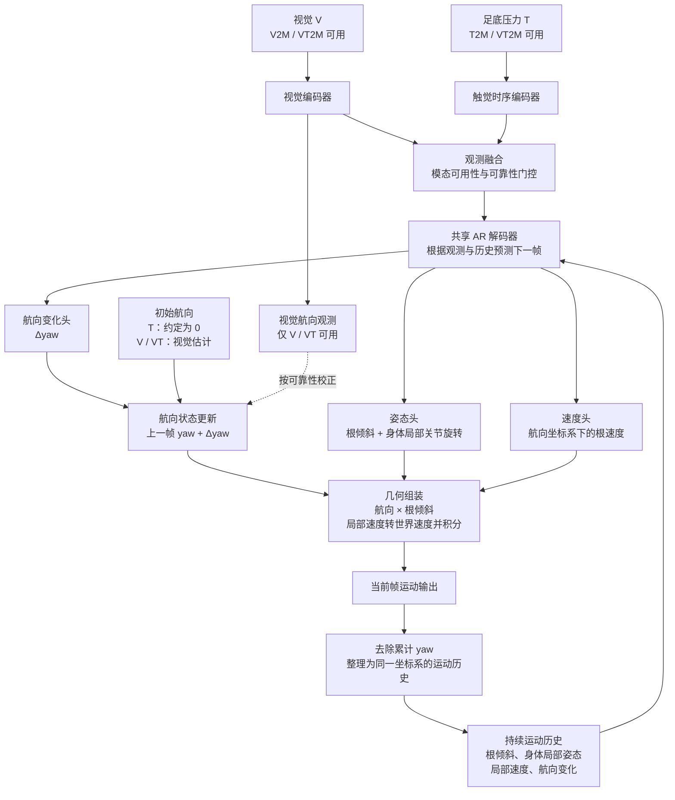

# V7 AR：相对运动预测与航向状态分离方案

日期：2026-11-01。状态：设计草案，未实现、未实验验证。

本文记录本轮讨论的模型结构，不替换既有续写方案，不改变已运行实验的定义。核心目标是减少 T2M 无依据的航向和倾斜跳变，同时保留真实转向与动作幅度。

## 1. 设计主张

- V2M、T2M、VT2M 共用一个 AR 运动生成器、同一套相对运动表示；条件差异由模态可用性控制。
- 累计 yaw 保存在网络外部的状态更新模块中。生成器预测单步 yaw 变化，不要求 T2M 每窗重新估计世界系绝对 yaw。
- 根倾斜与 yaw 分开；非根关节沿用 SMPL 父关节局部旋转。根倾斜和身体姿态预测当前值，不进行无约束的逐帧增量累加。
- 历史输入包含相对运动状态，不包含 T2M 的累计绝对 yaw。视觉在可用时提供航向观测，用于初始化与校正。
- 训练覆盖同一序列的连续反馈，评估使用完整自由生成；AR 和相对表示不被视为自动消除暴露偏差或漂移的保证。

信息边界：压力缺少世界系 yaw 参照；压力与接触对倾斜、步态及转向变化可提供线索，但不能普遍唯一确定这些运动。历史和共享运动先验用于减少歧义，不构成额外传感器观测。

## 2. 模型结构



| 模块 | 设计 |
|---|---|
| 观测编码 | 以 Cv5 的 HRNet 视觉特征和 raw108 压力输入为基础，沿用现有编码器及门控作为起点 |
| 共享解码器 | 三条件均使用因果姿态反馈；同帧身体部位可交互，不读取未来姿态反馈 |
| 航向变化头 | 预测每帧 Δyaw，单位 rad/frame |
| 姿态头 | 预测去 yaw 的根倾斜，以及 23 个非根关节的父关节局部旋转 |
| 速度头 | 预测当前航向坐标系下的三维根速度，单位 m/s |
| 视觉航向观测 | 从视觉特征估计 yaw 及校正可靠性，仅 V 在场时生效 |
| 外部状态 | 携带累计 yaw 与根位置，进行确定性几何组合和积分 |
| 历史缓存 | 跨计算窗口保留固定长度的相对运动历史，长度由实验确定 |

原有观测编码可读取完整观测窗，因此本方案首先是离线重建方案。姿态反馈因果不等于整个系统实时因果；若后续要求实时部署，需要另行约束观测编码与观测可见范围。

## 3. 坐标与运动表示

### 3.1 坐标约定

- 几何计算使用原生 SMPL 坐标：+Y 向上，根局部 +Z 为前向；显示端的 z-up 变换仅发生在导出边界。
- 设根旋转为 `R_root(t)`，身体局部旋转为 `R_local(j,t)`，其中 `j=1..23`。
- `Y(ψ)` 表示绕世界竖直轴的 yaw 旋转。yaw 提取与组合必须使用配对的轴、符号和乘法顺序。
- 所有旋转组合、yaw 提取和 FK 均在反归一化后的物理旋转上执行；统计归一化只用于网络数值尺度。

### 3.2 监督目标

从 GT 根旋转提取航向 `ψ_gt(t)`，按连续有效片段展开角度：

```text
Δψ_gt(t)   = ψ_gt(t) - ψ_gt(t-1)
R_tilt(t)  = Y(ψ_gt(t))ᵀ R_root_gt(t)
v_head(t)  = Y(ψ_gt(t))ᵀ v_world_gt(t)
body(j,t)  = R_local_gt(j,t), j=1..23
```

航向变化使用 rad/frame，速度使用 m/s，两者的时间尺度不能混用。会话首帧没有前驱，其增量沿用明确的零增量约定；普通窗口首帧仍使用该会话的真实前驱。

非根关节已经相对父关节表达，不对全部 24 个局部旋转统一左乘根锚逆旋转。世界 yaw 的改变只应改变根航向及世界系轨迹，不应改变非根局部监督目标。

### 3.3 输出约束

根倾斜输出经合法旋转投影后，再显式去除其 yaw 分量，避免姿态头绕过 Δyaw 通道预测航向。倾斜分解需检查根前向在水平面的投影是否退化；发现退化样本时报告，不能静默填值或跳过验证。

共享生成器单帧概念输出为：

```text
[Δyaw 1维, 根倾斜6D, 身体局部旋转23×6D, 航向系速度3维]
```

共 148 维，用于描述表示容量，不在本文预设运行时字段或 checkpoint 接口。6D 旋转投影需检查有限值、正交性与行列式。

### 3.4 外部状态与几何组装

```text
ψ_pred(t)  = ψ(t-1) + Δψ_hat(t)
R_root(t)  = Y(ψ(t)) R_tilt_hat(t)
v_world(t) = Y(ψ(t)) v_head_hat(t)
p(t)       = p(t-1) + v_world(t) / FPS
```

其中 `ψ(t)` 是经过可用视觉校正后的航向，当前数据 FPS=40。根位置从片段初始原点积分，连续窗口之间不使用 GT 位置重新锚定。

反馈给生成器的历史包含 Δyaw、根倾斜、身体局部姿态及航向系速度。累计 yaw 和累计位置留在外部状态中；不能将世界系根 6D 或世界系速度直接混入 T2M 历史。

## 4. 三条件与初始化

| 条件 | 输入 | 初始 yaw | 连续航向更新 |
|---|---|---|---|
| T2M | 压力 + 相对运动历史 | 约定为 0 | 仅累计预测 Δyaw |
| V2M | 视觉 + 相对运动历史 | 视觉估计 | Δyaw 预测 + 视觉观测校正 |
| VT2M | 视觉、压力 + 相对运动历史 | 视觉估计 | Δyaw 预测 + 视觉观测校正 |

T2M 的零初始 yaw 是坐标参照约定，不代表恢复了真实初始航向。训练及评分中的相对航向目标按 GT 片段首帧定义；推理不读取该 GT 航向。所有条件的位置初始原点需明确登记，不从每窗 GT 位移取得。

设连续片段首帧为 `t0`，T2M 的累计航向和轨迹监督统一到片段初始航向坐标系：

```text
ψ_rel_gt(t) = ψ_gt(t) - ψ_gt(t0)
p_rel_gt(t) = Y(ψ_gt(t0))ᵀ [p_gt(t) - p_gt(t0)]
```

这里的 GT 初始变换只用于构造监督或声明过的相对评分，不作为模型输入，也不逐帧重新对齐。片段首帧直接使用初始 yaw 和零位置，从下一帧开始累计增量；V/VT 在同样的时间约定下使用视觉估计的初始 yaw。

视觉校正在角度空间进行：

```text
error(t) = wrap(ψ_visual(t) - ψ_pred(t))
ψ(t)     = ψ_pred(t) + g_visual(t) × error(t)
```

`g_visual` 的范围为 `[0,1]`，只使用运行时可获得的证据估计可靠性，不读取 GT 误差。V 缺失时强制为 0。校正只修改外部航向状态，不改变共享生成器的相对目标语义。门控不构成连续性保证，需单独检查视觉校正是否引入跳变。

会话开始或真实数据断链时，清空历史并初始化外部状态；普通计算窗口边界不复位。模态暂时缺失只关闭对应观测，不应自动清空连续运动状态。恢复视觉后的校正效果需单独验收。

## 5. 训练与损失

### 5.1 连续反馈

- 在同一会话、时间连续的训练片段内构造前序历史；训练和推理采用相同的历史长度与窗口边界规则。
- teacher forcing 使用当前序列对应时间的 GT 相对历史。只有片段真正起点使用无历史初始化。
- 自生成反馈使用同一序列的模型预测，可采用逐步 rollout 或同序列预测后再次前向的方式；不能将无会话及帧位置匹配的 minibatch 缓存作为 scheduled sampling。
- rollout 中反馈预测的相对姿态、速度和 Δyaw，并持续维护外部状态。是否截断梯度只影响优化，不改变反馈来源与时间位置。
- 在同一数据划分和基础配方下验证表示与反馈机制；rollout 长度、采样概率和损失权重由实验确定，不把讨论建议写成已裁定参数。

### 5.2 监督项

| 监督项 | 作用 |
|---|---|
| 单步 Δyaw 误差 | 学习真实转向变化，采用角度环绕安全的误差 |
| 多帧累计相对 yaw 误差 | 约束增量累计后的偏差，T2M 不监督不可观测的初始绝对 yaw |
| 根倾斜与身体局部姿态误差 | 学习当前姿态，并区分倾斜与身体动作 |
| 航向系速度及多尺度位移误差 | 同时约束局部运动和自由积分后的轨迹变化 |
| 姿态与运动的时间差分误差 | 对齐 GT 的变化，减少抖动而非直接要求所有变化为零 |
| 视觉 yaw 监督 | 仅用于 V 在场的视觉航向观测分支，使用环绕安全的角度误差 |

现有压力接触辅助监督可沿用；不将接触标签当作推理输入。损失分量在共享表示和几何组合后的物理量上分别定义，训练、统计拟合、val 和导出必须使用同一变换。

若使用预测历史，仍然存在暴露偏差。残差化不会消除预测误差，也不保证累计 yaw 不漂移；必须以自由生成表现判断有效性。

## 6. 推理与评估

1. 读取实际可用观测，按会话及有效时间顺序生成。
2. 从持续历史预测当前相对运动，更新 yaw，应用可用视觉校正，再组合姿态和积分位置。
3. 将本帧相对状态写入历史；跨计算窗口延续历史和外部状态，每个时间帧只发射一次。
4. 会话开始或真实断链才初始化，不以每窗 GT 姿态、GT 航向或 GT 位置重置。
5. 指标和可视化消费同一条组装结果及同一有效帧掩码，避免评分发射与显示淡化各用一套序列。

teacher-forced val 用于诊断单步拟合；模型选择与最终结论必须包含自由生成 val。最终 test 不用于选择损失权重或 checkpoint。

所有模型先核对会话、评分帧号和导出有效帧覆盖。发现长度、缺文件或覆盖不一致时报告并修复生成或评估代码，不补齐、不截断、不伪造预测。不能直接把不同覆盖下的数字解释为严格同口径增益。

现有每窗 GT 位置锚下的轨迹指标与本方案自由积分指标语义不同，必须明确区分，不能沿用旧数字直接排名。对齐只用于明确声明的评分步骤，不反馈给模型或积分状态。

## 7. 验收标准

| 验收项 | 要求 |
|---|---|
| 几何往返 | GT 分解与重组恢复根旋转、局部关节旋转和速度；阈值按数值精度预先固定 |
| yaw 不变性 | 对同一运动施加固定世界 yaw 后，Δyaw、根倾斜、非根局部姿态及航向系速度目标保持不变 |
| 反馈因果性 | 修改未来姿态反馈不能影响当前输出；观测可见范围另行登记 |
| 窗口连续性 | 连续分块执行与同一观测上下文下的连续执行一致，不在普通窗口边界清空状态 |
| 自由生成 | 只在片段起点初始化，后续全用预测历史，无 GT 姿态、航向或位置锚回填 |
| T2M 稳定性 | 同时检查全帧及窗界根旋转跳变、倾斜变化、yaw 漂移和 jitter |
| 动作保真 | 同时检查姿态误差、真实转向变化及动作幅度，排除冻结动作或缩小运动换取低 jitter |
| V2M / VT2M | 检查姿态、稳定性及视觉校正行为，不假定共享 AR 保持原 Cv5 数字 |
| 导出一致性 | 评分与显示使用相同预测帧及有效掩码；GT 仅用于评分与监督 |

现有 `RootOrientationDrift` 仅反映 yaw，不能代替 roll/pitch 验收。倾斜诊断可使用根坐标系下重力方向的相邻变化；根旋转测地角反映整体旋转变化，两者需分别解释。

比较以 Cv5、现有绝对姿态 AR 和本方案为基础，分别判断时间反馈与相对表示的收益。视觉校正的增益需通过同一结构关闭校正的对照判断；新增表示、训练反馈与视觉校正的贡献不能混写为单一 AR 收益。

## 8. 与现有实现的关系

- `anysole/models/common/model_v7.py`：现有编码器、门控和解码器可作为载体；运动读出需区分 Δyaw、根倾斜、身体局部姿态与航向系速度。
- `anysole/data/dataset.py`、`anysole/train.py`：统一相对目标、同序列历史、连续片段训练及自由生成 val，修正普通窗口首帧一律零反馈的语义。
- `anysole/utils/geometry.py`：复用配对的 yaw 提取与组合思路，检查倾斜去 yaw、速度坐标变换和几何往返；不重复对非根局部关节施加全局锚旋转。
- `anysole/utils/losses.py`：按本方案表示定义监督，不把损失项名称存在视作该分支已经生效。
- `anysole/utils/eval_protocol.py`、`anysole/eval.py`、`anysole/infer.py`：统一持续状态、自由积分、发射规则与导出。

以上为后续实现边界，不表示这些文件已修改。本轮仅新增本文，不登记模型名、配置字段、训练任务或结果。
